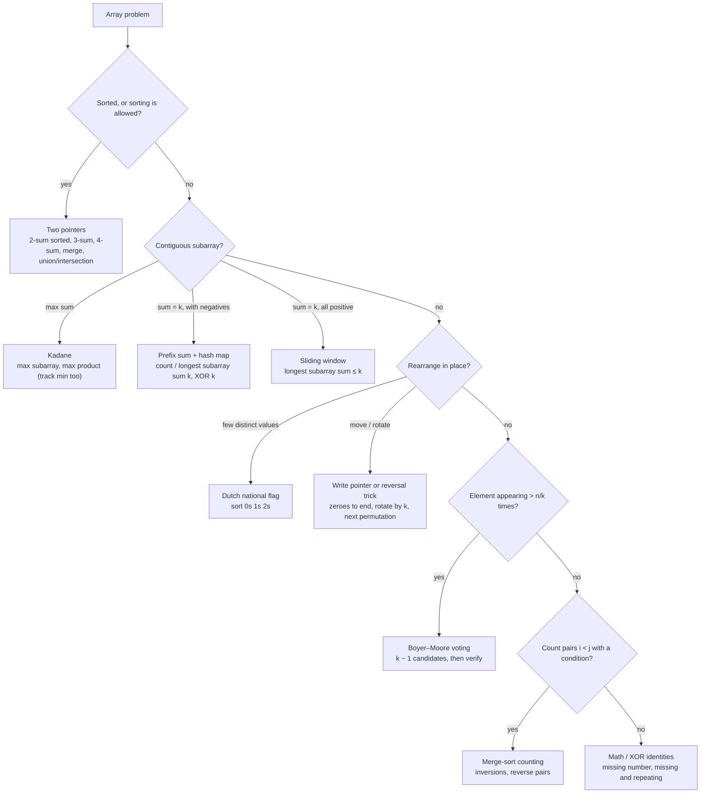

# Part 14: Arrays

← [Striver course map](../README.md)

> [!abstract] What this part covers
> **Goal:** Own the array toolkit every later part reuses: in-place pointer moves, prefix sums with a hash map, Kadane, Boyer–Moore voting, Dutch flag, matrix index tricks, and merge-sort counting.
> **Prereqs:** [Sorting](../13-sorting/README.md) (merge sort powers inversions and reverse pairs) · Basic hashing (a dict / `unordered_map` of counts) **Time:** ~14 h.
> **Outcome:** Given an array problem, name the pattern from its constraints within a minute, write the optimal solution in place, and state why the brute force is too slow.

---

## Theory

| # | Lesson | What you get | Source |
|---|---|---|---|
| 0 | [Array Techniques](00-array-techniques-theory.md) | Cost model, read/write pointers, reversal trick, two pointers, prefix/difference/2D prefix, Kadane, Dutch flag, Boyer–Moore, index-as-hash, matrix moves and a technique map. | [link](https://takeuforward.org/learning/dsa/largest-element-in-an-array?category=easy&source=strivers-a2z-dsa-sheet) |

Read these first; the problems below apply them.

---

## Problems

| # | Problem | Difficulty | Key insight | Optimal | Source |
|---|---|---|---|---|---|
| | **Fundamentals** | | | | |
| 1 | [Linear Search](01-linear-search.md) | Easy | Scan left to right and return at the first match. This is the only option for unsorted data with no preprocessing, and the baseline that binary search and hashing improve on. | O(n) | [link](https://takeuforward.org/learning/dsa/linear-search?category=fundamentals&source=strivers-a2z-dsa-sheet) |
| 2 | [Largest Element](02-largest-element.md) | Easy | Seed `best` with `nums[0]` (not 0 and not `INT_MIN` by habit) and update it in a single pass. Sorting also works, but it's O(n log n) for an O(n) question. | O(n) | [link](https://takeuforward.org/learning/dsa/largest-element?category=fundamentals&source=strivers-a2z-dsa-sheet) |
| 3 | [Second Largest Element](03-second-largest-element.md) | Easy | Keep `first` and `second` in one pass. A bigger value demotes `first` into `second`; a value strictly between them replaces `second`. Equal-to-`first` values must be skipped, or duplicates of the max get reported. | O(n) | [link](https://takeuforward.org/learning/dsa/second-largest-element?category=fundamentals&source=strivers-a2z-dsa-sheet) |
| 4 | [Maximum Consecutive Ones](04-maximum-consecutive-ones.md) | Easy | Keep a running streak: +1 on a 1, reset to 0 on a 0, and record the best after every step. | O(n) | [link](https://takeuforward.org/learning/dsa/maximum-consecutive-ones?category=fundamentals&source=strivers-a2z-dsa-sheet) |
| 5 | [Left Rotate Array by One](05-left-rotate-array-by-one.md) | Easy | Save `nums[0]`, shift `nums[1..n−1]` left by one, put the saved value at `n − 1`. One temporary, O(n). | O(n) | [link](https://takeuforward.org/learning/dsa/left-rotate-array-by-one?category=fundamentals&source=strivers-a2z-dsa-sheet) |
| 6 | [Left Rotate Array by K Places](06-left-rotate-array-by-k.md) | Easy | Reduce `k %= n`. Then reverse `[0, k)`, reverse `[k, n)`, reverse the whole array. Three reversals give O(n) time with O(1) extra space. | O(n) | [link](https://takeuforward.org/learning/dsa/left-rotate-array?category=fundamentals&source=strivers-a2z-dsa-sheet) |
| | **Logic building** | | | | |
| 7 | [Move Zeros to End](07-move-zeros-to-end.md) | Easy | Two pointers: `j` marks where the next non-zero belongs. For each non-zero at `i`, swap it into `j` and advance `j`. Order is preserved and the zeros collect at the back. | O(n) | [link](https://takeuforward.org/learning/dsa/move-zeros-to-end?category=logic-building&source=strivers-a2z-dsa-sheet) |
| 8 | [Remove Duplicates from Sorted Array](08-remove-duplicates-from-sorted-array.md) | Easy | Sorted means duplicates are adjacent. Keep a write index `i` at the last unique value; when `nums[j] != nums[i]`, write it to `++i`. Answer `i + 1`. | O(n) | [link](https://takeuforward.org/learning/dsa/remove-duplicates-from-sorted-array?category=logic-building&source=strivers-a2z-dsa-sheet) |
| 9 | [Find Missing Number](09-find-missing-number.md) | Easy | The expected total is `n(n + 1)/2`, so the missing number is that minus `sum(nums)`. The XOR version, `XOR(0..n) ^ XOR(nums)`, cancels every present value and can't overflow. | O(n) | [link](https://takeuforward.org/learning/dsa/find-missing-number?category=logic-building&source=strivers-a2z-dsa-sheet) |
| 10 | [Union of Two Sorted Arrays](10-union-of-two-sorted-arrays.md) | Easy | Merge with two pointers like merge sort, but append a value only if it differs from the last value appended. That handles duplicates inside and across both arrays in O(n + m). | O(n + m) | [link](https://takeuforward.org/learning/dsa/union-of-two-sorted-arrays?category=logic-building&source=strivers-a2z-dsa-sheet) |
| 11 | [Intersection of Two Sorted Arrays](11-intersection-of-two-sorted-arrays.md) | Easy | Two pointers: advance the smaller side; on equality, record the value and advance both. Each match consumes one copy from each array, which is exactly the min-count rule. | O(n + m) | [link](https://takeuforward.org/learning/dsa/intersection-of-two-sorted-arrays?category=logic-building&source=strivers-a2z-dsa-sheet) |
| | **FAQs — Medium** | | | | |
| 12 | [Majority Element I](12-majority-element.md) | Easy | Boyer–Moore voting: pair each majority vote with a different vote and cancel both. The majority has more than half, so it survives. Keep `(cand, cnt)`: if `cnt == 0` adopt the current element; same → +1, different → −1. | O(n) | [link](https://takeuforward.org/learning/dsa/majority-element-i?category=faqs-medium&source=strivers-a2z-dsa-sheet) |
| 13 | [Leaders in an Array](13-leaders-in-an-array.md) | Easy | Scan from the right keeping `maxRight`. An element is a leader iff it beats `maxRight`. Collect, then reverse to restore left-to-right order. O(n) instead of O(n²). | O(n) | [link](https://takeuforward.org/learning/dsa/leaders-in-an-array?category=faqs-medium&source=strivers-a2z-dsa-sheet) |
| 14 | [Rearrange Array Elements by Sign](14-rearrange-by-sign.md) | Medium | Positives go to even indices and negatives to odd indices. Two write pointers, `pos = 0` and `neg = 1`, each advance by 2. One pass, O(n). | O(n) | [link](https://takeuforward.org/learning/dsa/rearrange-array-elements-by-sign?category=faqs-medium&source=strivers-a2z-dsa-sheet) |
| 15 | [Print the Matrix in Spiral Manner](15-spiral-matrix.md) | Medium | Keep four boundaries: `top`, `bottom`, `left`, `right`. Walk right along `top`, down along `right`, left along `bottom`, up along `left`, shrinking each boundary after its side. Guard the last two walks with `top <= bottom` / `left <= right` for single rows and columns. | O(m · n) | [link](https://takeuforward.org/learning/dsa/print-the-matrix-in-spiral-manner?category=faqs-medium&source=strivers-a2z-dsa-sheet) |
| 16 | [Pascal's Triangle I](16-pascals-triangle-i.md) | Easy | That element is C(r − 1, c − 1). Compute it in O(c) with the running product `res = res · (n − i) / (i + 1)`, which stays an integer at every step, instead of building the whole triangle or using factorials that overflow. | O(min(k, n − k)) | [link](https://takeuforward.org/learning/dsa/pascals-triangle-i?category=faqs-medium&source=strivers-a2z-dsa-sheet) |
| 17 | [Pascal's Triangle II](17-pascals-triangle-ii.md) | Easy | Row `r` is C(r − 1, 0), C(r − 1, 1), …, C(r − 1, r − 1). Each value follows from the previous one: `next = prev · (n − k) / (k + 1)`. That gives O(r) for the row, versus O(r²) to build every row above it. | O(r) | [link](https://takeuforward.org/learning/dsa/pascals-triangle-ii?category=faqs-medium&source=strivers-a2z-dsa-sheet) |
| 18 | [Pascal's Triangle III](18-pascals-triangle-iii.md) | Easy | Each row's inner values are sums of adjacent pairs from the previous row: `row[j] = prev[j − 1] + prev[j]`, with 1s at both ends. Generating each row independently with the incremental product works too. | O(n²) | [link](https://takeuforward.org/learning/dsa/pascals-triangle-iii?category=faqs-medium&source=strivers-a2z-dsa-sheet) |
| 19 | [Rotate Matrix by 90 Degrees](19-rotate-matrix.md) | Medium | A clockwise rotation is a transpose (swap across the main diagonal) followed by reversing each row. Both steps are in place, and only the upper triangle is swapped during the transpose. | O(n²) | [link](https://takeuforward.org/learning/dsa/rotate-matrix-by-90-degrees?category=faqs-medium&source=strivers-a2z-dsa-sheet) |
| 20 | [Set Matrix Zeroes](20-set-matrix-zeroes.md) | Medium | Use the first row and first column as the marker arrays. Column 0's own marker needs a separate flag (`col0`), because `mat[0][0]` can only hold one of row 0 and column 0. Fill the inner cells first, then row 0, then column 0. | O(m · n) | [link](https://takeuforward.org/learning/dsa/set-matrix-zeroes?category=faqs-medium&source=strivers-a2z-dsa-sheet) |
| 21 | [Two Sum](21-two-sum.md) | Easy | For each `x`, the partner it needs is `target − x`. A hash map from value to index answers "have I seen the partner?" in O(1). Check before inserting, so an element isn't paired with itself. | O(n) | [link](https://takeuforward.org/learning/dsa/two-sum?category=faqs-medium&source=strivers-a2z-dsa-sheet) |
| 22 | [3 Sum](22-3-sum.md) | Medium | Sort. Fix `nums[i]`, then two-pointer `l, r` over the rest for sum `−nums[i]`. Skip equal values for `i`, and after each hit, skip equal values for `l` and `r`. That avoids duplicates without a set, in O(n²). | O(n²) | [link](https://takeuforward.org/learning/dsa/3-sum?category=faqs-medium&source=strivers-a2z-dsa-sheet) |
| 23 | [4 Sum](23-4-sum.md) | Medium | Exactly 3Sum with one more fixed loop: sort, fix `i` and `j` (skipping duplicates of each), then two-pointer for the remainder. O(n³). The sum can overflow 32 bits, so add in 64-bit. | O(n³) | [link](https://takeuforward.org/learning/dsa/4-sum?category=faqs-medium&source=strivers-a2z-dsa-sheet) |
| 24 | [Sort an Array of 0s, 1s and 2s](24-sort-colors.md) | Medium | Dutch National Flag: three pointers `low`, `mid`, `high`. `[0, low)` holds 0s, `[low, mid)` 1s, `(high, n)` 2s, and `[mid, high]` is unknown. A 0 at `mid` swaps to `low` (both advance), a 1 just advances `mid`, a 2 swaps to `high` (only `high` moves, because the swapped-in value is unexamined). | O(n), one pass | [link](https://takeuforward.org/learning/dsa/sort-an-array-of-0's-1's-and-2's?category=faqs-medium&source=strivers-a2z-dsa-sheet) |
| 25 | [Kadane's Algorithm: Maximum Subarray Sum](25-kadanes-algorithm.md) | Medium | At each index, either extend the best subarray ending at `i − 1` or start fresh: `cur = max(x, cur + x)`. Equivalently, drop a negative running sum. The answer is the max `cur` seen. | O(n) | [link](https://takeuforward.org/learning/dsa/kadane's-algorithm?category=faqs-medium&source=strivers-a2z-dsa-sheet) |
| 26 | [Next Permutation](26-next-permutation.md) | Medium | From the right, find the first `i` with `nums[i] < nums[i + 1]` (the pivot). Swap it with the smallest value to its right that's greater than it (scan from the right). Then reverse the suffix after `i`, which was descending. No pivot means it's the last permutation, so reverse the whole array. | O(n) | [link](https://takeuforward.org/learning/dsa/next-permutation?category=faqs-medium&source=strivers-a2z-dsa-sheet) |
| | **FAQs — Hard** | | | | |
| 27 | [Majority Element II](27-majority-element-ii.md) | Medium | At most two elements can exceed n/3. Extended Boyer–Moore keeps two candidates and two counters: a third, different value decrements both. A second pass verifies the candidates, since none is guaranteed. | O(n) | [link](https://takeuforward.org/learning/dsa/majority-element-ii?category=faqs-hard&source=strivers-a2z-dsa-sheet) |
| 28 | [Find the Repeating and Missing Number](28-repeating-and-missing.md) | Hard | Two equations in `x` (repeating) and `y` (missing): `S − Sₙ = x − y` and `S₂ − S₂ₙ = x² − y²`. Dividing gives `x + y`, and two linear equations solve it in O(n)/O(1). The XOR split is the overflow-free alternative. | O(n) | [link](https://takeuforward.org/learning/dsa/find-the-repeating-and-missing-number?category=faqs-hard&source=strivers-a2z-dsa-sheet) |
| 29 | [Count Inversions](29-count-inversions.md) | Hard | Piggyback on merge sort. When merging, if `right[j] < left[i]`, then `right[j]` is smaller than *every* remaining element of the left half (it's sorted), so add `mid − i + 1` in one step. Total O(n log n). | O(n log n) | [link](https://takeuforward.org/learning/dsa/count-inversions?category=faqs-hard&source=strivers-a2z-dsa-sheet) |
| 30 | [Reverse Pairs](30-reverse-pairs.md) | Hard | Merge-sort counting again, but the condition isn't the merge's comparison. So before each merge, count with a separate two-pointer pass over the two sorted halves (`j` only moves forward), then merge normally. Use 64-bit for `2 · nums[j]`. | O(n log n) | [link](https://takeuforward.org/learning/dsa/reverse-pairs?category=faqs-hard&source=strivers-a2z-dsa-sheet) |
| 31 | [Maximum Product Subarray](31-maximum-product-subarray.md) | Medium | A negative number turns the smallest product into the largest. So track both `maxEnd` and `minEnd` (the max/min product ending here) and update `max(x, x·maxEnd, x·minEnd)`. Equivalently: the answer is the best prefix or suffix product, restarting after zeros. | O(n) | [link](https://takeuforward.org/learning/dsa/maximum-product-subarray-in-an-array?category=faqs-hard&source=strivers-a2z-dsa-sheet) |
| 32 | [Merge Two Sorted Arrays Without Extra Space](32-merge-sorted-arrays.md) | Medium | Fill `nums1` from the back. The largest remaining element of either array goes to position `k = m + n − 1`, then `k−−`. Writing from the back never overwrites an unread element of `nums1`. Leftover `nums1` elements are already in place. | O(m + n) | [link](https://takeuforward.org/learning/dsa/merge-two-sorted-arrays-without-extra-space?category=faqs-hard&source=strivers-a2z-dsa-sheet) |
| | **Extra (A2Z sheet)** | | | | |
| 33 | [Check if array is sorted and rotated](33-check-if-array-is-sorted-and-rotated.md) | Easy | Walk the array circularly and count the **drops**, places where `a[i] > a[(i+1) % n]`. A sorted array has 0 drops in a straight walk. A sorted array that was rotated has exactly one drop around the circle, at the rotation point, and the wrap from last to first has to be a non-drop. So the answer is `drops ≤ 1`. The plain "is it sorted" check is the same loop without the wrap, requiring `drops == 0`. | O(n) | [link](https://takeuforward.org/learning/dsa/check-if-the-array-is-sorted?category=easy&source=strivers-a2z-dsa-sheet) |

---

## Which array pattern, when

---

## Part 14 cheat sheet

| Pattern | Trigger | Time | Space | Problems here |
|---|---|---|---|---|
| Write pointer | "in place", "remove", "move to end" | O(n) | O(1) | remove duplicates, move zeroes |
| Reversal trick | rotate by k, reorder suffix | O(n) | O(1) | rotate array, next permutation |
| Two pointers on sorted | pairs/triplets with target sum | O(n²) for 3-sum | O(1) extra | 2-sum, 3-sum, 4-sum, merge sorted |
| Prefix sum + hash map | subarray sum/XOR = k, negatives allowed | O(n) | O(n) | longest subarray sum k, count subarrays |
| Kadane | max contiguous sum | O(n) | O(1) | max subarray, max product (with min) |
| Dutch national flag | 3 distinct values | O(n) one pass | O(1) | sort colors |
| Boyer–Moore voting | > n/2 or > n/3 frequency | O(n) | O(1) | majority I, majority II |
| Merge-sort counting | count pairs i < j with a[i] vs a[j] | O(n log n) | O(n) | inversions, reverse pairs |
| Matrix index math | rotate, spiral, set zeroes | O(mn) | O(1) | rotate matrix, spiral, set zeroes |
| Math / XOR | one missing or repeating value in 1..n | O(n) | O(1) | missing number, repeating and missing |

**Facts interviewers test:** prefix sum + map must store `{0: -1}` (or count 1) before the loop, and for "longest" store only the *first* index of each prefix. Sliding window only works for "sum ≤ k" when all values are non-negative. Kadane resets when the running sum drops below zero; for an all-negative array it returns the largest element, not 0. Rotate by `k` uses `k %= n` first. Boyer–Moore always needs a verification pass unless a majority is guaranteed. 3-sum dedupes by skipping equal neighbours after sorting, never with a set of tuples in the optimal answer. Inversions and reverse pairs overflow `int` (up to n²/2), and `2 * a[j]` overflows too — use `long long` / `long`.

---

## Mastery checklist

- [ ] Write the write-pointer loop for remove-duplicates and move-zeroes from memory
- [ ] Rotate an array by k with three reversals, and say why `k %= n` comes first
- [ ] Explain why prefix sum + map handles negatives and sliding window doesn't
- [ ] Write Kadane with start/end indices, and the all-negative edge case
- [ ] Run Dutch national flag on `[2, 0, 2, 1, 1, 0]` and state the loop invariant
- [ ] Write Boyer–Moore for > n/3 with the verification pass
- [ ] Write 3-sum with sorting and neighbour skipping; extend it to 4-sum
- [ ] Rotate an n×n matrix in place (transpose + reverse rows) and print a spiral
- [ ] Count inversions and reverse pairs with a merge-sort pass, using 64-bit counts
- [ ] Write next permutation: find the pivot, swap with the rightmost larger, reverse the suffix

**Interview track →** [Array deep-dive](../../01-data-structures/01-array.md) · [Array walkthroughs](../../04-practice/data-structures/01-array.md) · [Matrix deep-dive](../../01-data-structures/04-matrix.md) · [Matrix walkthroughs](../../04-practice/data-structures/04-matrix.md) · [Two pointers](../../02-algorithms/03-two-pointers.md)

Next part → [Hashing](../15-hashing/README.md)
