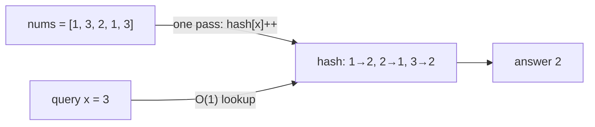
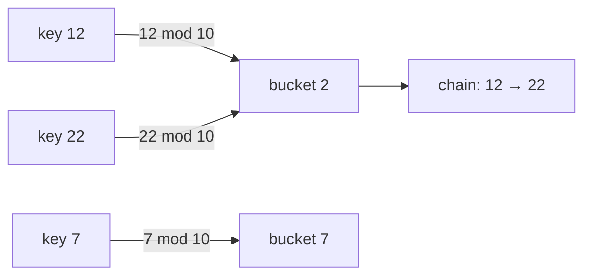
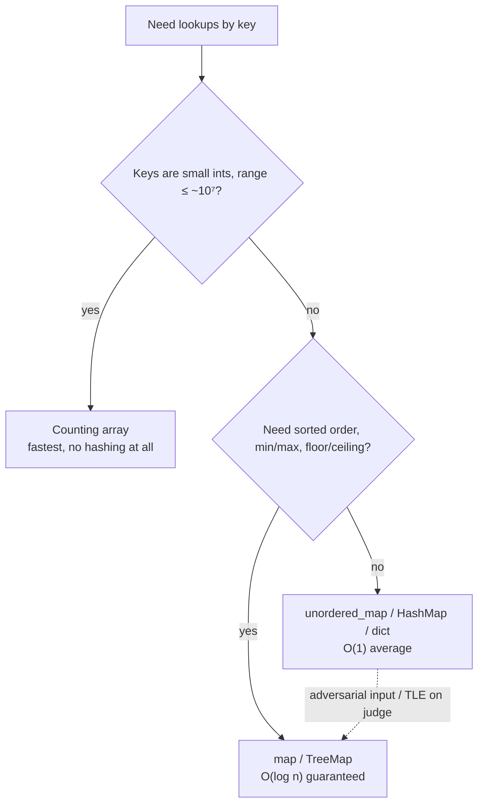

# 1. Basic Hashing

← [Part 15 index](README.md) · Next → [Longest Consecutive Sequence in an Array](02-longest-consecutive-sequence.md)

> [!abstract] What this covers
> **Core idea:** Hashing turns "search the whole array for x" (O(n)) into "jump to x's slot" (O(1) on average). You precompute once and then answer each query in constant time. When the keys are small integers, a plain array is the hash table. Otherwise a hash function maps each key to a bucket, and collisions are handled by chaining or probing.
> **You'll be able to:** pick between a counting array, `unordered_map` and `map` from the constraints; explain the division-method hash, collisions, chaining, open addressing and rehashing; know the real worst cases of each language's map; and write frequency counting in C++, Java and Python.
> **Source:** [takeuforward lesson](https://takeuforward.org/learning/dsa/basic-hashing?category=theory&source=strivers-a2z-dsa-sheet) · **Time:** 45 min

**Sections:** [1. Why hash](#1-why-hash) · [2. Array hashing](#2-array-hashing) · [3. Character hashing](#3-character-hashing) · [4. Hash functions and collisions](#4-hash-functions-and-collisions) · [5. Language maps](#5-language-maps) · [6. Choosing a structure](#6-choosing-a-structure) · [7. Hashing patterns](#7-hashing-patterns) · [Common mistakes](#common-mistakes) · [Practice](#practice) · [Key terms](#key-terms) · [Flashcards](#flashcards)

---

## 1. Why hash

"How many times does `x` appear?" asked `q` times:

| Approach | Precompute | Per query | Total |
|---|---|---|---|
| Scan the array each time | — | O(n) | O(n·q) |
| Sort + binary search (lower/upper bound) | O(n log n) | O(log n) | O((n + q) log n) |
| Hash (count once) | O(n) | O(1) avg | O(n + q) |

With `n = q = 10⁵`, scanning is 10¹⁰ operations (TLE), and hashing is 2·10⁵.



---

## 2. Array hashing

If every value lies in `[0, M]` with `M` up to about 10⁷, an array of size `M + 1` **is** a perfect hash table. Index = value, slot = count.

```python
def count_queries(nums, queries, M):
    h = [0] * (M + 1)
    for x in nums:
        h[x] += 1
    return [h[q] if 0 <= q <= M else 0 for q in queries]
```

```cpp
vector<int> countQueries(const vector<int>& nums, const vector<int>& queries, int M) {
    vector<int> h(M + 1, 0);
    for (int x : nums) h[x]++;
    vector<int> out;
    for (int q : queries) out.push_back(q >= 0 && q <= M ? h[q] : 0);
    return out;
}
```

```java
static int[] countQueries(int[] nums, int[] queries, int M) {
    int[] h = new int[M + 1];
    for (int x : nums) h[x]++;
    int[] out = new int[queries.length];
    for (int i = 0; i < queries.length; i++)
        out[i] = queries[i] >= 0 && queries[i] <= M ? h[queries[i]] : 0;
    return out;
}
```

| Limit | Why |
|---|---|
| Local `int` array in C++ ≈ 10⁶ | Stack size (~1–8 MB). Declare it **global** or use `vector` (heap) for 10⁷. |
| Global / heap `int` array ≈ 10⁷ | 10⁷ × 4 B = 40 MB, near typical 256 MB limits once there's more than one; 10⁸ doesn't fit. |
| `bool` / `bitset` ≈ 10⁸ | 1 byte or 1 bit each. |
| Values up to 10⁹, negatives, strings | Not array-hashable → use a map, or **coordinate-compress** (sort + rank). |

Negative values with a small range: offset them, `h[x + OFFSET]`.

---

## 3. Character hashing

There are 26 lowercase letters, so use `int h[26]` indexed by `c − 'a'`. For any ASCII character use `int h[256]` indexed by the char code.

```python
def char_freq(s):
    h = [0] * 26
    for c in s:
        h[ord(c) - ord('a')] += 1
    return h
```

```cpp
int h[26] = {0};
for (char c : s) h[c - 'a']++;
```

```java
int[] h = new int[26];
for (char c : s.toCharArray()) h[c - 'a']++;
```

Two strings are anagrams iff their 26-count arrays are equal. The comparison is O(26) — constant.

---

## 4. Hash functions and collisions

When keys are large or not integers, a **hash function** maps each key to one of `m` buckets. The simplest is the **division method**: `h(k) = k mod m`, ideally with `m` prime.



A **collision** happens when two keys land in the same bucket, and collisions are unavoidable (pigeonhole). There are two ways to resolve them:

| Strategy | How | Pros | Cons | Used by |
|---|---|---|---|---|
| **Separate chaining** | each bucket holds a list (or tree) of entries | simple, degrades gracefully | pointer chasing, cache misses | C++ `unordered_map`, Java `HashMap` |
| **Open addressing** | on collision, probe the next slot (linear `i + 1`, quadratic `i + j²`, double hashing) | cache-friendly, no extra nodes | clustering; deletion needs tombstones | Python `dict`/`set`, `absl::flat_hash_map` |

**Load factor** `α = entries / buckets`. The expected chain length (or probe count) is O(1 + α). When `α` passes a threshold the table **rehashes**: it allocates about 2× the buckets and reinserts everything. A single insert can then cost O(n), but each insert is still O(1) **amortised**.

| Implementation | Max load factor before growth |
|---|---|
| C++ `unordered_map` | 1.0 (`max_load_factor()`) |
| Java `HashMap` | 0.75 |
| Python `dict` | ~2/3 |

**Worst case.** If all keys collide, every operation is O(n). Java 8+ converts a long bucket (≥ 8 entries) to a red-black tree, so its worst case becomes O(log n). C++'s `unordered_map` can be attacked with crafted inputs; on Codeforces-style judges the fix is a randomised custom hash, e.g. splitmix64 with a time-based seed.

---

## 5. Language maps

| | Ordered (balanced BST) | Unordered (hash table) |
|---|---|---|
| C++ | `map`, `set`, `multiset` — O(log n), sorted iteration, `lower_bound` | `unordered_map`, `unordered_set` — O(1) avg, O(n) worst |
| Java | `TreeMap`, `TreeSet` — O(log n), `floorKey`/`ceilingKey` | `HashMap`, `HashSet` — O(1) avg, O(log n) worst (treeified buckets) |
| Python | none built in (`sortedcontainers.SortedList` is third-party) | `dict`, `set`, `collections.Counter`, `defaultdict` — O(1) avg |

```python
from collections import Counter
freq = Counter(nums)                 # {value: count}
freq[x]                              # 0 if absent — no KeyError
freq.most_common(1)                  # [(value, count)]
```

```cpp
unordered_map<int, int> freq;
for (int x : nums) freq[x]++;        // operator[] inserts 0 first if absent
if (freq.count(x)) { /* present */ } // lookup without inserting
```

```java
HashMap<Integer, Integer> freq = new HashMap<>();
for (int x : nums) freq.merge(x, 1, Integer::sum);
int c = freq.getOrDefault(x, 0);
```

**Key types.** C++ `unordered_map` has no built-in hash for `pair` or `vector`. Use `map<pair<int,int>, …>`, encode the pair as `1LL * a * BIG + b`, or write a hash struct. Java keys need consistent `equals` and `hashCode`; `List<Integer>` works, but `int[]` hashes by identity, so it's wrong as a key. Python keys must be hashable, so use `tuple(lst)` instead of `lst`.

---

## 6. Choosing a structure



---

## 7. Hashing patterns

| Pattern | Map holds | Example |
|---|---|---|
| Frequency count | value → count | [Highest occurring element](../10-basic-hashing/01-highest-occurring-element-in-an-array.md), anagrams |
| Seen-before / complement | value → index | [Two Sum](../14-arrays/21-two-sum.md) |
| Membership + run starts | set of values | [Longest consecutive sequence](02-longest-consecutive-sequence.md) |
| Prefix + first index | prefix → earliest index | [Longest subarray sum k](03-longest-subarray-with-sum-k.md), [sum 0](04-largest-subarray-with-sum-0.md) |
| Prefix + count | prefix → count | [Count subarrays sum k](05-count-subarrays-with-given-sum.md), [XOR k](06-count-subarrays-with-xor-k.md) |
| Group by signature | canonical key → list | group anagrams (key = sorted string or 26-count tuple) |
| Window counts | char → count in window | [Sliding window](../22-sliding-window-and-2-pointer/README.md) problems |

---

## Common mistakes

1. Declaring `int h[10000001]` as a local in C++, which overflows the stack. Make it global or use a `vector`.
2. Using C++ `freq[x]` to test membership. It inserts `x` with value 0, which changes `size()` and the iteration.
3. Iterating an `unordered_map` and expecting sorted order.
4. Using `int[]` as a Java `HashMap` key, or a list as a Python dict key.
5. Assuming O(1) is guaranteed. It is the average; the worst case is O(n) (C++, Python) or O(log n) (Java 8+).
6. Comparing Java `Integer` values from a map with `==`. Only cached values in −128..127 compare equal by reference, so use `.equals` or unbox first.

---

## Practice

1. `n = 10⁵` values in `[1, 10⁹]` and `q = 10⁵` frequency queries. Which structure do you use, and what is the total time?
2. Why is `k mod 10` a poor hash for keys that are all multiples of 10?
3. A table has 16 buckets and 13 entries. What's the load factor, and does Java `HashMap` resize?
4. Write a function that checks whether two strings are anagrams in O(n) time and O(1) extra space.
5. Count frequencies of values in `[−1000, 1000]` without a map.

<details><summary>Answer sketches</summary>

**#1:** `unordered_map`/`HashMap`/`Counter`. Values are too large for an array. O(n + q) average. Alternatively sort and binary search for O((n + q) log n).

**#2:** every key lands in bucket 0, so all operations become O(n). Use a prime `m`, or a hash that mixes the bits.

**#3:** α = 13/16 ≈ 0.81 > 0.75, so yes. Java resizes when the size exceeds 16 × 0.75 = 12, which happens on the 13th insert.

**#4:** `int h[26]`. Increment for `s`, decrement for `t`, then check that all entries are zero. Lengths must match.

**#5:** `h = [0] * 2001` and `h[x + 1000] += 1`.
</details>

---

## Key terms

| Term | Meaning |
|---|---|
| Hash function | Maps a key to a bucket index |
| Bucket | One slot of the table |
| Collision | Two keys mapping to the same bucket |
| Separate chaining | Each bucket stores a list of entries |
| Open addressing | Collisions probe for another empty slot in the same array |
| Load factor | entries / buckets; triggers a rehash past a threshold |
| Rehashing | Growing the table and reinserting every key |
| Amortised O(1) | Occasional O(n) rehash averaged over many O(1) inserts |
| Coordinate compression | Replace large values by their rank so an array can index them |

---

## Flashcards

**When can a plain array replace a hash map?** #flashcard
Keys are small non-negative ints (range up to ~10⁷), or offset negatives.

**Separate chaining vs open addressing?** #flashcard
Chaining: a list per bucket. Open addressing: probe other slots in the same array.

**Load factor thresholds: C++, Java, Python?** #flashcard
1.0, 0.75, ~2/3.

**Worst case of `unordered_map` vs Java `HashMap`?** #flashcard
O(n) vs O(log n) (Java treeifies long buckets).

**Why does C++ `freq[x]` break membership tests?** #flashcard
`operator[]` inserts a default 0. Use `count` or `find`.

**`map` vs `unordered_map`?** #flashcard
`map` is a red-black tree: O(log n), sorted, supports `lower_bound`. `unordered_map` is a hash table: O(1) average, unordered.

**Interview track →** [Hashing deep-dive](../../01-data-structures/02-hashing.md) · [Hashing walkthroughs](../../04-practice/data-structures/02-hashing.md)
