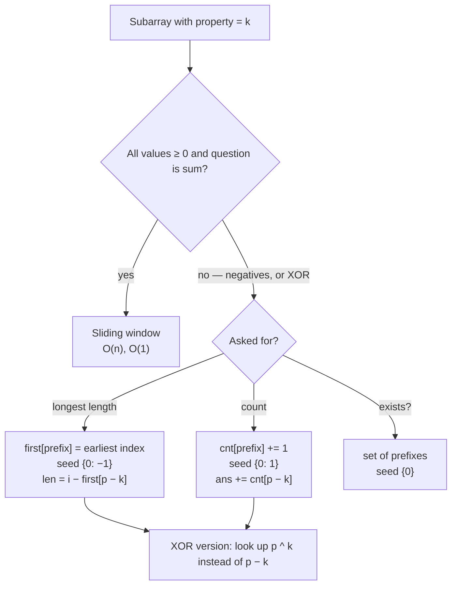

# Part 15: Hashing

← [Striver course map](../README.md)

> [!abstract] What this part covers
> **Goal:** Turn hash maps from a counting tool into a subarray tool: prefix sum (or prefix XOR) + a map of earlier prefixes answers "longest" and "count" subarray questions in O(n), with negatives allowed.
> **Prereqs:** [Basic Hashing](../10-basic-hashing/README.md) · [Arrays](../14-arrays/README.md) (Two Sum is the seed of every problem here) **Time:** ~5 h.
> **Outcome:** Recognise "subarray with sum/XOR = k" instantly, write the prefix + map loop with the right seed (`{0: -1}` for length, `{0: 1}` for count), and explain when a sliding window would be enough.

---

## Theory

| # | Lesson | What you get | Source |
|---|---|---|---|
| 1 | [Basic Hashing](01-basic-hashing.md) | Hash functions, collisions, load factor, array vs map hashing, language APIs and their worst cases | [link](https://takeuforward.org/learning/dsa/basic-hashing?category=theory&source=strivers-a2z-dsa-sheet) |

Read these first; the problems below apply them.

---

## Problems

| # | Problem | Difficulty | Key insight | Optimal | Source |
|---|---|---|---|---|---|
| | **FAQs** | | | | |
| 2 | [Longest Consecutive Sequence in an Array](02-longest-consecutive-sequence.md) | Medium | Put everything in a set. Only start counting at a value `x` with `x − 1` missing (a run's start); walk up while `x + 1` exists. Each value is visited by at most one walk, so the total is O(n). | O(n) average | [link](https://takeuforward.org/learning/dsa/longest-consecutive-sequence-in-an-array?category=faqs&source=strivers-a2z-dsa-sheet) |
| 3 | [Longest Subarray with Sum K](03-longest-subarray-with-sum-k.md) | Medium | `sum(l..i) = P[i] − P[l − 1]`. At index `i`, the longest subarray ending here starts right after the **earliest** index whose prefix was `P[i] − k`. Store each prefix's first index only, seeded with `{0: −1}`. | O(n) average | [link](https://takeuforward.org/learning/dsa/longest-subarray-with-sum-k?category=faqs&source=strivers-a2z-dsa-sheet) |
| 4 | [Largest Subarray with Sum 0](04-largest-subarray-with-sum-0.md) | Medium | Sum of `(j, i]` is 0 iff `P[i] == P[j]`. So the answer is the largest distance between two equal prefix sums — store the first index of each prefix, seeded `{0: −1}`. | O(n) average | [link](https://takeuforward.org/learning/dsa/largest-subarray-with-sum-0?category=faqs&source=strivers-a2z-dsa-sheet) |
| 5 | [Count Subarrays with Given Sum](05-count-subarrays-with-given-sum.md) | Medium | Every earlier prefix equal to `P[i] − k` starts one valid subarray ending at `i`. Keep a **count** of each prefix value seen, seeded `{0: 1}`, and add `cnt[p − k]` before recording `p`. | O(n) average | [link](https://takeuforward.org/learning/dsa/count-subarrays-with-given-sum?category=faqs&source=strivers-a2z-dsa-sheet) |
| 6 | [Count Subarrays with Given XOR K](06-count-subarrays-with-xor-k.md) | Medium | `xor(l..r) = X[r] ^ X[l − 1]`, and `a ^ b = k ⇔ b = a ^ k`. So it's the count-subarrays-sum-k loop with `p − k` replaced by `x ^ k`, seeded `{0: 1}`. | O(n) average | [link](https://takeuforward.org/learning/dsa/count-subarrays-with-given-xor-k?category=faqs&source=strivers-a2z-dsa-sheet) |

---

## Prefix + map: which variant

---

## Part 15 cheat sheet

| Problem | Prefix | Map stores | Seed | Per step | Time / Space |
|---|---|---|---|---|---|
| Longest subarray sum k | running sum `p` | first index of each `p` | `{0: −1}` | `i − first[p − k]`; insert `p` only if new | O(n) / O(n) |
| Largest subarray sum 0 | running sum | first index | `{0: −1}` | `i − first[p]` | O(n) / O(n) |
| Count subarrays sum k | running sum | count of each `p` | `{0: 1}` | `ans += cnt[p − k]`, then `cnt[p]++` | O(n) / O(n) |
| Count subarrays XOR k | running XOR `x` | count of each `x` | `{0: 1}` | `ans += cnt[x ^ k]`, then `cnt[x]++` | O(n) / O(n) |
| Longest consecutive sequence | — | set of values | — | start only where `x − 1 ∉ set` | O(n) / O(n) |

**Facts interviewers test:** `sum(l..r) = P[r] − P[l − 1]`, so "subarray sum = k ending at r" means "some earlier prefix equals `P[r] − k`". XOR works the same because `a ^ b = k ⇔ a = b ^ k`. Seed the map *before* the loop or you miss subarrays starting at index 0. For "longest", never overwrite an existing prefix (you want the earliest). For "count", look up *before* incrementing the current prefix, or `k = 0` counts the empty subarray. The sliding window fails with negatives because extending the window no longer monotonically increases the sum. `unordered_map` / `HashMap` are O(1) average but O(n) worst case under adversarial collisions — mention it, and that sorting or a balanced tree (`map`, `TreeMap`) gives a guaranteed O(log n).

---

## Mastery checklist

- [ ] Explain separate chaining vs open addressing, and what load factor triggers a rehash
- [ ] Write the counting array (`hash[x]++`) and the map version, and say when each is allowed
- [ ] Write longest consecutive sequence in O(n) and explain why it isn't O(n²)
- [ ] Write longest-subarray-sum-k with `{0: −1}` and the 'don't overwrite' rule
- [ ] Write count-subarrays-sum-k with `{0: 1}`, and state why look-up comes before insert
- [ ] Convert the sum version to XOR in one line
- [ ] State when a sliding window replaces prefix + map, and give a counterexample with a negative

**Interview track →** [Hashing deep-dive](../../01-data-structures/02-hashing.md) · [Hashing walkthroughs](../../04-practice/data-structures/02-hashing.md) · [Sliding window](../../02-algorithms/04-sliding-window.md)

Next part → [Binary Search](../16-binary-search/README.md)
