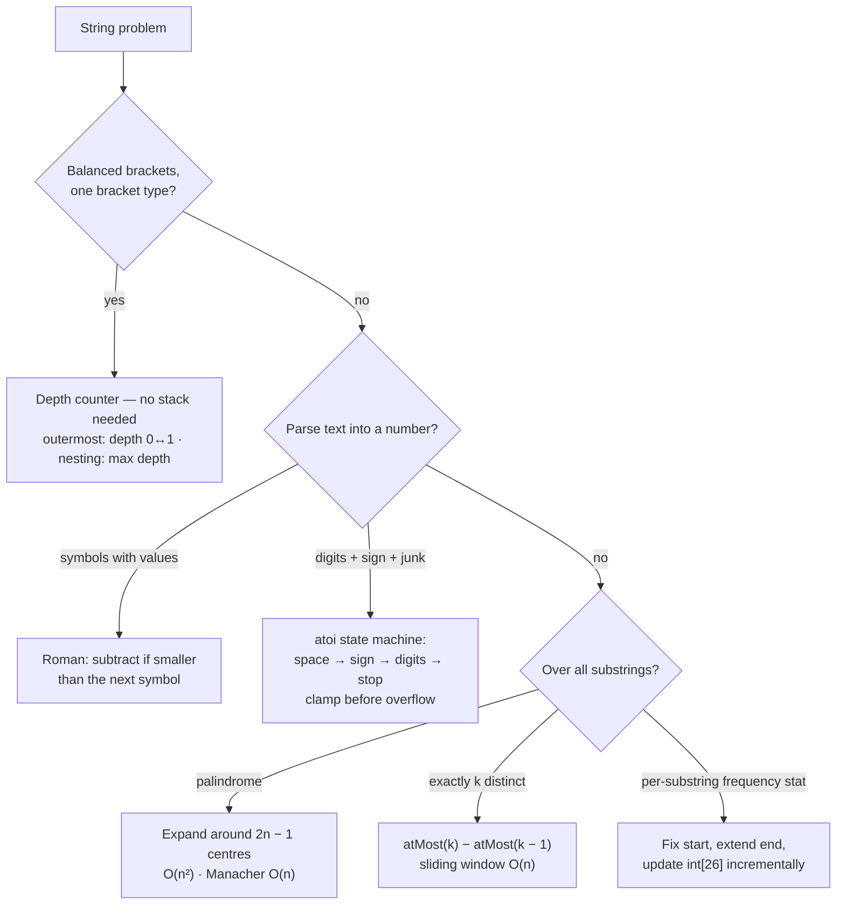

# Part 17: Strings (Basic and Medium)

← [Striver course map](../README.md)

> [!abstract] What this part covers
> **Goal:** Move from one-pass string scans to the three medium shapes: a depth counter for balanced parentheses, a careful state machine for parsing, and substring enumeration — O(n²) by centre or start index, O(n) when an "at most k" window applies.
> **Prereqs:** [Basic Strings](../11-basic-strings/README.md) · [Hashing](../15-hashing/README.md) **Time:** ~4 h.
> **Outcome:** Solve all 7 problems in their optimal complexity, write atoi without overflow bugs in C++/Java, expand around centres for palindromes, and turn "exactly k" into "at most k − at most (k − 1)".

---

## Theory

| # | Lesson | What you get | Source |
|---|---|---|---|
| 0 | [String Fundamentals](00-string-basics-theory.md) | Immutability and builder costs, char arithmetic, frequency tables, overflow-safe parsing, balance counters, palindrome expansion, substring enumeration, rotation and where advanced tools live. | [link](https://takeuforward.org/learning/dsa/remove-outermost-parentheses?category=basic-and-easy-string-problems&source=strivers-a2z-dsa-sheet) |

Read these first; the problems below apply them.

---

## Problems

| # | Problem | Difficulty | Key insight | Optimal | Source |
|---|---|---|---|---|---|
| | **Parentheses** | | | | |
| 1 | [Remove Outermost Parentheses](01-remove-outermost-parentheses.md) | Easy | Track depth. A `(` that takes depth 0 → 1 opens a primitive, and a `)` that takes depth 1 → 0 closes it. Those are the only chars to drop; keep everything else. | O(n) | [link](https://takeuforward.org/learning/dsa/remove-outermost-parentheses?category=parentheses&source=strivers-a2z-dsa-sheet) |
| 2 | [Maximum Nesting Depth of the Parentheses](02-maximum-nesting-depth-of-the-parentheses.md) | Easy | Depth goes up on `(` and down on `)`; the answer is the highest value it reaches. Ignore every other character. | O(n) | [link](https://takeuforward.org/learning/dsa/maximum-nesting-depth-of-the-parentheses?category=parentheses&source=strivers-a2z-dsa-sheet) |
| | **String conversions** | | | | |
| 3 | [Roman to Integer](03-roman-to-integer.md) | Easy | Add each symbol's value, except when it's smaller than the next symbol — then subtract it (IV = −1 + 5). Only six such pairs exist, and the rule covers all of them. | O(n) | [link](https://takeuforward.org/learning/dsa/roman-to-integer?category=conversions&source=strivers-a2z-dsa-sheet) |
| 4 | [String to Integer (atoi)](04-string-to-integer-atoi.md) | Medium | It's a 4-state machine: skip spaces → optional sign → digits → stop at the first non-digit. The only hard part is overflow, and you check it *before* `res = res·10 + d`. | O(n) | [link](https://takeuforward.org/learning/dsa/string-to-integer-atoi?category=conversions&source=strivers-a2z-dsa-sheet) |
| | **Substring problems** | | | | |
| 5 | [Count Substrings with Exactly K Distinct Characters](05-count-substrings-k-distinct.md) | Medium | "At most k distinct" is monotone, so a sliding window counts it in O(n): every valid window ending at `r` contributes `r − l + 1` substrings. Exactly k = atMost(k) − atMost(k − 1). | O(n) | [link](https://takeuforward.org/learning/dsa/count-number-of-substring?category=substrings&source=strivers-a2z-dsa-sheet) |
| 6 | [Longest Palindromic Substring](06-longest-palindromic-substring.md) | Medium | Every palindrome mirrors around a centre — a character (odd length) or a gap (even length). There are 2n − 1 centres; expand each while the ends match. O(n²) time, O(1) space. | O(n²) | [link](https://takeuforward.org/learning/dsa/longest-palindromic-substring?category=substrings&source=strivers-a2z-dsa-sheet) |
| 7 | [Sum of Beauty of All Substrings](07-sum-of-beauty-of-all-substrings.md) | Medium | Fix the start, extend the end one char at a time, and update a 26-entry count array incrementally — no recount per substring. Max/min over 26 counts is O(26), giving O(26 · n²). | O(26 · n²) | [link](https://takeuforward.org/learning/dsa/sum-of-beauty-of-all-substrings?category=substrings&source=strivers-a2z-dsa-sheet) |

---

## Which string technique?

---

## Part 17 cheat sheet

| Problem | Technique | Time / Space |
|---|---|---|
| Remove outermost parentheses | depth counter; keep char unless it moves depth 0↔1 | O(n) / O(n) output |
| Max nesting depth | running depth, track max | O(n) / O(1) |
| Roman to integer | add, but subtract when value < next value | O(n) / O(1) |
| String to integer (atoi) | skip spaces → sign → digits, clamp before overflow | O(n) / O(1) |
| Substrings with exactly k distinct | atMost(k) − atMost(k − 1), window + count map | O(n) / O(Σ) |
| Longest palindromic substring | expand around 2n − 1 centres | O(n²) / O(1) |
| Sum of beauty of all substrings | fix start, extend end, int[26] counts | O(26 · n²) / O(26) |

**Facts interviewers test:** one bracket type never needs a stack — an integer depth is the stack's height. In atoi, check overflow *before* multiplying: `res > (MAX − d) / 10` → clamp. "Exactly k" isn't monotone for a sliding window but "at most k" is, so subtract two at-most counts. There are `2n − 1` palindrome centres (n letters, n − 1 gaps). Counting all substrings is O(n²) because there are n(n + 1)/2 of them — say this when your answer is O(n²).

---

## Mastery checklist

- [ ] Remove outermost parentheses and max depth with a single integer, no stack
- [ ] Explain the Roman subtraction rule and run `MCMXCIV` by hand
- [ ] Write atoi with whitespace, sign, leading zeros, junk and overflow clamping
- [ ] Derive exactly(k) = atMost(k) − atMost(k − 1) and write atMost
- [ ] Expand around odd and even centres; know Manacher exists and what it costs
- [ ] Compute sum of beauty in O(26 · n²) by updating counts incrementally

**Interview track →** [Strings deep-dive](../../01-data-structures/03-string.md) · [String walkthroughs](../../04-practice/data-structures/03-string.md) · [Sliding window](../../02-algorithms/04-sliding-window.md)

Next part → [Recursion](../18-recursion/README.md)
