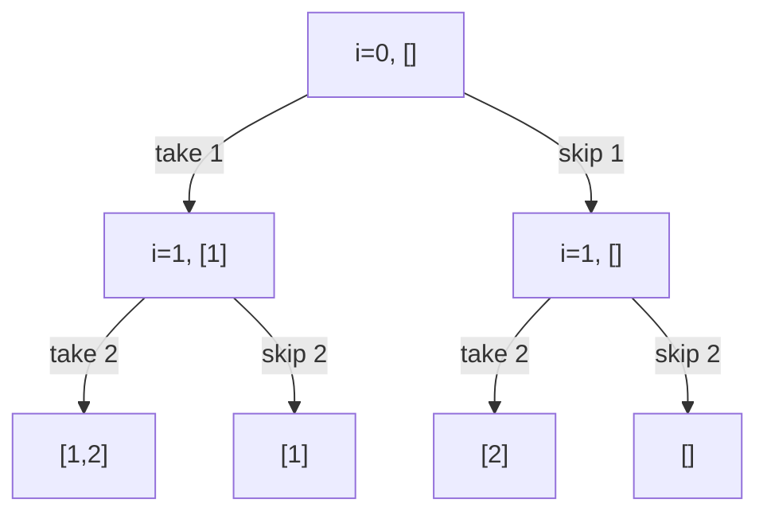
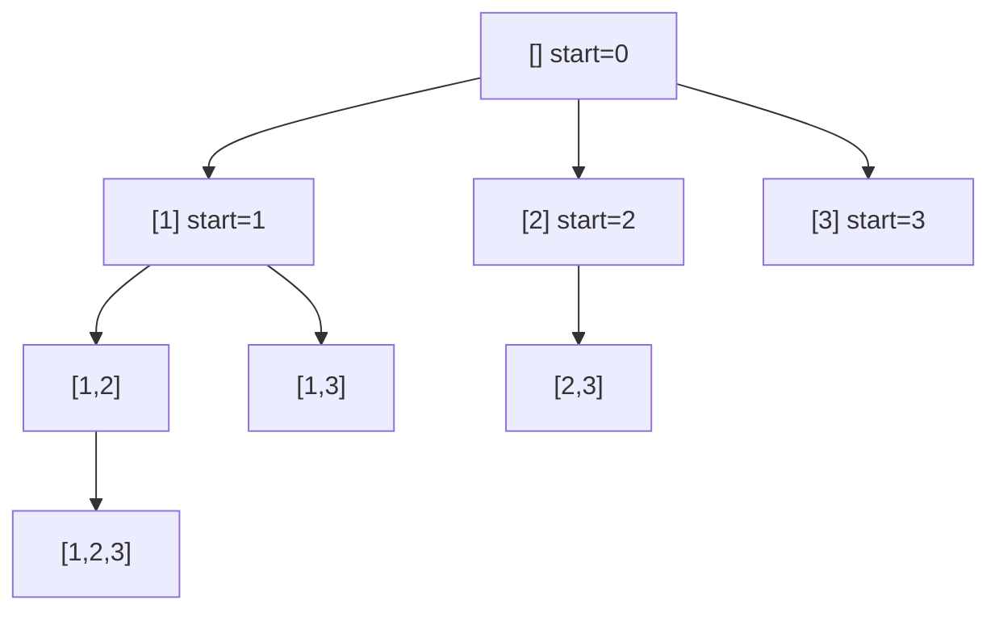

# 1. Subsequence Patterns

← [Part 18 index](README.md) · Next → [Pow(x, n)](02-pow-x-n.md)

> [!abstract] What this covers
> **Core idea:** Every "all subsets / all combinations / all ways" problem is a walk over a **decision tree**. At each level you either decide *take or skip element i* (pick/not-pick), or decide *which element comes next* (for-loop). The output you want (every path, any one path, or how many) only changes what the leaves return.
> **You'll be able to:** write pick/not-pick in its three return flavours; write the for-loop template; skip duplicates without losing valid answers; choose between reuse (`i`) and no reuse (`i + 1`); prune on sorted input; and read off time complexity from the tree's shape.
> **Source:** [takeuforward lesson](https://takeuforward.org/learning/dsa/learn-all-patterns-of-subsequences?category=subsequence-pattern-problems&source=strivers-a2z-dsa-sheet) (this note is a synthesis of the whole part) · **Time:** 45 min

**Sections:** [1. Subsequence vs subarray vs subset](#1-subsequence-vs-subarray-vs-subset) · [2. The pick/not-pick tree](#2-the-picknot-pick-tree) · [3. Three return flavours](#3-three-return-flavours) · [4. Sum-K variants](#4-sum-k-variants) · [5. The for-loop template](#5-the-for-loop-template) · [6. Duplicates](#6-duplicates) · [7. Reuse vs no reuse](#7-reuse-vs-no-reuse) · [8. Backtracking on boards](#8-backtracking-on-boards) · [9. Complexity from the tree](#9-complexity-from-the-tree) · [10. When recursion becomes DP](#10-when-recursion-becomes-dp) · [Common mistakes](#common-mistakes) · [Practice](#practice) · [Key terms](#key-terms) · [Flashcards](#flashcards)

---

## 1. Subsequence vs subarray vs subset

| Term | Order kept? | Contiguous? | Count for n elements |
|---|---|---|---|
| Subarray / substring | yes | yes | n(n + 1)/2 |
| Subsequence | yes | no | 2ⁿ (incl. empty) |
| Subset | no (a set) | — | 2ⁿ |

For distinct elements, subsequences and subsets are the same 2ⁿ objects. The difference shows up with **duplicates**: `[1, 2, 2]` has 8 subsequences by index but only 6 distinct subsets.

---

## 2. The pick/not-pick tree

At index `i` you make a binary choice, then recurse on `i + 1`. At `i == n` you have a full subsequence.



```python
def subsequences(a):
    out, cur = [], []
    def go(i):
        if i == len(a):
            out.append(cur[:])      # copy — cur keeps changing
            return
        cur.append(a[i]); go(i + 1); cur.pop()   # take
        go(i + 1)                                # skip
    go(0)
    return out
```

```cpp
void go(int i, vector<int>& a, vector<int>& cur, vector<vector<int>>& out) {
    if (i == (int)a.size()) { out.push_back(cur); return; }
    cur.push_back(a[i]); go(i + 1, a, cur, out); cur.pop_back();
    go(i + 1, a, cur, out);
}
```

```java
static void go(int i, int[] a, List<Integer> cur, List<List<Integer>> out) {
    if (i == a.length) { out.add(new ArrayList<>(cur)); return; }
    cur.add(a[i]); go(i + 1, a, cur, out); cur.remove(cur.size() - 1);
    go(i + 1, a, cur, out);
}
```

**Backtracking = undo after the call.** `cur.pop()` restores the state the parent expects. Without it the skip branch would still see `a[i]`.

**Bitmask alternative (no recursion):** subset `m` for `m in 0 … 2ⁿ − 1` takes `a[j]` iff bit `j` of `m` is set. Useful when n ≤ 20 and you want an iterative answer.

---

## 3. Three return flavours

The tree is the same. Only the leaf and the way results combine change.

| Want | Leaf returns | Combine | Early stop |
|---|---|---|---|
| **All** answers | append a copy of `cur` | none (void) | no |
| **Any one** answer | `True` if valid | `return take() or skip()` | yes, on the first `True` |
| **Count** | `1` if valid else `0` | `return take() + skip()` | no |

```python
def any_sum_k(a, k):                    # print one / exists
    def go(i, s):
        if i == len(a): return s == k
        return go(i + 1, s + a[i]) or go(i + 1, s)
    return go(0, 0)

def count_sum_k(a, k):                  # count
    def go(i, s):
        if i == len(a): return 1 if s == k else 0
        return go(i + 1, s + a[i]) + go(i + 1, s)
    return go(0, 0)
```

The `or` short-circuit is what makes "any one" faster in practice: the skip branch never runs once take succeeds.

---

## 4. Sum-K variants

| Variant | Change |
|---|---|
| All non-negative, `s > k` | prune: `if s > k: return 0` |
| Count subsequences with sum K | count flavour; DP `dp[i][s]` once n·K is small |
| Subset sums (all 2ⁿ sums) | carry `s` only, append at leaf, sort output |
| Target Sum (±) | `go(i + 1, s + a[i]) + go(i + 1, s − a[i])` |

**Pruning is only safe with a monotonic sum.** With negatives, `s > k` can still come back down.

---

## 5. The for-loop template

Instead of "take or skip a[i]", ask "**which index comes next** in the combination?". The recursion variable is the start of the allowed range.

```python
def combos(a):
    out, cur = [], []
    def go(start):
        out.append(cur[:])                  # every node is an answer (subsets)
        for i in range(start, len(a)):
            cur.append(a[i])
            go(i + 1)
            cur.pop()
    go(0)
    return out
```



Pick/not-pick produces answers only at **leaves**. The for-loop produces one at **every node**, so the tree has exactly 2ⁿ nodes and no wasted leaves. The for-loop also makes duplicate skipping easy (next section), so it's the default for combination problems.

| Problem | Leaf condition | Next call |
|---|---|---|
| Subsets | every node | `go(i + 1)` |
| Combination Sum (reuse) | `target == 0` | `go(i, target − a[i])` |
| Combination Sum II | `target == 0` | `go(i + 1, …)` + skip dups |
| Combination Sum III | `len == k and target == 0` | digits 1–9, `go(i + 1)` |
| Palindrome partitioning | `start == n` | loop over `end`, `go(end + 1)` |
| Letter combinations | `len == digits` | loop over letters of the next digit |

---

## 6. Duplicates

Input `[1, 2, 2]`, want distinct subsets. **Sort**, then at a given level take only the **first** of each run of equal values:

```python
for i in range(start, len(a)):
    if i > start and a[i] == a[i - 1]:   # same value already tried at this level
        continue
    cur.append(a[i]); go(i + 1); cur.pop()
```

- `i > start`, **not** `i > 0`. With `i > 0` you'd also block `[2, 2]`, where the second 2 sits at a deeper level, not the same one.
- "Same level" means the same parent node. Two siblings starting with the same value produce identical subtrees, and that's the duplication.
- Pick/not-pick version: after a *skip* of value v, skip all following v's (`while i + 1 < n and a[i + 1] == a[i]: i += 1`).

Avoid generating everything and deduplicating with a set. It costs extra time and memory, and interviewers read it as not knowing the trick.

---

## 7. Reuse vs no reuse

| Element can be used | Recurse on | Example |
|---|---|---|
| Unlimited times | `i` | Combination Sum (LC 39), coin change enumeration |
| At most once | `i + 1` | Combination Sum II, subsets |
| Exactly once, any order | `used[]` array, loop from 0 | permutations |

**Sorted-input pruning:** if `a[i] > target`, then `break` (not `continue`), because every later element is bigger.

---

## 8. Backtracking on boards

Same idea, but the "choice" is a value for a cell or the next cell of a path:

```
place(choice)  →  if consistent: recurse  →  undo(choice)
```

| Problem | Level | Choices | Constraint check |
|---|---|---|---|
| N-Queens | row | column | col / `r − c` / `r + c` sets, O(1) |
| Sudoku | k-th empty cell | digit 1–9 | row / col / box tables |
| M-colouring | vertex | colour 1–m | neighbours' colours |
| Word Search | k-th letter | 4 neighbours | in bounds, matches, unvisited |
| Rat in a Maze | path step | D, L, R, U | open and unvisited |

Two rules:
1. **Every mark has an unmark.** Grid cells set to `#` or `visited = True` must be restored, or later branches see a corrupted board.
2. **Return `bool` when one solution suffices** (Sudoku, Word Search). That way the first success propagates up, and the undo steps after it never run.

---

## 9. Complexity from the tree

**Time = number of nodes × work per node.** Space = depth × frame size, plus the output.

| Tree | Nodes | Typical time |
|---|---|---|
| Binary, depth n (pick/not-pick) | 2ⁿ⁺¹ | O(2ⁿ), or O(n · 2ⁿ) with copying |
| Branch b, depth d | b^d | O(b^d) |
| Permutations | n!·e | O(n · n!) |
| Generate parentheses | Catalan Cₙ leaves | O(4ⁿ / √n) |
| Halving (Pow) | log n | O(log n) |

Copying each answer costs O(length), which is why "all subsets" is O(n · 2ⁿ), not O(2ⁿ). Recursion depth for subsets is n, so the stack is O(n). Python's default recursion limit (1000) is fine here; for deep linear recursion use `sys.setrecursionlimit` or go iterative.

---

## 10. When recursion becomes DP

If the function's result depends only on its arguments (`go(i, s)`, with no `cur` list) and the same arguments repeat, memoise it:

| Recursion | States | DP time |
|---|---|---|
| `count_sum_k(i, s)` | n · K | O(n · K) |
| `exists_sum_k(i, s)` | n · K | O(n · K) |
| `partition(start)` → min cuts | n | O(n²) |

This is the bridge to [Part 28 — Dynamic Programming](../28-dynamic-programming/README.md). Enumeration problems ("return all …") can't be memoised into polynomial time, because the output itself is exponential.

---

## Common mistakes

1. Appending `cur` instead of a copy, which leaves every stored answer as the same (finally empty) list.
2. Forgetting `pop()` after the take branch.
3. Duplicate skip with `i > 0` instead of `i > start`.
4. Skipping duplicates without sorting first.
5. Recursing on `i + 1` when reuse is allowed, or on `i` when it isn't.
6. Pruning with `s > k` when negatives exist.
7. In "any one" mode, calling both branches and discarding the first result, which loses the early stop.
8. Not restoring board/grid cells after a backtrack.

---

## Practice

1. Draw the pick/not-pick tree for `[3, 1]`. In what order does the template above emit the subsets?
2. Count subsequences of `[1, 2, 1]` with sum 2 by hand.
3. Why does `[1, 2, 2]` with `i > 0` lose `[2, 2]` but `i > start` keeps it?
4. Combination Sum, `candidates = [2, 3], target = 6`. List the answers and say which recursion index allows `[2, 2, 2]`.
5. What's the time complexity of printing all subsets of size exactly k?
6. Turn `count_sum_k(i, s)` into a bottom-up table. What are the dimensions?

<details><summary>Answer sketches</summary>

**#1:** take-first order: `[3, 1]`, `[3]`, `[1]`, `[]`.

**#2:** `{a0, a2} = 1 + 1` and `{a1} = 2`, so the count is 2.

**#3:** In the branch `[2]` (first 2 taken at level 1), the next level has `start = 2`, where `i = 2` equals `start`, so it isn't skipped under `i > start`. Under `i > 0`, `a[2] == a[1]` blocks it.

**#4:** `[2, 2, 2]` and `[3, 3]`. Reuse comes from recursing on `i`.

**#5:** `O(k · C(n, k))`: C(n, k) answers, each copied in O(k).

**#6:** `dp[i][s]` = ways using `a[i:]` to make `s`. Size `(n + 1) × (K + 1)`, `dp[n][0] = 1`.
</details>

---

## Key terms

| Term | Meaning |
|---|---|
| Decision tree | Tree of recursive calls; each edge is a choice |
| Pick/not-pick | Binary choice per element: include or exclude |
| For-loop template | Choose the next element from `[start, n)` |
| Backtracking | Make a choice, recurse, undo it |
| Pruning | Cutting a branch that can't lead to a valid answer |
| Same-level duplicate | Equal values tried as siblings, which produce identical subtrees |
| Memoisation | Caching `f(args)` when subproblems repeat |

---

## Flashcards

**Pick/not-pick: three return flavours?** #flashcard
All: append a copy at the leaf. Any one: `return take or skip`. Count: `return take + skip`.

**Duplicate-skip condition?** #flashcard
Sort, then `if i > start and a[i] == a[i−1]: continue`.

**Why `i > start`, not `i > 0`?** #flashcard
Only siblings at the same level duplicate subtrees. Deeper equal values are valid (e.g. [2, 2]).

**Reuse allowed — recurse on?** #flashcard
`i` (same index). No reuse → `i + 1`.

**Subsets time complexity?** #flashcard
O(n · 2ⁿ): 2ⁿ answers × O(n) copy.

**When can sum pruning `s > k` be used?** #flashcard
Only when all values are non-negative.

**Pick/not-pick vs for-loop: where are answers?** #flashcard
Pick/not-pick: at the leaves. For-loop: at every node.

**When does recursion become DP?** #flashcard
When the result depends only on the arguments and the same arguments repeat (count / exists, not enumerate).

**Interview track →** [Recursion deep-dive](../../02-algorithms/09-recursion.md) · [Backtracking deep-dive](../../02-algorithms/12-backtracking.md) · [Recursion walkthroughs](../../04-practice/algorithms/09-recursion.md) · [Backtracking walkthroughs](../../04-practice/algorithms/12-backtracking.md)
