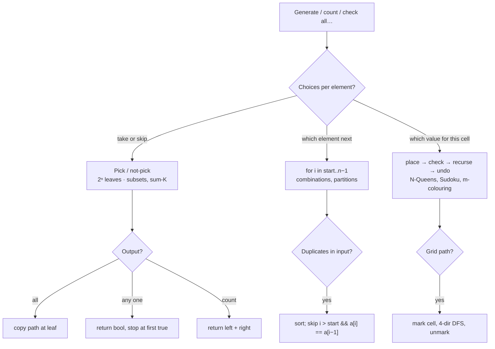

# Part 18: Recursion

← [Striver course map](../README.md)

> [!abstract] What this part covers
> **Goal:** Turn every "generate / count / check all X" problem into one of three recursion shapes — pick/not-pick (subsequences), for-loop over the next choice (combinations, partitions), or place-check-undo on a board (N-Queens, Sudoku) — and know their complexity at a glance.
> **Prereqs:** [Basic Recursion](../12-basic-recursion/README.md) · [Arrays](../14-arrays/README.md) **Time:** ~8 h.
> **Outcome:** Solve all 21 problems, write the pick/not-pick and for-loop templates from memory, skip duplicates correctly after sorting, and justify O(2ⁿ), O(n!) and O(9^E) bounds.

---

## Theory

| # | Lesson | What you get | Source |
|---|---|---|---|
| 1 | [Subsequence Patterns](01-subsequence-patterns.md) | Pick/not-pick tree, print all / print one / count, sum-K variants, for-loop template, duplicate skipping, complexity of recursion trees | [link](https://takeuforward.org/learning/dsa/learn-all-patterns-of-subsequences?category=subsequence-pattern-problems&source=strivers-a2z-dsa-sheet) |

Read these first; the problems below apply them.

---

## Problems

| # | Problem | Difficulty | Key insight | Optimal | Source |
|---|---|---|---|---|---|
| | **Implementation problems** | | | | |
| 2 | [Pow(x, n)](02-pow-x-n.md) | Medium | xⁿ = (x^(n/2))² when n is even, and x · xⁿ⁻¹ when odd. Halving the exponent gives O(log n). For negative n, compute (1/x)^|n| — using a 64-bit copy of n, since |INT_MIN| overflows int. | O(log n) | [link](https://takeuforward.org/learning/dsa/pow(x,n)?category=implementation-problems&source=strivers-a2z-dsa-sheet) |
| 3 | [Generate Parentheses](03-generate-parentheses.md) | Medium | Build left to right and only make legal moves: add `(` while `open < n`, add `)` while `close < open`. Every leaf is then valid — no filtering. The count is the n-th Catalan number. | O(4ⁿ / √n) | [link](https://takeuforward.org/learning/dsa/generate-parentheses?category=implementation-problems&source=strivers-a2z-dsa-sheet) |
| 4 | [Power Set](04-power-set.md) | Medium | Each element is either in or out — two branches per element, 2ⁿ leaves. Equivalently, the numbers 0 … 2ⁿ − 1 enumerate the subsets: bit i set means "take nums[i]". | O(n · 2ⁿ) | [link](https://takeuforward.org/learning/dsa/power-set?category=implementation-problems&source=strivers-a2z-dsa-sheet) |
| 5 | [Count Good Numbers](05-count-good-numbers.md) | Medium | Positions are independent: ⌈n/2⌉ even indices with 5 choices {0,2,4,6,8}, ⌊n/2⌋ odd indices with 4 choices {2,3,5,7}. Answer = 5^⌈n/2⌉ · 4^⌊n/2⌋ mod p, with n up to 10¹⁵ — so fast modular power. | O(log n) | [link](https://takeuforward.org/learning/dsa/count-good-numbers?category=implementation-problems&source=strivers-a2z-dsa-sheet) |
| 6 | [Reverse a Stack](06-reverse-a-stack.md) | Medium | Two recursions: `reverse` pops the top, reverses the rest, then pushes the saved element to the *bottom*. `insertAtBottom` pops everything, pushes the element, and restores. The call stack is the auxiliary storage. | O(n²) | [link](https://takeuforward.org/learning/dsa/reverse-a-stack?category=implementation-problems&source=strivers-a2z-dsa-sheet) |
| | **Subsequence pattern problems** | | | | |
| 7 | [Check if There Exists a Subsequence with Sum K](07-subsequence-sum-k-exists.md) | Medium | Pick/not-pick recursion with a **boolean return**: return true as soon as any branch succeeds, which prunes the rest. Positive values let you also stop when the sum exceeds k. Memoising on (i, remaining) turns 2ⁿ into O(n · k) subset-sum DP. | O(n · k) | [link](https://takeuforward.org/learning/dsa/check-if-there-exists-a-subsequence-with-sum-k?category=subsequence-pattern-problems&source=strivers-a2z-dsa-sheet) |
| 8 | [Count All Subsequences with Sum K](08-count-subsequences-sum-k.md) | Medium | Same pick/not-pick tree, but **return a count**: base cases return 1 or 0, and each node returns `take + skip`. Memoise (i, remaining) for O(n · k), or do the 1D counting DP `ways[s] += ways[s − x]` downward. | O(n · k) | [link](https://takeuforward.org/learning/dsa/count-all-subsequences-with-sum-k?category=subsequence-pattern-problems&source=strivers-a2z-dsa-sheet) |
| 9 | [Generate Binary Strings Without Consecutive 1s](09-binary-strings-no-consecutive-ones.md) | Medium | At each position you can always place `0`; place `1` only if the previous char isn't `1`. Trying `0` before `1` yields lexicographic order for free. The count is Fib(n + 2). | O(n · Fib(n)) | [link](https://takeuforward.org/learning/dsa/generate-binary-strings-without-consecutive-1s?category=subsequence-pattern-problems&source=strivers-a2z-dsa-sheet) |
| | **FAQs (Medium)** | | | | |
| 10 | [Combination Sum](10-combination-sum.md) | Medium | Loop-based backtracking from a start index: choosing `c[j]` recurses with start `j` (not `j + 1`) so it can be reused, and never looks back at earlier candidates — that's what makes combinations unique. Sort first so you can `break` when `c[j] > remaining`. | O(2^(t/m) · t) | [link](https://takeuforward.org/learning/dsa/combination-sum?category=faqs-medium&source=strivers-a2z-dsa-sheet) |
| 11 | [Combination Sum II](11-combination-sum-ii.md) | Medium | Sort, then in the loop at each level skip `c[j]` if `j > start` and `c[j] == c[j − 1]` — an equal value was already tried *at this position*. Recurse with `j + 1` for use-once. This dedupes without a set. | O(2ⁿ · n) worst | [link](https://takeuforward.org/learning/dsa/combination-sum-ii?category=faqs-medium&source=strivers-a2z-dsa-sheet) |
| 12 | [Subsets I (Subset Sums)](12-subset-sums.md) | Medium | Pick/not-pick carrying only the running sum — no list to copy, so each leaf costs O(1). 2ⁿ leaves → O(2ⁿ) plus sorting if a sorted output is required. | O(2ⁿ) | [link](https://takeuforward.org/learning/dsa/subsets-i?category=faqs-medium&source=strivers-a2z-dsa-sheet) |
| 13 | [Subsets II](13-subsets-ii.md) | Medium | Sort, then use the loop form: every recursion node *is* a subset (record it on entry), and the loop picks the next element with the sibling-skip `j > i && a[j] == a[j−1]`. Duplicates never get generated. | O(n · 2ⁿ) | [link](https://takeuforward.org/learning/dsa/subsets-ii?category=faqs-medium&source=strivers-a2z-dsa-sheet) |
| 14 | [Combination Sum III](14-combination-sum-iii.md) | Medium | Choose digits in increasing order from `start`; stop when the size reaches k. Prune when the next digit exceeds the remaining sum (digits are increasing). The search space is at most C(9, k) ≤ 126. | O(C(9, k) · k) | [link](https://takeuforward.org/learning/dsa/combination-sum-iii?category=faqs-medium&source=strivers-a2z-dsa-sheet) |
| | **Hard** | | | | |
| 15 | [Letter Combinations of a Phone Number](15-letter-combinations-of-a-phone-number.md) | Medium | One recursion level per digit, one branch per letter of that digit — a Cartesian product. Depth = number of digits, branching ≤ 4, so O(4ⁿ · n). Empty input returns `[]`, not `[""]`. | O(4ⁿ · n) | [link](https://takeuforward.org/learning/dsa/letter-combinations-of-a-phone-number?category=hard&source=strivers-a2z-dsa-sheet) |
| | **FAQs (Hard)** | | | | |
| 16 | [Palindrome Partitioning](16-palindrome-partitioning.md) | Medium | Recurse on the start index: for every end `e ≥ start` where `s[start..e]` is a palindrome, cut there and recurse on `e + 1`. Precompute `isPal[i][j]` in O(n²) so each check is O(1). | O(n · 2ⁿ) | [link](https://takeuforward.org/learning/dsa/palindrome-partitioning?category=faqs-hard&source=strivers-a2z-dsa-sheet) |
| 17 | [Word Search](17-word-search.md) | Medium | DFS from every cell matching `word[0]`; at depth k the cell must equal `word[k]`. Mark the cell visited (overwrite with `#`) before exploring neighbours and restore it after — backtracking on the grid itself. | O(m·n·3^L) | [link](https://takeuforward.org/learning/dsa/word-search?category=faqs-hard&source=strivers-a2z-dsa-sheet) |
| 18 | [N-Queens](18-n-queens.md) | Hard | One queen per row, so recurse on the row and choose a column. A placement is safe iff its column, `r − c` diagonal and `r + c` anti-diagonal are all unused — three boolean arrays give O(1) checks. | O(n!) | [link](https://takeuforward.org/learning/dsa/n-queens?category=faqs-hard&source=strivers-a2z-dsa-sheet) |
| 19 | [Rat in a Maze](19-rat-in-a-maze.md) | Medium | Grid DFS with a visited mark and backtracking. Exploring moves in alphabetical order D, L, R, U produces the paths already sorted, so no final sort is needed. | O(3^(n²) · n²) | [link](https://takeuforward.org/learning/dsa/rat-in-a-maze?category=faqs-hard&source=strivers-a2z-dsa-sheet) |
| 20 | [M-Coloring Problem](20-m-coloring.md) | Medium | Colour vertices 0, 1, 2, … in order; for vertex v try each colour not used by an already-coloured neighbour, recurse, and undo on failure. Return true at v == n. NP-complete in general, so backtracking is the expected answer. | O(mⁿ) worst | [link](https://takeuforward.org/learning/dsa/m-coloring-problem?category=faqs-hard&source=strivers-a2z-dsa-sheet) |
| 21 | [Sudoku Solver](21-sudoku-solver.md) | Hard | Find the next empty cell, try digits 1–9 that are absent from its row, column and box, recurse, and undo on failure. Keep `row[r][d]`, `col[c][d]`, `box[b][d]` boolean tables (b = (r/3)·3 + c/3) so each check is O(1). | O(9^E) | [link](https://takeuforward.org/learning/dsa/sudoku-solver?category=faqs-hard&source=strivers-a2z-dsa-sheet) |
| 22 | [Expression Add Operators](22-expression-add-operators.md) | Hard | Backtrack over the next operand `num[i..j]` and its operator, carrying `value` (total so far) and `last` (the last multiplicative term). For `*`, undo the last term: `value − last + last·x`, new `last = last·x`. Skip operands with a leading zero. | O(n · 4ⁿ) | [link](https://takeuforward.org/learning/dsa/expression-add-operators?category=faqs-hard&source=strivers-a2z-dsa-sheet) |
| | **Extra (A2Z sheet)** | | | | |
| 23 | [Sort a stack using recursion](23-sort-a-stack-using-recursion.md) | Medium | Do the same thing as reverse-a-stack, but with *sorted* insertion. `sort(st)`: pop the top `x`, sort the rest recursively, then `insertSorted(st, x)`. `insertSorted`: if the stack is empty or `top ≤ x`, push `x`. Otherwise pop the top `t`, insert `x` into the remainder, then push `t` back. This is insertion sort with the call stack acting as the temporary storage. | O(n²) | [link](https://takeuforward.org/learning/dsa/sort-a-stack?category=medium&source=strivers-a2z-dsa-sheet) |

---

## Which recursion shape?

---

## Part 18 cheat sheet

| Problem | Shape | Time |
|---|---|---|
| Pow(x, n) | halve exponent | O(log n) |
| Count good numbers | fast power mod | O(log n) |
| Generate parentheses | open < n / close < open | O(4ⁿ/√n) |
| Power set / Subsets I | pick/not-pick | O(n · 2ⁿ) |
| Subsets II | sort + for-loop skip | O(n · 2ⁿ) |
| Sum-K exists / count | pick/not-pick, bool / int return | O(2ⁿ) |
| Combination Sum I / II / III | for-loop, reuse i / i+1 + skip / k digits | exponential |
| Letter combinations | one digit per level | O(4ⁿ · n) |
| Palindrome partitioning | for-loop over cut end + isPal table | O(n · 2ⁿ) |
| Word search / Rat in maze | grid DFS, mark & restore | O(mn · 3^L) |
| N-Queens | row recursion, col/diag sets | O(n!) |
| M-colouring | vertex recursion | O(mⁿ) |
| Sudoku | empty-cell recursion, 3 tables | O(9^E) |
| Expression add operators | operand loop + value/last | O(n · 4ⁿ) |

**Facts interviewers test:** a recursion tree's time is (#nodes) × (work per node) — 2ⁿ leaves for subsets, n! for permutations. Return `bool` to stop early; return `int` and add to count. Duplicate skip is `i > start` (same level), never `i > 0`. Reuse an element by recursing on `i`, not `i + 1`. Backtracking state must be restored exactly — every mark has an unmark.

---

## Mastery checklist

- [ ] Write pick/not-pick for print-all, print-one (bool) and count (int)
- [ ] Write the for-loop template and explain why `i > start` skips duplicates
- [ ] Derive Combination Sum I vs II from the recursion index (i vs i + 1)
- [ ] Implement Pow(x, n) iteratively and handle n = −2³¹
- [ ] Mark/restore a grid cell in Word Search and Rat in a Maze
- [ ] N-Queens with diagonal indices r − c + n − 1 and r + c
- [ ] Sudoku with row/col/box tables and a bool return
- [ ] Explain the `last` trick in Expression Add Operators

**Interview track →** [Recursion deep-dive](../../02-algorithms/09-recursion.md) · [Backtracking deep-dive](../../02-algorithms/12-backtracking.md) · [Recursion walkthroughs](../../04-practice/algorithms/09-recursion.md) · [Backtracking walkthroughs](../../04-practice/algorithms/12-backtracking.md)

Next part → [Linked List](../19-linked-list/README.md)
