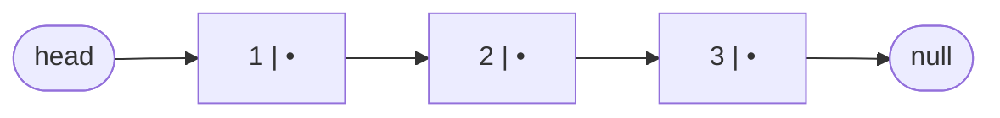
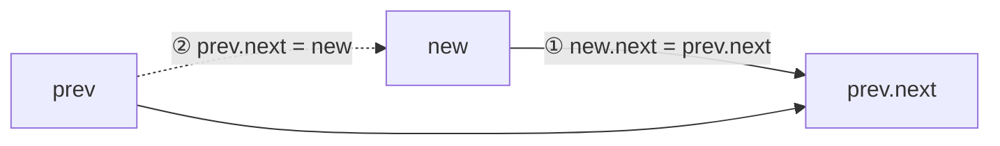

# 1. Singly Linked List

← [Part 19 index](README.md) · Next → [Doubly Linked List](02-doubly-linked-list.md)

> [!abstract] What this covers
> **Core idea:** A linked list is a chain of nodes, each holding a value and a pointer to the next node. You lose O(1) indexing but gain O(1) insertion and deletion **once you hold the predecessor**. Almost every bug comes from the order in which you overwrite pointers.
> **You'll be able to:** define a node in Python/C++/Java; convert array ⇄ list; traverse, search and count; insert and delete at head, tail, position K and before/at a value; use a dummy head to remove special cases; reason about null checks and memory.
> **Source:** [takeuforward lesson](https://takeuforward.org/learning/dsa/introduction-to-singly-linkedlist?category=fundamentals-single-ll&source=strivers-a2z-dsa-sheet) · **Time:** 40 min

**Sections:** [1. Node anatomy](#1-node-anatomy) · [2. Array vs linked list](#2-array-vs-linked-list) · [3. Building and traversing](#3-building-and-traversing) · [4. Insertion](#4-insertion) · [5. Deletion](#5-deletion) · [6. The dummy head](#6-the-dummy-head) · [7. Pointer safety rules](#7-pointer-safety-rules) · [8. The five interview primitives](#8-the-five-interview-primitives) · [Common mistakes](#common-mistakes) · [Practice](#practice) · [Key terms](#key-terms) · [Flashcards](#flashcards)

---

## 1. Node anatomy



A node = **data** + **next** reference. The list is identified only by `head`; lose it and the whole chain is unreachable (garbage in Python/Java, a leak in C++).

```python
class ListNode:
    def __init__(self, val=0, next=None):
        self.val = val
        self.next = next
```

```cpp
struct ListNode {
    int val;
    ListNode* next;
    ListNode(int v = 0, ListNode* n = nullptr) : val(v), next(n) {}
};
```

```java
class ListNode {
    int val;
    ListNode next;
    ListNode() {}
    ListNode(int v) { val = v; }
    ListNode(int v, ListNode n) { val = v; next = n; }
}
```

**C++ note:** `new ListNode(5)` allocates on the heap and returns a pointer; a stack object `ListNode x(5);` dies at end of scope — never link one into a list you return. Every `new` you unlink should be `delete`d.

**Memory per node:** 4 B int + 8 B pointer (+ padding → 16 B) in C++; ~16–24 B object header + fields in Java; ~56+ B in Python. Lists are memory-heavy and cache-unfriendly compared with arrays.

---

## 2. Array vs linked list

| Operation | Array | Singly linked list |
|---|---|---|
| Access index i | O(1) | O(i) |
| Search value | O(n) (O(log n) if sorted) | O(n) — no binary search |
| Insert/delete at front | O(n) shift | **O(1)** |
| Insert/delete at end | O(1) amortized | O(n) (O(1) with a tail pointer for insert) |
| Insert/delete in middle, given predecessor | O(n) shift | **O(1)** |
| Memory | contiguous, compact | scattered, + pointer per node |
| Cache behaviour | excellent | poor |
| Size | fixed / amortized resize | grows one node at a time |

**Where lists are actually used:** stacks/queues with unbounded size, LRU cache (DLL + hash map), hash-table chaining, adjacency lists, OS free-lists, undo histories, browser back/forward (DLL).

---

## 3. Building and traversing

```python
def array_to_list(arr):
    dummy = tail = ListNode()
    for x in arr:
        tail.next = ListNode(x)
        tail = tail.next
    return dummy.next

def traverse(head):
    out, cur = [], head
    while cur:                 # NOT while cur.next — that skips the last node
        out.append(cur.val)
        cur = cur.next
    return out
```

```cpp
ListNode* arrayToList(const vector<int>& a) {
    ListNode dummy;
    ListNode* tail = &dummy;
    for (int x : a) { tail->next = new ListNode(x); tail = tail->next; }
    return dummy.next;
}
```

```java
static ListNode arrayToList(int[] a) {
    ListNode dummy = new ListNode(), tail = dummy;
    for (int x : a) { tail.next = new ListNode(x); tail = tail.next; }
    return dummy.next;
}
```

**Two loop shapes — know which you need:**

| Loop | Stops with `cur` at | Use for |
|---|---|---|
| `while cur:` | null (visited every node) | print, count, search, sum |
| `while cur.next:` | last node | append at tail, find tail |
| `while cur.next and cur.next.val != x:` | node **before** x | delete x, insert before x |

Length, search and traversal are all O(n) time, O(1) space. Recursive versions cost O(n) stack — 10⁵ nodes will overflow Python's default limit.

---

## 4. Insertion

The rule: **link the new node first, then redirect the old pointer.** Reversing these two steps loses the rest of the list.



| Where | Code (Python) | Time |
|---|---|---|
| Head | `return ListNode(x, head)` | O(1) |
| Tail | walk to last; `last.next = ListNode(x)` (empty list → new head) | O(n) |
| Position K (1-indexed) | K == 1 → head case; else walk to node K − 1; `p.next = ListNode(x, p.next)` | O(K) |
| Before value v | head.val == v → head case; else walk while `p.next.val != v`; same splice | O(n) |

```python
def insert_at_k(head, k, x):
    if k == 1:
        return ListNode(x, head)
    p, i = head, 1
    while p and i < k - 1:
        p, i = p.next, i + 1
    if p:                       # k ≤ n + 1 → valid
        p.next = ListNode(x, p.next)
    return head
```

---

## 5. Deletion

To delete a node you need its **predecessor** (singly lists can't look back). Then `prev.next = prev.next.next`.

| Where | Code (Python) | Edge cases |
|---|---|---|
| Head | `return head.next` | empty list |
| Tail | walk while `p.next.next`; `p.next = None` | 0 or 1 node |
| Position K | K == 1 → head; walk to K − 1; bypass | K > n → no-op |
| Value x (first occurrence) | head.val == x → head; walk while `p.next.val != x`; bypass | x absent |

```cpp
ListNode* deleteKth(ListNode* head, int k) {
    if (!head) return nullptr;
    if (k == 1) { ListNode* t = head; head = head->next; delete t; return head; }
    ListNode* p = head;
    for (int i = 1; p && i < k - 1; i++) p = p->next;
    if (p && p->next) { ListNode* t = p->next; p->next = t->next; delete t; }
    return head;
}
```

**Deleting a node given only that node** (LC 237, not tail): copy `node.next.val` into it, then bypass `node.next`. A trick, not a true deletion — it fails for the tail.

---

## 6. The dummy head

Most head special-cases disappear if you put a fake node before the head:

```python
def delete_value_all(head, x):
    dummy = ListNode(0, head)
    p = dummy
    while p.next:
        if p.next.val == x:
            p.next = p.next.next   # don't advance — the new p.next may also match
        else:
            p = p.next
    return dummy.next
```

**Use a dummy when:** the head can be deleted, you build a new list (merge, partition, add numbers), or you'd otherwise write `if prev is None`. **Return `dummy.next`**, never `head` (head may be gone).

---

## 7. Pointer safety rules

1. **Before every `x.next`, know x is non-null.** Loop guards like `while fast and fast.next` exist for this.
2. **Save before you overwrite:** `nxt = cur.next` before changing `cur.next`.
3. **Draw 3 nodes** and update arrows in order before coding any relink.
4. **Test on 0, 1, 2 nodes** — almost every linked-list bug lives there.
5. **Return the right head** — after head deletions, reversals or rotations it changes.
6. **Don't modify input silently** — restore it (palindrome, clone) or say you're mutating it.

---

## 8. The five interview primitives

Every problem in this part is a combination of these:

| Primitive | Template | Problems |
|---|---|---|
| Dummy head | `dummy = ListNode(0, head)`; return `dummy.next` | delete, merge, add, partition |
| Fast/slow | slow +1, fast +2 | middle, palindrome, cycle, sort |
| Gap pointers | fast ahead by N | Nth from end |
| In-place reversal | `nxt = cur.next; cur.next = prev; prev = cur; cur = nxt` | reverse, k-group, palindrome, add one |
| Merge | dummy + tail, splice smaller | merge two, sort list, flatten |

Plus two specials: **pointer switching** (intersection) and **interleaving** (clone with random).

---

## Common mistakes

- `while cur.next` when you meant `while cur` → last node skipped, and crash on empty list.
- Redirecting `prev.next` before linking `new.next` → rest of list lost.
- Advancing `p` after deleting `p.next` in a delete-all loop → consecutive matches skipped.
- Forgetting that deleting/inserting at position 1 changes the head.
- Returning `head` instead of `dummy.next`.
- C++: dereferencing a node after `delete`; linking stack-allocated nodes.

## Practice

1. Insert x at position K where K = n + 1 — what must your loop allow?
2. Delete every node whose value is even, in one pass.
3. Find the second-to-last node without computing length.
4. Why can't you binary search a sorted linked list in O(log n)?

<details><summary>Answer sketches</summary>

1. Walk to node K − 1 = n (the tail), which exists, so splice there. The guard is "predecessor exists", not "node K exists".
2. Dummy head; `while p.next`: if even, bypass and stay; else advance.
3. `while p.next.next: p = p.next` (requires ≥ 2 nodes).
4. Reaching the middle costs O(n); total O(n) per lookup — no better than a scan.

</details>

## Key terms

| Term | Meaning |
|---|---|
| Head | Reference to the first node; the list's identity |
| Tail | Last node; `tail.next is None` |
| Predecessor | Node before the one you're operating on — needed for SLL insert/delete |
| Dummy / sentinel | Fake node before the head that removes head special cases |
| Splice | Insert or remove by redirecting pointers, no copying |
| Self-referential structure | Type containing a pointer to its own type |

## Flashcards

**Why is SLL deletion O(1) only "given the predecessor"?** #flashcard
You must redirect `prev.next`; finding `prev` from the head is O(n).

**Order of pointer updates when inserting after p?** #flashcard
`new.next = p.next` first, then `p.next = new`.

**Loop to stop on the last node?** #flashcard
`while cur.next:`.

**When should you use a dummy head?** #flashcard
Whenever the head can change or you're building a new list; return `dummy.next`.

**Delete-all-x loop: why not advance after a deletion?** #flashcard
The new `p.next` may also equal x.

**Delete a node given only that node?** #flashcard
Copy the next node's value in and bypass the next node; impossible for the tail.

**Array vs list for random access / front insertion?** #flashcard
Array O(1) / O(n); list O(n) / O(1).

**Interview track →** [Linked-list deep-dive](../../01-data-structures/07-linked-list.md) · [Linked-list walkthroughs](../../04-practice/data-structures/07-linked-list.md)
