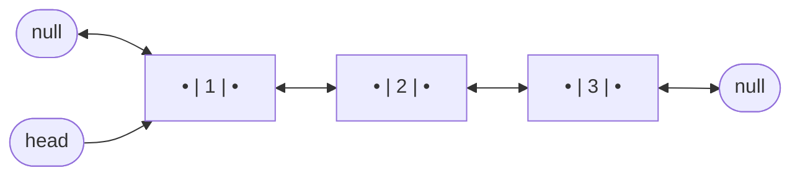
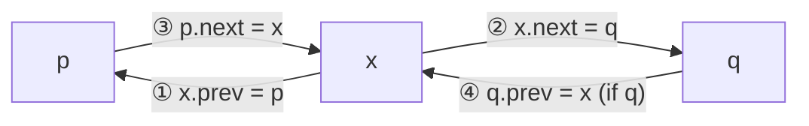

# 2. Doubly Linked List

← [Part 19 index](README.md) · Next → [Traversal in Linked List](03-traversal-in-linked-list.md)

> [!abstract] What this covers
> **Core idea:** Each node also stores `prev`, so you can walk backwards and delete **a node you hold directly** in O(1) — no predecessor search. The price is one extra pointer per node and twice as many links to keep consistent on every insert and delete.
> **You'll be able to:** define a DLL node in Python/C++/Java; build a DLL from an array; insert and delete at head, tail, position K and before a given node; unlink any node in O(1); reverse a DLL by swapping `prev`/`next`; explain why LRU caches use a DLL.
> **Source:** [takeuforward lesson](https://takeuforward.org/learning/dsa/introduction-to-doubly-ll?category=fundamentals-doubly-ll&source=strivers-a2z-dsa-sheet) · **Time:** 35 min

**Sections:** [1. Node anatomy](#1-node-anatomy) · [2. Array → DLL](#2-array--dll) · [3. Insertion — four links](#3-insertion--four-links) · [4. Deletion — unlink](#4-deletion--unlink) · [5. Reversal](#5-reversal) · [6. Sentinels](#6-sentinels) · [7. DLL vs SLL](#7-dll-vs-sll) · [Common mistakes](#common-mistakes) · [Practice](#practice) · [Key terms](#key-terms) · [Flashcards](#flashcards)

---

## 1. Node anatomy



**Invariant (check it after every operation):** for every node x, `x.next is None or x.next.prev is x`, and `x.prev is None or x.prev.next is x`. Also `head.prev is None`.

```python
class Node:
    def __init__(self, val=0, prev=None, next=None):
        self.val, self.prev, self.next = val, prev, next
```

```cpp
struct Node {
    int val;
    Node *prev, *next;
    Node(int v = 0, Node* p = nullptr, Node* n = nullptr) : val(v), prev(p), next(n) {}
};
```

```java
class Node {
    int val;
    Node prev, next;
    Node(int v) { val = v; }
    Node(int v, Node p, Node n) { val = v; prev = p; next = n; }
}
```

---

## 2. Array → DLL

```python
def array_to_dll(arr):
    if not arr:
        return None
    head = tail = Node(arr[0])
    for x in arr[1:]:
        node = Node(x, tail)      # prev = tail
        tail.next = node
        tail = node
    return head
```

```cpp
Node* arrayToDLL(const vector<int>& a) {
    if (a.empty()) return nullptr;
    Node* head = new Node(a[0]);
    Node* tail = head;
    for (size_t i = 1; i < a.size(); i++) {
        tail->next = new Node(a[i], tail);
        tail = tail->next;
    }
    return head;
}
```

```java
static Node arrayToDLL(int[] a) {
    if (a.length == 0) return null;
    Node head = new Node(a[0]), tail = head;
    for (int i = 1; i < a.length; i++) {
        tail.next = new Node(a[i], tail, null);
        tail = tail.next;
    }
    return head;
}
```

Traversal forward is identical to SLL. Backward: walk to tail, then follow `prev`. **Verifying a DLL in tests:** print forward *and* backward — a broken `prev` link is invisible in a forward-only print.

---

## 3. Insertion — four links

Inserting `x` between `p` and `q = p.next` changes **four** pointers. Set the new node's two first (they read old state safely), then fix the neighbours.



```python
def insert_after(p, val):
    q = p.next
    x = Node(val, p, q)   # ① ②
    p.next = x            # ③
    if q:
        q.prev = x        # ④ — skip when inserting at the tail
    return x
```

| Where | Steps | Edge cases |
|---|---|---|
| Before head | `x = Node(v, None, head)`; `if head: head.prev = x`; head = x | empty list |
| After tail | walk to tail; `x = Node(v, tail)`; `tail.next = x` | empty list → x is head |
| Before position K | K == 1 → before head; else walk to node K, `insert_after(node.prev, v)` | K = n + 1 → after tail |
| Before a given node `t` (t ≠ head) | `insert_after(t.prev, v)` — O(1), no search | t is head → head case |

---

## 4. Deletion — unlink

With `prev` available, removing node `t` needs **no search**:

```python
def unlink(head, t):
    if t.prev:
        t.prev.next = t.next
    else:
        head = t.next          # t was the head
    if t.next:
        t.next.prev = t.prev
    t.prev = t.next = None     # optional: detach so stale references can't corrupt the list
    return head
```

```cpp
Node* unlink(Node* head, Node* t) {
    if (t->prev) t->prev->next = t->next; else head = t->next;
    if (t->next) t->next->prev = t->prev;
    delete t;
    return head;
}
```

| Where | How | Time |
|---|---|---|
| Head | `head = head.next`; `if head: head.prev = None` | O(1) |
| Tail | walk to tail (or keep a tail pointer); `tail.prev.next = None` | O(n) / O(1) |
| Position K | walk to node K; `unlink` | O(K) |
| Given node | `unlink` | **O(1)** |

The two `if` checks map exactly to "is t the head?" and "is t the tail?" — get these right and every deletion variant is the same function.

---

## 5. Reversal

In a DLL every node already has both directions, so reversing = **swap `prev` and `next` in each node**; the old tail becomes the head.

```python
def reverse_dll(head):
    cur, last = head, None
    while cur:
        cur.prev, cur.next = cur.next, cur.prev   # swap
        last = cur
        cur = cur.prev                            # old next
    return last
```

```java
static Node reverseDLL(Node head) {
    Node cur = head, last = null;
    while (cur != null) {
        Node tmp = cur.prev;
        cur.prev = cur.next;
        cur.next = tmp;
        last = cur;
        cur = cur.prev;   // was cur.next
    }
    return last;
}
```

O(n) time, O(1) space. The brute force (push values on a stack, overwrite in a second pass) is O(n) space — mention it, then do the swap.

**Gotcha:** after the swap, the "next" node is in `cur.prev`. Advancing with `cur.next` walks backwards into the already-reversed part and loops forever/stops early.

---

## 6. Sentinels

Production DLLs (Java `LinkedList`, LRU caches) use a **head sentinel and a tail sentinel**: `H <-> ... <-> T`, never null neighbours. Then insert-after and unlink have **no `if`s at all**:

```python
class DLL:
    def __init__(self):
        self.H, self.T = Node(), Node()
        self.H.next, self.T.prev = self.T, self.H

    def push_front(self, x):            # x is a Node
        x.prev, x.next = self.H, self.H.next
        self.H.next.prev = x
        self.H.next = x

    def remove(self, x):
        x.prev.next, x.next.prev = x.next, x.prev

    def pop_back(self):
        x = self.T.prev
        self.remove(x)
        return x
```

This is the exact core of **LRU Cache (LC 146)**: hash map `key → node` for O(1) lookup, DLL for O(1) "move to front" (remove + push_front) and "evict least recent" (pop_back). An SLL can't do it — removing an arbitrary node needs its predecessor.

---

## 7. DLL vs SLL

| | SLL | DLL |
|---|---|---|
| Pointers per node | 1 | 2 |
| Traverse backwards | ✗ | ✓ |
| Delete given node | O(n) (need prev) / value-copy trick | **O(1)** |
| Insert before given node | O(n) | **O(1)** |
| Delete tail with tail pointer | O(n) (need new tail) | **O(1)** |
| Links to update on insert | 2 | 4 |
| Reverse | 3-pointer relink | swap prev/next |
| Typical uses | stacks, hash chaining, most LC problems | LRU/LFU cache, deque, browser history, text editors, `std::list` |

**Interview rule of thumb:** if the problem needs O(1) removal of an arbitrary element found via a hash map, you want a DLL.

---

## Common mistakes

- Updating only `next` and forgetting `prev` — forward prints look correct, backward is broken.
- Writing `q.prev = x` without checking `q` exists (inserting at the tail).
- Deleting the head and forgetting `new_head.prev = None`.
- In reversal, advancing with `cur.next` after the swap instead of `cur.prev`.
- Returning the old head after reversal instead of the last node visited.
- Losing `t.next` before using it: compute both neighbours before relinking.

## Practice

1. Delete the K-th node from the end of a DLL that has a tail pointer, without a length pass.
2. Insert x before the tail node (not after).
3. Check that a DLL is consistent — write the invariant check.
4. Why does LRU cache need the hash map to store nodes, not values?

<details><summary>Answer sketches</summary>

1. Walk K − 1 steps back from the tail via `prev`, then `unlink`. O(K).
2. `insert_after(tail.prev, x)` if `tail.prev` exists, else it's a new head.
3. Walk forward; for each node assert `node.next is None or node.next.prev is node`; assert `head.prev is None`; the forward and backward value sequences must be mirror images.
4. To unlink in O(1) you need the node itself (its `prev`/`next`); a value would force an O(n) search.

</details>

## Key terms

| Term | Meaning |
|---|---|
| `prev` pointer | Reference to the previous node; `head.prev is None` |
| Unlink | Remove a node by connecting its neighbours to each other |
| Sentinel (head/tail) | Permanent dummy nodes at both ends that remove all null checks |
| Four-link insertion | `x.prev`, `x.next`, `p.next`, `q.prev` — the four pointers changed when inserting |
| LRU cache | Hash map + DLL; O(1) get, put, move-to-front, evict |

## Flashcards

**What does a DLL buy over an SLL?** #flashcard
O(1) deletion/insertion-before for a node you hold, and backward traversal — at the cost of one extra pointer per node.

**Order of updates for inserting x between p and q?** #flashcard
`x.prev = p`, `x.next = q`, `p.next = x`, `if q: q.prev = x`.

**Unlink node t (general case)?** #flashcard
`if t.prev: t.prev.next = t.next else head = t.next`; `if t.next: t.next.prev = t.prev`.

**How do you reverse a DLL in O(1) space?** #flashcard
Swap `prev` and `next` in every node, advance with `cur.prev`, return the last node visited.

**Why does LRU cache use a DLL?** #flashcard
Map gives the node in O(1); DLL removes it and re-inserts at the front in O(1); evict from the tail in O(1).

**What do head/tail sentinels eliminate?** #flashcard
Every null check in insert and delete.

**Interview track →** [Linked-list deep-dive](../../01-data-structures/07-linked-list.md) · [Linked-list walkthroughs](../../04-practice/data-structures/07-linked-list.md)
