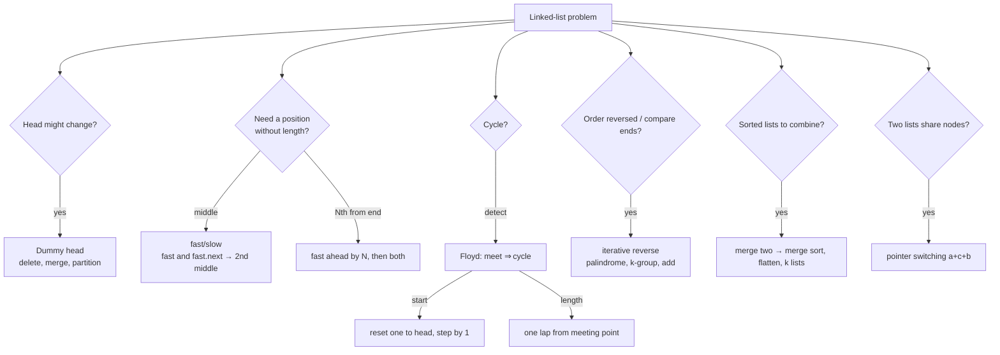

# Part 19: Linked List

← [Striver course map](../README.md)

> [!abstract] What this part covers
> **Goal:** Manipulate pointers without losing nodes: traverse, insert and delete in singly and doubly linked lists, then combine five primitives — dummy head, fast/slow pointers, in-place reversal, merge, and pointer switching — to solve every interview linked-list problem in O(1) extra space.
> **Prereqs:** [Basic Recursion](../12-basic-recursion/README.md) · [Arrays](../14-arrays/README.md) **Time:** ~9 h.
> **Outcome:** Solve all 43 problems, write iterative reversal and Floyd's cycle detection from memory, derive the loop-start equation L = kC − d, pick first vs second middle on purpose, and restore any list you modify.

---

## Theory

| # | Lesson | What you get | Source |
|---|---|---|---|
| 1 | [Singly Linked List](01-singly-linked-list.md) | Node anatomy, array vs list, traversal, insert/delete at head/tail/K/value, dummy head, memory and pointer safety | [link](https://takeuforward.org/learning/dsa/introduction-to-singly-linkedlist?category=fundamentals-single-ll&source=strivers-a2z-dsa-sheet) |
| 2 | [Doubly Linked List](02-doubly-linked-list.md) | prev pointer, building from an array, four-link insertion, unlinking a node, reversal by swapping prev/next, when DLL beats SLL | [link](https://takeuforward.org/learning/dsa/introduction-to-doubly-ll?category=fundamentals-doubly-ll&source=strivers-a2z-dsa-sheet) |

Read these first; the problems below apply them.

---

## Problems

| # | Problem | Difficulty | Key insight | Optimal | Source |
|---|---|---|---|---|---|
| | **Singly linked list — fundamentals** | | | | |
| 3 | [Traversal in Linked List](03-traversal-in-linked-list.md) | Easy | Copy the head into a moving pointer `cur` and advance `cur = cur.next` until it is null. Never advance `head` itself if the caller still needs it. | O(n) | [link](https://takeuforward.org/learning/dsa/traversal-in-linked-list?category=fundamentals-single-ll&source=strivers-a2z-dsa-sheet) |
| 4 | [Deletion of the Head of LL](04-deletion-of-the-head-of-ll.md) | Easy | The new head is `head.next`. In C++ free the old node; in Java/Python it is garbage-collected once unreferenced. | O(1) | [link](https://takeuforward.org/learning/dsa/deletion-of-the-head-of-ll?category=fundamentals-single-ll&source=strivers-a2z-dsa-sheet) |
| 5 | [Deletion of the Tail of LL](05-deletion-of-the-tail-of-ll.md) | Easy | Stop at the **second-to-last** node (`cur.next.next == null`) and set `cur.next = null`. Lists of length 0 or 1 become empty. | O(n) | [link](https://takeuforward.org/learning/dsa/deletion-of-the-tail-of-ll?category=fundamentals-single-ll&source=strivers-a2z-dsa-sheet) |
| 6 | [Deletion of the Kth Element of LL](06-deletion-of-the-kth-element-of-ll.md) | Easy | `k = 1` is the head case. Otherwise walk with `prev` to node `k − 1` and bypass: `prev.next = prev.next.next`. A dummy node removes the special case. | O(k) | [link](https://takeuforward.org/learning/dsa/deletion-of-the-kth-element-of-ll?category=fundamentals-single-ll&source=strivers-a2z-dsa-sheet) |
| 7 | [Delete the Element with Value X](07-delete-the-element-with-value-x.md) | Easy | Same bypass as deleting by position, but the stop condition is `prev.next.val == x`. A dummy node covers the case where the head holds `x`. | O(n) | [link](https://takeuforward.org/learning/dsa/delete-the-element-with-value-x?category=fundamentals-single-ll&source=strivers-a2z-dsa-sheet) |
| 8 | [Insertion at the Head of LL](08-insertion-at-the-head-of-ll.md) | Easy | `return new Node(x, head)` — one allocation, one pointer. Works for an empty list too. | O(1) | [link](https://takeuforward.org/learning/dsa/insertion-at-the-head-of-ll?category=fundamentals-single-ll&source=strivers-a2z-dsa-sheet) |
| 9 | [Insertion at the Tail of LL](09-insertion-at-the-tail-of-ll.md) | Easy | Walk to the node whose `next` is null and hang the new node there. Empty list → the new node is the head. A stored tail pointer makes it O(1). | O(n) | [link](https://takeuforward.org/learning/dsa/insertion-at-the-tail-of-ll?category=fundamentals-single-ll&source=strivers-a2z-dsa-sheet) |
| 10 | [Insertion at the Kth Position of LL](10-insertion-at-the-kth-position-of-ll.md) | Easy | Reach node `k − 1` (the predecessor) and splice: `node.next = prev.next; prev.next = node`. From a dummy, that's `k − 1` steps; `k = 1` is not special. | O(k) | [link](https://takeuforward.org/learning/dsa/insertion-at-the-kth-position-of-ll?category=fundamentals-single-ll&source=strivers-a2z-dsa-sheet) |
| 11 | [Insertion Before the Value X in LL](11-insertion-before-the-value-x-in-ll.md) | Easy | Search with the predecessor: stop when `prev.next.val == x`, then splice. From a dummy, `x` at the head needs no special case. | O(n) | [link](https://takeuforward.org/learning/dsa/insertion-before-the-value-x-in-ll?category=fundamentals-single-ll&source=strivers-a2z-dsa-sheet) |
| 12 | [Find the Length of the Linked List](12-find-the-length-of-the-linked-list.md) | Easy | Traverse and count. Many medium problems (rotate, remove n-th from end, intersection) start with this pass. | O(n) | [link](https://takeuforward.org/learning/dsa/find-the-length-of-the-linked-list?category=fundamentals-single-ll&source=strivers-a2z-dsa-sheet) |
| 13 | [Search in Linked List](13-search-in-linked-list.md) | Easy | Linear scan with early exit. No binary search on linked lists, even sorted ones — there's no O(1) access to the middle. | O(n) | [link](https://takeuforward.org/learning/dsa/search-in-linked-list?category=fundamentals-single-ll&source=strivers-a2z-dsa-sheet) |
| | **Doubly linked list — fundamentals** | | | | |
| 14 | [Convert Array to DLL](14-convert-array-to-dll.md) | Easy | Keep a `tail`; each new node gets `prev = tail`, then `tail.next = node; tail = node`. Two links per node, both set at creation. | O(n) | [link](https://takeuforward.org/learning/dsa/convert-array-to-dll?category=fundamentals-doubly-ll&source=strivers-a2z-dsa-sheet) |
| 15 | [Delete Head of DLL](15-delete-head-of-dll.md) | Easy | `head = head.next`, then **clear the new head's `prev`** — the step singly lists don't have. | O(1) | [link](https://takeuforward.org/learning/dsa/delete-head-of-dll?category=fundamentals-doubly-ll&source=strivers-a2z-dsa-sheet) |
| 16 | [Delete Tail of DLL](16-delete-tail-of-dll.md) | Easy | Walk to the tail itself (not its predecessor — `tail.prev` gives that), then `tail.prev.next = null`. | O(n) | [link](https://takeuforward.org/learning/dsa/delete-tail-of-dll?category=fundamentals-doubly-ll&source=strivers-a2z-dsa-sheet) |
| 17 | [Delete Kth Element of DLL](17-delete-kth-element-of-dll.md) | Easy | Walk **to** the k-th node (no predecessor needed). Then four cases by whether `prev`/`next` are null: only, head, tail, middle. Middle: `prev.next = next; next.prev = prev`. | O(k) | [link](https://takeuforward.org/learning/dsa/delete-kth-element-of-dll?category=fundamentals-doubly-ll&source=strivers-a2z-dsa-sheet) |
| 18 | [Removing Given Node in DLL](18-removing-given-node-in-dll.md) | Easy | A DLL node knows both neighbours, so no head and no walk are needed: `node.prev.next = node.next`, and if `node.next` exists, `node.next.prev = node.prev`. O(1). | O(1) | [link](https://takeuforward.org/learning/dsa/removing-given-node-in-dll?category=fundamentals-doubly-ll&source=strivers-a2z-dsa-sheet) |
| 19 | [Insert Node Before Head in DLL](19-insert-node-before-head-in-dll.md) | Easy | `node = Node(x, next = head)`; then `head.prev = node` if head exists. Two links instead of one. | O(1) | [link](https://takeuforward.org/learning/dsa/insert-node-before-head-in-dll?category=fundamentals-doubly-ll&source=strivers-a2z-dsa-sheet) |
| 20 | [Insert Node Before Tail in DLL](20-insert-node-before-tail-in-dll.md) | Easy | Walk to the tail; then the generic "insert before node `t`": `node = Node(x, next = t, prev = t.prev)`, `t.prev.next = node` (or new head), `t.prev = node`. | O(n) | [link](https://takeuforward.org/learning/dsa/insert-node-before-tail-in-dll?category=fundamentals-doubly-ll&source=strivers-a2z-dsa-sheet) |
| 21 | [Insert Node Before Kth Node in DLL](21-insert-node-before-kth-node-in-dll.md) | Easy | Walk to the k-th node `t`, then the same insert-before-`t` primitive. `k = 1` is the `t.prev == null` branch. | O(k) | [link](https://takeuforward.org/learning/dsa/insert-node-before-kth-node-in-dll?category=fundamentals-doubly-ll&source=strivers-a2z-dsa-sheet) |
| 22 | [Insert Before Given Node in DLL](22-insert-before-given-node-in-dll.md) | Easy | No head needed: `node.prev` exists (not the head), so `p = node.prev; new = Node(x, next = node, prev = p); p.next = new; node.prev = new`. O(1). | O(1) | [link](https://takeuforward.org/learning/dsa/insert-before-given-node-in-dll?category=fundamentals-doubly-ll&source=strivers-a2z-dsa-sheet) |
| 23 | [Reverse a Doubly Linked List](23-reverse-a-doubly-linked-list.md) | Easy | Swap `prev` and `next` in every node. After the swap, the old `next` is in `prev`, so advance with `cur = cur.prev`. The last node visited is the new head. | O(n) | [link](https://takeuforward.org/learning/dsa/reverse-a-doubly-linked-list?category=fundamentals-doubly-ll&source=strivers-a2z-dsa-sheet) |
| | **Logic building** | | | | |
| 24 | [Add Two Numbers in LL](24-add-two-numbers-in-ll.md) | Medium | Grade-school addition read left to right: `s = d1 + d2 + carry`, emit `s % 10`, carry `s // 10`. Loop while **either list or the carry** remains. | O(max(m, n)) | [link](https://takeuforward.org/learning/dsa/add-two-numbers-in-ll?category=logic-building&source=strivers-a2z-dsa-sheet) |
| 25 | [Segregate Odd and Even Nodes in LL](25-segregate-odd-and-even-nodes-in-ll.md) | Medium | Two chains woven out of one list: `odd.next = even.next; odd = odd.next; even.next = odd.next; even = even.next`. Remember `evenHead` and attach it after the last odd. | O(n) | [link](https://takeuforward.org/learning/dsa/segregate-odd-and-even-nodes-in-ll?category=logic-building&source=strivers-a2z-dsa-sheet) |
| 26 | [Sort a LL of 0's, 1's and 2's](26-sort-a-ll-of-0-s-1-s-and-2-s.md) | Medium | Three dummy-headed chains (zeros, ones, twos); append each node to its chain, then join `zero → one → two`. Join carefully: if the ones chain is empty, zeros link straight to twos. | O(n) | [link](https://takeuforward.org/learning/dsa/sort-a-ll-of-0's-1's-and-2's?category=logic-building&source=strivers-a2z-dsa-sheet) |
| 27 | [Remove Nth Node from the Back of the LL](27-remove-nth-node-from-the-back-of-the-ll.md) | Medium | Gap of n between two pointers: move `fast` n steps ahead, then move both until `fast.next` is null — `slow` is the predecessor. Starting both at a dummy covers deleting the head. | O(n) | [link](https://takeuforward.org/learning/dsa/remove-nth-node-from-the-back-of-the-ll?category=logic-building&source=strivers-a2z-dsa-sheet) |
| 28 | [Reverse a LL](28-reverse-a-ll.md) | Easy | Three pointers: save `nxt = cur.next`, flip `cur.next = prev`, advance `prev = cur; cur = nxt`. `prev` ends on the new head. Recursive: reverse the rest, then `head.next.next = head; head.next = null`. | O(n) | [link](https://takeuforward.org/learning/dsa/reverse-a-ll?category=logic-building&source=strivers-a2z-dsa-sheet) |
| | **FAQs (Medium)** | | | | |
| 29 | [Add One to a Number Represented by LL](29-add-one-to-a-number-represented-by-ll.md) | Medium | The carry starts at the **tail** but the list only goes forward. Either reverse → add → reverse, or recurse to the end and return the carry upward. All-9s needs a new head. | O(n) | [link](https://takeuforward.org/learning/dsa/add-one-to-a-number-represented-by-ll?category=faqs--medium&source=strivers-a2z-dsa-sheet) |
| 30 | [Find Middle of Linked List](30-find-middle-of-linked-list.md) | Easy | Tortoise and hare: slow moves 1, fast moves 2; when fast can't move, slow is at the middle. `while fast and fast.next` → second middle; `while fast.next and fast.next.next` → first middle. | O(n) | [link](https://takeuforward.org/learning/dsa/find-middle-of-linked-list?category=faqs--medium&source=strivers-a2z-dsa-sheet) |
| 31 | [Delete the Middle Node in LL](31-delete-the-middle-node-in-ll.md) | Medium | You need the node **before** the middle. Give fast a head start: `slow = head, fast = head.next.next`, loop `while fast and fast.next` — slow stops on the predecessor. | O(n) | [link](https://takeuforward.org/learning/dsa/delete-the-middle-node-in-ll?category=faqs--medium&source=strivers-a2z-dsa-sheet) |
| 32 | [Check if LL is Palindrome or Not](32-check-if-ll-is-palindrome-or-not.md) | Medium | Find the middle, reverse the second half, compare the halves node by node, then (politely) reverse it back. Combines the two core primitives. | O(n) | [link](https://takeuforward.org/learning/dsa/check-if-ll-is-palindrome-or-not?category=faqs--medium&source=strivers-a2z-dsa-sheet) |
| 33 | [Find the Intersection Point of Y LL](33-find-the-intersection-point-of-y-ll.md) | Easy | Two pointers that switch to the other list's head on reaching the end each walk `a + c + b` nodes — they meet at the junction (or both reach null together). | O(m + n) | [link](https://takeuforward.org/learning/dsa/find-the-intersection-point-of-y-ll?category=faqs--medium&source=strivers-a2z-dsa-sheet) |
| 34 | [Detect a Loop in LL](34-detect-a-loop-in-ll.md) | Easy | Floyd: slow moves 1, fast moves 2. Inside a cycle the gap shrinks by 1 each step, so they must meet; without a cycle fast reaches null. | O(n) | [link](https://takeuforward.org/learning/dsa/detect-a-loop-in-ll?category=faqs--medium&source=strivers-a2z-dsa-sheet) |
| 35 | [Find the Starting Point in LL](35-find-the-starting-point-in-ll.md) | Medium | After Floyd's meeting, reset one pointer to head; move both one step at a time — they meet at the loop start. Because `L = kC − d`: the head-to-start distance equals the meeting-point-to-start distance modulo the cycle. | O(n) | [link](https://takeuforward.org/learning/dsa/find-the-starting-point-in-ll?category=faqs--medium&source=strivers-a2z-dsa-sheet) |
| 36 | [Length of Loop in LL](36-length-of-loop-in-ll.md) | Easy | Floyd's meeting point is inside the cycle; keep one pointer there and walk the other around until it returns, counting steps. | O(n) | [link](https://takeuforward.org/learning/dsa/length-of-loop-in-ll?category=faqs--medium&source=strivers-a2z-dsa-sheet) |
| | **FAQs (Hard)** | | | | |
| 37 | [Reverse LL in Group of Given Size K](37-reverse-ll-in-group-of-given-size-k.md) | Hard | Loop: find the k-th node from the current group start (null → stop). Detach the group, reverse it, then reconnect: previous group's tail → new head, old head (now tail) → next group. Track `prev_tail`. | O(n) | [link](https://takeuforward.org/learning/dsa/reverse-ll-in-group-of-given-size-k?category=faqs--hard&source=strivers-a2z-dsa-sheet) |
| 38 | [Rotate a LL](38-rotate-a-ll.md) | Medium | k %= n. Make it a ring (tail.next = head), walk to the new tail at index n − k − 1, cut after it. Never rotate k times one step at a time. | O(n) | [link](https://takeuforward.org/learning/dsa/rotate-a-ll?category=faqs--hard&source=strivers-a2z-dsa-sheet) |
| 39 | [Merge Two Sorted Lists](39-merge-two-sorted-lists.md) | Easy | Dummy node + tail pointer; attach the smaller head each step; attach the leftover list in one go at the end. | O(n+m) | [link](https://takeuforward.org/learning/dsa/merge-sorted-lists-?category=faqs--hard&source=strivers-a2z-dsa-sheet) |
| 40 | [Flattening of LL](40-flattening-of-ll.md) | Hard | It's merge-k-sorted-lists on the `child` pointer. Recursively flatten `head.next`, then merge it with `head`'s column — or pour all heads into a min-heap. | O(N · k) | [link](https://takeuforward.org/learning/dsa/flattening-of-ll?category=faqs--hard&source=strivers-a2z-dsa-sheet) |
| 41 | [Sort LL](41-sort-ll.md) | Medium | Merge sort is the natural fit: split at the **first** middle (fast/slow), sort halves recursively, merge. No random access needed, and merging lists needs no extra array. | O(n log n) | [link](https://takeuforward.org/learning/dsa/sort-ll?category=faqs--hard&source=strivers-a2z-dsa-sheet) |
| 42 | [Clone a LL with Random and Next Pointer](42-clone-a-ll-with-random-and-next-pointer.md) | Medium | The hard part is mapping old → new for `random`. Hash map does it in O(n) space; **interleaving** (A→A'→B→B'…) makes `old.next` the map, so `old.next.random = old.random.next` — then unweave. | O(n) | [link](https://takeuforward.org/learning/dsa/clone-a-ll-with-random-and-next-pointer?category=faqs--hard&source=strivers-a2z-dsa-sheet) |
| | **FAQs (DLL)** | | | | |
| 43 | [Delete All Occurrences of a Key in DLL](43-delete-all-occurrences-of-a-key-in-dll.md) | Medium | With `prev` available, deleting a node is local: `prev.next = nxt`, `nxt.prev = prev`. Only special case: deleting the head moves `head`. | O(n) | [link](https://takeuforward.org/learning/dsa/delete-all-occurrences-of-a-key-in-dll?category=faqs--dll&source=strivers-a2z-dsa-sheet) |
| 44 | [Remove Duplicates from Sorted DLL](44-remove-duplicates-from-sorted-dll.md) | Medium | Duplicates are adjacent. For each kept node, skip forward over equal values to `nxt`, then link `cur.next = nxt` and `nxt.prev = cur`. | O(n) | [link](https://takeuforward.org/learning/dsa/remove-duplicated-from-sorted-dll?category=faqs--dll&source=strivers-a2z-dsa-sheet) |
| 45 | [Find Pairs with Given Sum in DLL](45-find-pairs-with-given-sum-in-dll.md) | Medium | Two pointers from both ends — exactly the sorted-array 2-sum — because a DLL can walk backward. Stop when the pointers meet or cross. | O(n) | [link](https://takeuforward.org/learning/dsa/find-pairs-with-given-sum-in-doubly-linked-list?category=faqs--dll&source=strivers-a2z-dsa-sheet) |

---

## Which linked-list primitive?

---

## Part 19 cheat sheet

| Problem | Primitive | Time / Space |
|---|---|---|
| Insert / delete head, tail, K, value | walk to predecessor | O(n) / O(1) |
| DLL delete node / insert before node | fix 2 / 4 links | O(1) / O(1) |
| Reverse SLL / DLL | 3-pointer / swap prev-next | O(n) / O(1) |
| Add two numbers | dummy + carry | O(max) / O(1) |
| Odd-even list, sort 0/1/2 | separate chains, stitch | O(n) / O(1) |
| Remove Nth from end | gap of N | O(n) / O(1) |
| Add one | rightmost non-9 / recursion | O(n) / O(1) |
| Middle / delete middle | fast/slow (head start for delete) | O(n) / O(1) |
| Palindrome | middle + reverse half + restore | O(n) / O(1) |
| Y intersection | pointer switching | O(m+n) / O(1) |
| Detect / start / length of loop | Floyd | O(n) / O(1) |
| Reverse in k-groups | detach, reverse, reconnect | O(n) / O(1) |
| Rotate | k mod n, ring, cut | O(n) / O(1) |
| Merge two sorted | dummy + splice | O(n+m) / O(1) |
| Flatten | merge along child | O(N·k) / O(k) |
| Sort list | merge sort, first middle | O(n log n) / O(log n) |
| Clone with random | interleave copies | O(n) / O(1) extra |
| DLL: delete key, dedupe, pair sum | unlink / skip run / two ends | O(n) / O(1) |

**Facts interviewers test:** use a dummy head whenever the head can change. `while fast and fast.next` gives the second middle; start `fast = head.next` for the first. Floyd's loop start comes from L = kC − d. Pointer switching terminates because both walk m + n. Save `next` before relinking. Restore input lists you temporarily modify (palindrome, clone).

---

## Mastery checklist

- [ ] Write insert/delete at head, tail and position K for SLL and DLL without a null dereference
- [ ] Reverse a list iteratively and recursively; reverse a DLL by swapping prev/next
- [ ] Pick first vs second middle with the right loop condition
- [ ] Remove Nth from end in one pass with a dummy head
- [ ] Derive and code Floyd's loop start (L = kC − d) and loop length
- [ ] Explain why pointer switching meets at the intersection or at null
- [ ] Reverse in k-groups naming temp / kth / nxt / prevTail
- [ ] Merge sort a list and explain why fast starts at head.next
- [ ] Clone a random-pointer list with interleaving and restore the original

**Interview track →** [Linked-list deep-dive](../../01-data-structures/07-linked-list.md) · [Linked-list walkthroughs](../../04-practice/data-structures/07-linked-list.md)

Next part → [Bit Manipulation](../20-bit-manipulation/README.md)
