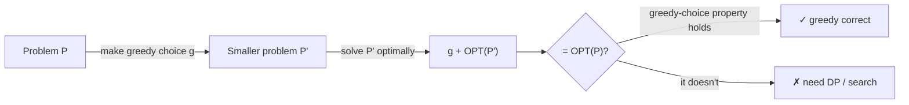
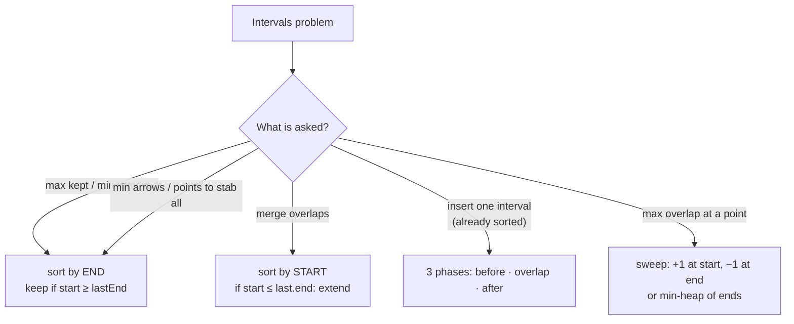

# 1. Greedy Fundamentals

← [Part 21 index](README.md) · Next → [Assign Cookies](02-assign-cookies.md)

> [!abstract] What this covers
> **Core idea:** A greedy algorithm makes the choice that looks best right now and never undoes it. That works only when one locally best choice is always part of *some* optimal solution. The skill is not writing the loop, which is usually five lines. The skill is picking the right ordering (the sort key) and showing in two sentences that it can't lose.
> **You'll be able to:** state the greedy-choice property and optimal substructure; prove a greedy with an exchange argument or a stays-ahead argument; break a wrong greedy with a 3-element counterexample; pick the sort key for interval, scheduling and ratio problems; decide between greedy and DP in under a minute.
> **Source:** add-on theory for the [Striver greedy section](https://takeuforward.org/learning/dsa/assign-cookies?category=easy&source=strivers-a2z-dsa-sheet) · **Time:** 45 min

**Sections:** [1. What makes greedy correct](#1-what-makes-greedy-correct) · [2. Exchange argument](#2-exchange-argument) · [3. Greedy stays ahead](#3-greedy-stays-ahead) · [4. When greedy fails](#4-when-greedy-fails) · [5. Choosing the sort key](#5-choosing-the-sort-key) · [6. Interval patterns](#6-interval-patterns) · [7. Greedy vs DP](#7-greedy-vs-dp) · [8. Interview workflow](#8-interview-workflow) · [Common mistakes](#common-mistakes) · [Practice](#practice) · [Key terms](#key-terms) · [Flashcards](#flashcards)

---

## 1. What makes greedy correct

A greedy algorithm is correct when two properties both hold:

| Property | Meaning | Also needed by DP? |
|---|---|---|
| **Optimal substructure** | An optimal solution contains optimal solutions to its subproblems | ✓ |
| **Greedy-choice property** | Some optimal solution starts with the locally best choice, so committing to it loses nothing | ✗ (this is what greedy adds) |



DP keeps every candidate choice and takes the best one. Greedy keeps only one, so it needs proof that the discarded choices could never have done better. Every proof below has the same shape: take any optimal solution, change it step by step into the greedy one, and show it never gets worse.

---

## 2. Exchange argument

**Template:** let OPT be an optimal solution that differs from greedy G. Find the first point where they differ. **Swap** OPT's choice there for G's choice, and show the result is still valid and no worse. Repeat until OPT equals G.

**Example: Shortest Job First minimises total waiting time.**
Suppose an optimal order puts job `a` directly before job `b`, with `t_a > t_b` (an inversion). Swap them:
- Jobs before and after this pair keep the same waiting time.
- Before the swap the pair adds `t_a` of waiting (b waits for a). After it, the pair adds `t_b`.
- The change is `t_b − t_a < 0`, so the total strictly drops.

So an optimal order has no inversions, which means it is sorted ascending. ∎

**Example: Assign Cookies (sort both, give each child the smallest cookie that fits).**
If OPT gives child `c` a bigger cookie `y` while the smallest fitting cookie `x` goes to someone else or to no one, swap `x` and `y`. Child `c` is still satisfied by `x`. Whoever held `x` can also take `y`, because `y ≥ x`. The count is unchanged. ∎

**Adjacent swaps for sorting rules.** To find "sort by what?", compare two neighbours `i, j` and ask which order is better. The condition you derive is the comparator:

| Problem | Compare `i` before `j` vs `j` before `i` | Comparator |
|---|---|---|
| Min total waiting | `t_i` vs `t_j` | `t` ascending |
| Min weighted completion `Σ w·C` | `t_i·w_j` vs `t_j·w_i` | `t/w` ascending (Smith's rule) |
| Largest number from digits (LC 179) | `i+j` vs `j+i` as strings | `a+b > b+a` |
| Fractional knapsack | value per unit weight | `v/w` descending |

---

## 3. Greedy stays ahead

**Template:** index the greedy's choices `g1, g2, …` and the optimal's `o1, o2, …`. Define a measure, then prove by induction that after `k` steps greedy is **at least as far along** as OPT. If OPT had more choices, greedy would have had room for one more too, which contradicts greedy stopping.

**Example: Activity selection (N meetings), sort by end time.**
- Measure: `end(g_k) ≤ end(o_k)` for every k.
- Base case: `g1` has the earliest end of all meetings, so `end(g1) ≤ end(o1)`.
- Step: `o_{k+1}` starts after `end(o_k) ≥ end(g_k)`, so `o_{k+1}` was still available to greedy at step k+1. Greedy takes the earliest-ending available meeting, so `end(g_{k+1}) ≤ end(o_{k+1})`.
- If OPT had m+1 meetings and greedy only m, then `o_{m+1}` starts after `end(o_m) ≥ end(g_m)`. Greedy would have taken it, a contradiction. ∎

**Example: Jump Game I.** Invariant: after scanning index `i`, `reach = max(j + nums[j]) over j ≤ i` is the farthest index reachable from the start. If `i > reach` at any point, index `i` is unreachable, and so is everything after it.

---

## 4. When greedy fails

**Always try to break your greedy on a 3-element input before you code it.**

**0/1 knapsack.** `val = [60, 100, 120]`, `wt = [10, 20, 30]`, `W = 50`. The ratios are 6, 5, 4.

| Strategy | Takes | Value |
|---|---|---|
| Greedy by ratio (0/1) | items 1, 2 (wt 30); item 3 doesn't fit | **160** |
| Optimal (0/1) | items 2, 3 (wt 50) | **220** |
| Greedy by ratio (fractional) | items 1, 2 + ⅔ of item 3 | 240 ✓ optimal |

The ratio greedy is correct only when items can be split. Without splitting, filling the remaining capacity well depends on which combination of items you take, so this is a DP problem.

**Coin change with arbitrary denominations.** Coins `{1, 3, 4}`, target `6`:
- Largest-first greedy: `4 + 1 + 1`, 3 coins.
- Optimal: `3 + 3`, 2 coins.

Largest-first works for **canonical** systems such as `{1, 2, 5, 10, 20, 50, 100, 200, 500, 2000}` (Indian currency) and US coins. In an interview, assume it doesn't work unless the problem says the system is canonical. The safe solution is DP (`coins[]`, unbounded knapsack).

**Other classic traps:**

| Looks greedy | Why it fails | Use |
|---|---|---|
| Weighted interval scheduling | Earliest end ignores weights | DP + binary search on ends |
| Longest path in a graph | Locally longest edge leads into a dead end | DP on DAG / NP-hard in general |
| Max subset sum ≤ K | Largest-first overshoots the target | DP subset sum |
| Activity selection sorted by **start** or **duration** | A long early meeting / a short meeting overlapping two others | Sort by **end** |
| Min jumps "always jump the max" | A big jump can land on a 0 | BFS windows (Jump Game II) |

**Counterexamples for the wrong interval keys:**
- Sort by start: `[1,10], [2,3], [4,5]` → greedy picks 1 meeting, optimal is 2.
- Sort by duration: `[1,5], [4,7], [6,10]` → greedy takes `[4,7]` (the shortest) and blocks both others. Greedy gets 1, optimal is 2.

---

## 5. Choosing the sort key

Most greedy problems are "sort by the right thing, then one pass". Match on what the problem *optimises*:

| Signal in the problem | Sort key | Then |
|---|---|---|
| Maximise count of non-overlapping things | **end** ascending | take if compatible with last kept |
| Merge / union / cover | **start** ascending | extend the last block |
| Min resources running at once (rooms, platforms) | starts and ends separately | sweep; answer = max active |
| Value per unit, splittable | **ratio** descending | take whole items, split the last |
| Minimise sum of completion/waiting times | **duration** ascending | prefix sums |
| Unit-time jobs with deadlines, max profit | **profit** descending | place each in latest free slot ≤ deadline |
| Same, alternative | **deadline** ascending | min-heap of profits; pop when size > deadline |
| Match items to capacities | **both** ascending | two pointers |
| Pair largest with smallest (boats, min max-pair sum) | ascending | two pointers from both ends |
| Concatenation order | custom `a+b` vs `b+a` | join |

**Tie-breaks matter.** For non-overlapping intervals with closed ends, `[1,2]` and `[2,3]` overlap if touching counts. Decide `>` vs `≥` from the statement before you code. N Meetings uses strict `start > lastEnd`. Non-overlapping Intervals (LC 435) uses `start ≥ lastEnd`.

---

## 6. Interval patterns



**Sort by end: max non-overlapping (and min removals = n − kept).**

```python
def max_non_overlapping(iv):
    iv.sort(key=lambda x: x[1])
    kept, last_end = 0, float("-inf")
    for s, e in iv:
        if s >= last_end:          # touching allowed; use > if not
            kept += 1
            last_end = e
    return kept
```

```cpp
int maxNonOverlapping(vector<vector<int>>& iv) {
    sort(iv.begin(), iv.end(), [](auto& a, auto& b) { return a[1] < b[1]; });
    int kept = 0; long long lastEnd = LLONG_MIN;
    for (auto& v : iv)
        if (v[0] >= lastEnd) { kept++; lastEnd = v[1]; }
    return kept;
}
```

```java
static int maxNonOverlapping(int[][] iv) {
    Arrays.sort(iv, (a, b) -> Integer.compare(a[1], b[1]));
    int kept = 0; long lastEnd = Long.MIN_VALUE;
    for (int[] v : iv)
        if (v[0] >= lastEnd) { kept++; lastEnd = v[1]; }
    return kept;
}
```

**Sort by start: merge.**

```python
def merge(iv):
    iv.sort()
    out = []
    for s, e in iv:
        if out and s <= out[-1][1]:
            out[-1][1] = max(out[-1][1], e)   # max: a contained interval mustn't shrink it
        else:
            out.append([s, e])
    return out
```

**Sweep: max concurrent (min platforms / meeting rooms).**

```python
def max_concurrent(starts, ends):
    starts, ends = sorted(starts), sorted(ends)
    i = j = cur = best = 0
    while i < len(starts):
        if starts[i] <= ends[j]:   # <= : an arrival at the same time as a departure needs a new platform
            cur += 1; i += 1
            best = max(best, cur)
        else:
            cur -= 1; j += 1
    return best
```

Why sorting starts and ends **independently** is fine: the answer only depends on how many intervals are active at each moment, not on which interval each start belongs to.

| Pattern | Sort | Time | Space |
|---|---|---|---|
| Max non-overlapping / min removals / min arrows | end | O(n log n) | O(1) extra |
| Merge | start | O(n log n) | O(n) output |
| Insert (input sorted) | none | O(n) | O(n) |
| Max concurrent | starts, ends | O(n log n) | O(n) |

---

## 7. Greedy vs DP

| Question to ask | Points to greedy | Points to DP |
|---|---|---|
| Can I split items? | yes (fractional) | no (0/1) |
| Does a 3-element brute force agree with my rule? | always | finds a counterexample |
| Do future choices depend on *which* earlier choice I made, or only on a scalar (end time, reach)? | scalar | full state |
| Can I write an exchange / stays-ahead proof in two sentences? | yes | no |
| Problem says "count the ways" | — | almost always DP |
| Weights / values attached to intervals | — | DP |
| Constraints n ≤ 10⁵–10⁶ | O(n log n) greedy likely | DP must be O(n) or O(n log n) |
| Constraints n ≤ 100–1000 with a capacity W | — | O(n·W) DP likely |

**Rule of thumb:** greedy is the special case where the DP's `max` over choices always picks the same option, so you can drop the table. If you can't see why it always picks the same option, write the DP.

---

## 8. Interview workflow

1. **Name the candidate rule** out loud: "sort by end, take if it fits".
2. **Attack it** with 2–3 tiny inputs, including ties and a long-vs-short item.
3. **Give the proof in one or two sentences**: exchange ("swapping in the greedy choice never hurts") or stays-ahead ("greedy's k-th end ≤ any solution's k-th end").
4. **Code** the sort and the single pass. Check the boundary comparison (`>` vs `≥`).
5. **Complexity**: usually O(n log n) for the sort, then O(n).
6. **Follow-up readiness**: weighted version (→ DP), streaming input (→ heap), and online arrivals (→ the greedy usually doesn't change, but you can no longer sort up front).

---

## Common mistakes

- Picking the sort key by intuition (start or duration) instead of testing it. End time is the usual answer for max-count interval problems.
- Using `>` where the problem allows touching intervals, or `≥` where it doesn't.
- Merging with `last.end = e` instead of `max(last.end, e)`, which shrinks a block when the new interval sits inside it.
- Applying the ratio greedy to 0/1 knapsack, or largest-first to arbitrary coin systems.
- Sorting with a comparator that isn't a strict weak ordering. In C++ `<=` in a comparator is undefined behaviour.
- Integer overflow in ratio comparisons. Compare `v1 * w2` vs `v2 * w1` in `long long` instead of comparing doubles when exactness matters.
- Forgetting that greedy decisions are final. If the solution needs "undo", the problem is not greedy, or it needs a heap to swap out an earlier pick (as in Job Sequencing and Course Schedule III).

## Practice

1. Give a counterexample to "activity selection, sort by fewest overlaps with other intervals".
2. Minimum arrows to burst balloons (LC 452): which sort key, and why is it the same answer as max non-overlapping?
3. Prove that "two passes, take the max" gives the minimum total candies.
4. Gas Station (LC 134): why does resetting the start to `i + 1` whenever the tank goes negative work?
5. Coins `{1, 5, 6, 9}`, target 11. Does largest-first work?

<details><summary>Answer sketches</summary>

1. Use `[1,4] [5,8] [9,12] [13,16]` (the optimum, 4 intervals), plus `B = [7,10]`, three copies of `[3,6]` and three copies of `[11,14]`. B overlaps only 2 intervals, the fewest of any. Picking it removes `[5,8]` and `[9,12]`, so greedy can reach at most 3. "Fewest overlaps" has no exchange proof, which is why a counterexample exists.
2. Sort by end. Shoot at the first end, which bursts every balloon that starts at or before it. The next arrow goes at the next balloon that starts after it. Arrows = number of greedy-kept intervals with touching counted as overlap (`start > lastEnd` starts a new arrow).
3. The left pass gives the minimum each child needs to satisfy its left-neighbour constraint, and the right pass does the same for the right neighbour. Any valid assignment must meet both lower bounds, so it must give each child at least the max of the two. The max also satisfies both constraints, so it is optimal.
4. If the running tank from start `s` goes negative at `i`, then every start between `s` and `i` reaches `i` with no more gas than starting at `s` did, because each prefix of a feasible run had a non-negative tank. So none of them can pass `i`. If total gas ≥ total cost, the last reset point works.
5. No: greedy gives `9 + 1 + 1` (3 coins), optimal is `5 + 6` (2 coins).

</details>

## Key terms

| Term | Meaning |
|---|---|
| Greedy-choice property | Some optimal solution contains the locally best first choice |
| Optimal substructure | An optimal solution is built from optimal solutions to its subproblems |
| Exchange argument | Transform OPT into greedy by swaps that never make it worse |
| Greedy stays ahead | Inductively show greedy's partial solution is at least as good as OPT's at every step |
| Canonical coin system | Denominations for which largest-first gives the minimum coin count |
| Sweep line | Process sorted start/end events and track how many intervals are active |
| Smith's rule | Order jobs by `time / weight` to minimise weighted completion time |

## Flashcards

**Two properties that make a greedy algorithm correct?** #flashcard
Optimal substructure and the greedy-choice property (some optimal solution begins with the greedy choice).

**Shape of an exchange argument?** #flashcard
Take an optimal solution that differs from greedy; swap its choice for greedy's at the first difference; show the result is valid and no worse; repeat.

**Shape of a stays-ahead argument?** #flashcard
Show by induction that greedy's k-th step is at least as good (e.g. earlier end) as OPT's k-th step, so OPT can't have more steps.

**0/1 knapsack counterexample to the ratio greedy?** #flashcard
val [60,100,120], wt [10,20,30], W 50: greedy 160, optimal 220.

**Coin counterexample to largest-first?** #flashcard
Coins {1,3,4}, target 6: greedy 4+1+1 (3 coins), optimal 3+3 (2 coins).

**Sort key for max non-overlapping intervals?** #flashcard
End time ascending, keep an interval if it starts after (or at) the last kept end.

**Sort key for merging intervals?** #flashcard
Start time ascending; extend the last block with `max(last.end, e)`.

**How do you count min platforms / rooms?** #flashcard
Sort starts and ends separately and sweep; the answer is the max number active at once (or use a min-heap of end times).

**Greedy or DP: weighted interval scheduling?** #flashcard
DP: sort by end, `dp[i] = max(dp[i−1], w_i + dp[last compatible])` with binary search.

**Interview track →** [Greedy deep-dive](../../02-algorithms/16-greedy.md) · [Greedy walkthroughs](../../04-practice/algorithms/16-greedy.md)
