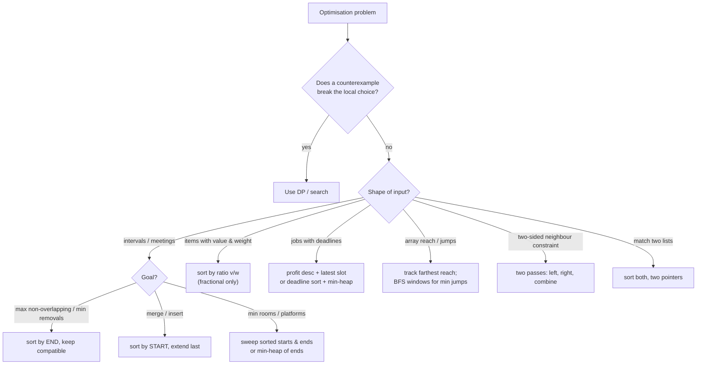

# Part 21: Greedy Algorithms

← [Striver course map](../README.md)

> [!abstract] What this part covers
> **Goal:** Recognise when a locally best choice is globally safe, prove it with an exchange or stay-ahead argument in two sentences, and know the sort key that makes the greedy work, especially for interval and scheduling problems.
> **Prereqs:** [Sorting](../13-sorting/README.md) · [Arrays](../14-arrays/README.md) **Time:** ~6 h.
> **Outcome:** Solve the classic greedy set (cookies, change, fractional knapsack, jump games, SJF, job sequencing, activity selection, interval merge/insert/erase, platforms, wildcard parentheses, candy) in O(n log n) or better, and spot when greedy fails and DP is needed.

---

## Theory

| # | Lesson | What you get | Source |
|---|---|---|---|
| 1 | [Greedy Fundamentals](01-greedy-fundamentals.md) | Greedy-choice property, exchange and stay-ahead proofs, when greedy fails (0/1 knapsack, coin systems), the sort-key decision table, interval patterns | add-on |

Read these first; the problems below apply them.

---

## Problems

| # | Problem | Difficulty | Key insight | Optimal | Source |
|---|---|---|---|---|---|
| | **Easy** | | | | |
| 2 | [Assign Cookies](02-assign-cookies.md) | Easy | Sort both. Give each cookie, smallest first, to the least greedy unsatisfied child it can satisfy — a small cookie that fits the least greedy child is never better spent elsewhere. | O(n log n + m log m) | [link](https://takeuforward.org/learning/dsa/assign-cookies?category=easy&source=strivers-a2z-dsa-sheet) |
| 3 | [Lemonade Change](03-lemonade-change.md) | Easy | Only $5 and $10 bills are useful as change. For $20, prefer giving $10 + $5 over $5 × 3, because $5 bills are strictly more flexible (they're needed for $10 customers too). | O(n) | [link](https://takeuforward.org/learning/dsa/lemonade-change?category=easy&source=strivers-a2z-dsa-sheet) |
| 4 | [Fractional Knapsack](04-fractional-knapsack.md) | Medium | Sort by value per unit weight (`v / w`) descending and take as much as possible of the best ratio. Fractions make the greedy optimal; for 0/1 knapsack it is not (use DP). | O(n log n) | [link](https://takeuforward.org/learning/dsa/fractional-knapsack?category=easy&source=strivers-a2z-dsa-sheet) |
| 5 | [Jump Game I](05-jump-game-i.md) | Medium | Track the farthest index reachable so far. If you ever stand at an index beyond it, you're stuck; otherwise extend it with `i + nums[i]`. | O(n) | [link](https://takeuforward.org/learning/dsa/jump-game---i?category=easy&source=strivers-a2z-dsa-sheet) |
| | **Scheduling and intervals** | | | | |
| 6 | [Shortest Job First](06-shortest-job-first.md) | Easy | Running shorter jobs first minimises total waiting time — each job's burst is added to the waiting time of every job after it, so the smallest bursts should be counted most often. | O(n log n) | [link](https://takeuforward.org/learning/dsa/shortest-job-first?category=scheduling-and-interval-problems&source=strivers-a2z-dsa-sheet) |
| 7 | [Job Sequencing Problem](07-job-sequencing-problem.md) | Medium | Take jobs by decreasing profit and schedule each in the **latest** free slot ≤ its deadline, keeping earlier slots open for jobs with tighter deadlines. | O(n log n) | [link](https://takeuforward.org/learning/dsa/job-sequencing-problem?category=scheduling-and-interval-problems&source=strivers-a2z-dsa-sheet) |
| 8 | [N Meetings in One Room](08-n-meetings-in-one-room.md) | Easy | Activity selection: always pick the meeting that **ends earliest** among those compatible with what you've chosen — it leaves the most room for the rest. | O(n log n) | [link](https://takeuforward.org/learning/dsa/n-meetings-in-one-room?category=scheduling-and-interval-problems&source=strivers-a2z-dsa-sheet) |
| 9 | [Non-overlapping Intervals](09-non-overlapping-intervals.md) | Medium | Removing the minimum = keeping the maximum non-overlapping set, which is activity selection: sort by end and keep greedily. Answer = n − kept. | O(n log n) | [link](https://takeuforward.org/learning/dsa/non-overlapping-intervals?category=scheduling-and-interval-problems&source=strivers-a2z-dsa-sheet) |
| 10 | [Insert Interval](10-insert-interval.md) | Medium | The list splits into three runs: intervals entirely left of the new one, intervals that overlap it (merge into one by min start / max end), and intervals entirely right. One linear pass. | O(n) | [link](https://takeuforward.org/learning/dsa/insert-interval?category=scheduling-and-interval-problems&source=strivers-a2z-dsa-sheet) |
| 11 | [Merge Intervals](11-merge-intervals.md) | Medium | After sorting by start, overlapping intervals are contiguous. Extend the last output interval while the next one starts ≤ its end; otherwise start a new one. | O(n log n) | [link](https://takeuforward.org/learning/dsa/merge-intervals?category=scheduling-and-interval-problems&source=strivers-a2z-dsa-sheet) |
| 12 | [Minimum Number of Platforms](12-minimum-number-of-platforms.md) | Medium | Answer = maximum number of trains present at the same instant. Sort arrivals and departures separately and sweep: an arrival adds one, a departure frees one. | O(n log n) | [link](https://takeuforward.org/learning/dsa/minimum-number-of-platforms-required-for-a-railway?category=scheduling-and-interval-problems&source=strivers-a2z-dsa-sheet) |
| | **Hard** | | | | |
| 13 | [Valid Parenthesis String](13-valid-parenthesis-string.md) | Medium | Track the **range** `[lo, hi]` of possible open-bracket counts. `(` shifts both up, `)` both down, `*` widens it (`lo − 1`, `hi + 1`). Fail if `hi < 0`; clamp `lo` at 0; valid iff `lo == 0` at the end. | O(n) | [link](https://takeuforward.org/learning/dsa/valid-paranthesis-checker?category=hard&source=strivers-a2z-dsa-sheet) |
| 14 | [Candy](14-candy.md) | Hard | Split the two-sided constraint into two one-sided ones. Left pass enforces the left neighbour, right pass the right neighbour; taking the max of both satisfies both minimally. | O(n) | [link](https://takeuforward.org/learning/dsa/candy?category=hard&source=strivers-a2z-dsa-sheet) |
| 15 | [Jump Game II](15-jump-game-ii.md) | Medium | Implicit BFS: indices reachable in exactly k jumps form a contiguous window. Sweep each window, record the farthest index it can reach — that's the next window. Count windows. | O(n) | [link](https://takeuforward.org/learning/dsa/jump-game-ii?category=hard&source=strivers-a2z-dsa-sheet) |
| | **Extra (A2Z sheet)** | | | | |
| 16 | [Minimum coins (greedy, canonical denominations)](16-minimum-coins-greedy-canonical-denominations.md) | Easy | For **canonical** coin systems like real currencies, always taking the largest coin `≤` the remaining amount is optimal. Greedy is **not** optimal for arbitrary denominations: with {1, 3, 4} and V = 6, greedy gives 4 + 1 + 1, but 3 + 3 is better. In that case use DP (coin change, Part 28). Always state the condition before using greedy. | O(k + answer) | [link](https://takeuforward.org/learning/dsa/find-minimum-number-of-coins?category=easy&source=strivers-a2z-dsa-sheet) |

---

## Which greedy?

---

## Part 21 cheat sheet

| Problem shape | Greedy rule | Proof |
|---|---|---|
| Match demands to supplies | sort both; smallest supply that fits | exchange |
| Max non-overlapping intervals | sort by end; take if start ≥ / > last end | stays ahead |
| Min intervals to remove | n − max non-overlapping | complement |
| Merge intervals | sort by start; extend `last.end = max(...)` | contiguity |
| Min rooms / platforms | max concurrent = sweep events | lower bound met |
| Fractional knapsack | sort by v/w desc | exchange of units |
| Min total waiting (SJF) | sort by duration asc | adjacent swap |
| Deadlines, unit jobs | profit desc, latest free slot | exchange |
| Jump reachability | farthest reach prefix | invariant |
| Min jumps | BFS layers as windows | BFS |
| Neighbour inequalities | left pass + right pass, take max | both lower bounds |
| Wildcard balance | track `[lo, hi]` of balances | interval of states |

**Greedy fails on:** 0/1 knapsack, coin change with arbitrary denominations ({1, 3, 4}, target 6), longest path, weighted interval scheduling. When you can't produce a proof in two sentences, look for a counterexample on 3 elements before committing.

---

## Mastery checklist

- [ ] State the greedy-choice property and optimal substructure
- [ ] Prove a greedy with an exchange argument and with greedy-stays-ahead
- [ ] Give counterexamples for greedy 0/1 knapsack and greedy coin change
- [ ] Choose the right sort key: end time vs start time vs ratio vs duration
- [ ] Solve activity selection, non-overlapping intervals, merge and insert interval
- [ ] Count minimum platforms with a sweep and with a min-heap
- [ ] Solve Jump Game I/II in O(n) and Candy in two passes
- [ ] Solve Valid Parenthesis String with a [lo, hi] balance range

**Interview track →** [Greedy deep-dive](../../02-algorithms/16-greedy.md) · [Greedy walkthroughs](../../04-practice/algorithms/16-greedy.md)

Next part → [Sliding Window / 2 Pointer](../22-sliding-window-and-2-pointer/README.md)
