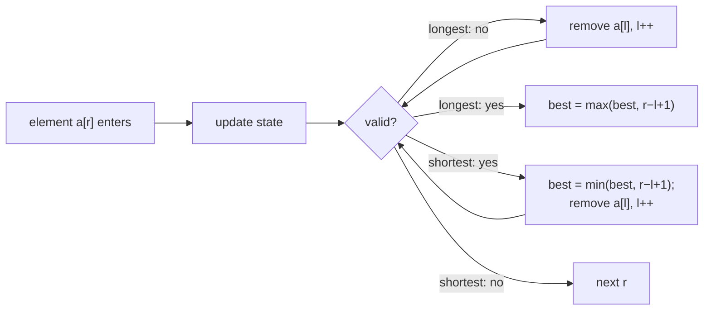

# 1. Sliding Window & Two Pointers: Patterns and Templates

← [Part 22 index](README.md) · Next → [Maximum Points You Can Obtain from Cards](02-maximum-points-you-can-obtain-from-cards.md)

> [!abstract] What this covers
> **Core idea:** Many "best contiguous subarray" questions look O(n²) because there are n² subarrays. A sliding window makes them O(n). It keeps one window `[l, r]` and only ever moves its two ends forward. That's legal only when validity is **monotone**: shrinking a valid window keeps it valid, and growing an invalid one keeps it invalid. Every problem in this part comes down to three steps: define the window state, write the validity rule, and pick one of four templates (fixed, longest, shortest, count).
> **You'll be able to:** recognise a window problem from its wording; write the fixed, longest, shortest and counting templates from memory; justify the O(n) bound; use the non-shrinking trick; count exact-K windows by subtraction; tell when a window fails and prefix sums are needed; tell same-direction windows apart from opposite-end two pointers.
> **Source:** [Striver: Sliding Window & 2 Pointer, Patterns and Template](https://takeuforward.org/learning/dsa/theory?category=pattern-and-template&source=strivers-a2z-dsa-sheet) · **Time:** 50 min

**Sections:** [1. The four problem shapes](#1-the-four-problem-shapes) · [2. Fixed-size window](#2-fixed-size-window) · [3. Variable window: longest](#3-variable-window-longest) · [4. The non-shrinking window](#4-the-non-shrinking-window) · [5. Variable window: shortest](#5-variable-window-shortest) · [6. Counting windows](#6-counting-windows) · [7. When the window breaks](#7-when-the-window-breaks) · [8. Two pointers vs sliding window](#8-two-pointers-vs-sliding-window) · [9. Why it's O(n)](#9-why-its-on) · [Common mistakes](#common-mistakes) · [Practice](#practice) · [Key terms](#key-terms) · [Flashcards](#flashcards)

---

## 1. The four problem shapes

| Shape | Wording cue | Template | Example |
|---|---|---|---|
| **Fixed** | "subarray of size k", "every window of length k" | slide by one: add `a[r]`, drop `a[r−k]` | max sum of size k, Max Points from Cards |
| **Longest** | "longest / maximum length … such that" | expand `r`; **shrink while invalid**; record after shrinking | Longest Unique Substring, Max Ones III |
| **Shortest** | "minimum length / smallest window … containing" | expand `r`; **shrink while valid**; record before each shrink | Minimum Window Substring, Min Size Subarray Sum |
| **Count** | "number of subarrays …" | at-most: `+= r − l + 1`; exact: subtract two at-mosts | Binary Subarrays With Sum, K Different Integers |

The window **state** is whatever lets you test validity in O(1) when one element enters or leaves: a running sum, a count array plus a `distinct` counter, a last-seen index map, or a deficit counter.



---

## 2. Fixed-size window

The window always has `k` elements. Build the first one, then slide: the element at `r` enters and the element at `r − k` leaves.

```python
def max_sum_k(a, k):
    s = sum(a[:k]); best = s
    for r in range(k, len(a)):
        s += a[r] - a[r - k]
        best = max(best, s)
    return best
```

```cpp
long long maxSumK(vector<int>& a, int k) {
    long long s = 0;
    for (int i = 0; i < k; i++) s += a[i];
    long long best = s;
    for (int r = k; r < (int)a.size(); r++) {
        s += a[r] - a[r - k];
        best = max(best, s);
    }
    return best;
}
```

```java
static long maxSumK(int[] a, int k) {
    long s = 0;
    for (int i = 0; i < k; i++) s += a[i];
    long best = s;
    for (int r = k; r < a.length; r++) {
        s += a[r] - a[r - k];
        best = Math.max(best, s);
    }
    return best;
}
```

| Fixed-window state | Needs | Cost per slide |
|---|---|---|
| Sum / average | running sum | O(1) |
| Count of a property (vowels, zeros) | running count | O(1) |
| Anagram / permutation match | 26-count array + "matches" counter | O(1) |
| Maximum / minimum | monotonic deque (Part 23) | O(1) amortised |
| Distinct count | count map + `distinct` | O(1) |
| Median | two heaps with lazy deletion | O(log k) |

**Wrap-around windows.** Max Points from Cards takes `i` cards from the left and `k − i` from the right. Treat it as a fixed window of `k` that wraps around the ends, or as the complement: the untaken cards form a middle window of fixed size `n − k`, and you minimise its sum.

---

## 3. Variable window: longest

```python
def longest(a):
    l = 0; best = 0
    state = init()
    for r in range(len(a)):
        add(state, a[r])
        while not valid(state):
            remove(state, a[l]); l += 1
        best = max(best, r - l + 1)   # [l, r] is valid here
    return best
```

**Invariant:** after the `while`, `[l, r]` is the longest valid window that ends at `r`. That's because `l` only advanced past starts that were invalid for this `r`, and monotonicity says those starts stay invalid for every larger `r`.

| Problem | State | `valid` |
|---|---|---|
| No repeating characters | count per char (or last index) | every count ≤ 1 |
| Max Consecutive Ones III | zeros in window | `zeros ≤ k` |
| Fruit Into Baskets / ≤ K distinct | count map, `distinct` | `distinct ≤ K` |
| Character replacement | counts, `maxFreq` | `len − maxFreq ≤ k` |
| Longest subarray sum ≤ K (non-negative) | running sum | `sum ≤ K` |

**The jump variant.** If the state can tell you exactly where the first valid start is, jump `l` there instead of looping. Longest Unique Substring does this with `l = max(l, last[c] + 1)`. The `max` is required: a last-seen index from before `l` is stale, and on "abba" it would pull `l` backwards.

---

## 4. The non-shrinking window

For a **longest** problem you never need a window shorter than the best one already found. So change `while` to `if`. When the window turns invalid, move `l` by one together with `r`. The window then slides at its current size instead of shrinking.

```python
def longest_nonshrinking(a):
    l = 0
    for r in range(len(a)):
        add(a[r])
        if not valid():
            remove(a[l]); l += 1
    return len(a) - l          # final window size = best size
```

**Why it's correct:** the size `r − l + 1` never decreases. It grows by one exactly when the current window, at its old best size plus one, is valid. So the size at the end equals the largest valid size seen. The window may be invalid at intermediate steps, so **don't read the answer mid-loop** unless you also check validity there.

**When it matters:** it removes the inner loop, and with it the cost of rescanning state on a shrink. Character Replacement benefits most. There, `maxFreq` can stay stale (too high) because a stale value can only stop the window from growing, and it grows only when a truly larger `maxFreq` appears.

---

## 5. Variable window: shortest

```python
def shortest(a):
    l = 0; best = INF
    for r in range(len(a)):
        add(a[r])
        while valid():
            best = min(best, r - l + 1)   # record BEFORE removing a[l]
            remove(a[l]); l += 1
    return best
```

The direction is reversed: here validity must be preserved when the window grows. For example, `sum ≥ target` with non-negative values, or "covers every character of t".

**The `need` counter (Minimum Window Substring).**
- `cnt[c]` holds how many more copies of `c` the window still needs. A negative value means a surplus.
- Adding `c` decreases `need` only if `cnt[c] > 0` before the decrement.
- Removing `c` increases `need` only if `cnt[c] > 0` after the increment.
- The window covers `t` exactly when `need == 0`. That's an O(1) test instead of comparing two maps.

**When order matters**, as in Minimum Window Subsequence, counts are not enough. Use a forward scan to find where a match ends, then a backward scan to find the tightest start for that end.

---

## 6. Counting windows

### 6a. At most K: add `r − l + 1`

After the shrink, every start in `[l, r]` gives a valid subarray ending at `r` (monotonicity again). That's `r − l + 1` subarrays, and summing over `r` counts each valid subarray exactly once, by its right end.

### 6b. Exactly K: subtract

"Exactly K" is **not** monotone. For a fixed `r`, the starts that give exactly K form a band in the middle, not a prefix. Sliding one pointer can't track both ends of that band, so subtract two monotone counts instead:

```
exactly(K) = atMost(K) − atMost(K − 1)       atMost(−1) = 0
```

```python
def exactly(a, K):
    def at_most(k):
        if k < 0: return 0
        l = cnt = 0; state = init()
        for r in range(len(a)):
            add(state, a[r])
            while violates(state, k):
                remove(state, a[l]); l += 1
            cnt += r - l + 1
        return cnt
    return at_most(K) - at_most(K - 1)
```

| Problem | "K" being counted | Reduction |
|---|---|---|
| Binary Subarrays With Sum | sum of 0/1 | direct |
| Count Nice Subarrays | number of odds | `x → x & 1`, then binary sum |
| Subarrays with K Different Integers | distinct values | count map + `distinct` |
| Sum in `[lo, hi]` | sum | `atMost(hi) − atMost(lo − 1)` |

**One-pass alternative:** keep two left pointers, `l1` for "≤ K" and `l2` for "≤ K − 1", and add `l2 − l1` for each `r`.

### 6c. At least: count the complement, or add `n − r`

- **Complement:** `atLeast(K) = total − atMost(K − 1)`, where `total = n(n+1)/2`.
- **Extension:** once `[l, r]` is minimally valid, every extension `[l, r'] ` with `r' ≥ r` is valid too. That's `n − r` subarrays for that start.
- **Last-seen trick:** for "contains all of a set", the subarrays ending at `r` number `1 + min(last[x] for x in set)`.

---

## 7. When the window breaks

The window needs **monotone validity**. If it fails, the window silently gives wrong answers.

| Situation | Why it breaks | Use instead |
|---|---|---|
| Negative numbers with a sum constraint | adding an element can lower the sum, so shrinking can make a window *valid again* | prefix sums + hashmap (exact), prefix sums + monotonic deque (shortest with sum ≥ K, LC 862) |
| Exact-K counting | valid starts form a middle band | atMost subtraction (or prefix sums + hashmap) |
| Order-sensitive containment | counts ignore order | forward/backward scan, or DP |
| Non-contiguous selection (subsequence of choices) | not a window at all | DP / greedy |

Quick test before you write the code: take a valid window and remove its first element. Is it still valid, for every input? If the answer is "not when there are negatives", don't use a window.

---

## 8. Two pointers vs sliding window

| | Sliding window (same direction) | Two pointers (opposite ends) |
|---|---|---|
| Pointers | `l` and `r` both start at 0 and move right | `l = 0`, `r = n − 1`, they move toward each other |
| Precondition | monotone validity over contiguous ranges | usually **sorted** input (or a symmetric structure) |
| Typical questions | longest / shortest / count subarrays | pair or triple sums, container with most water, palindrome checks, partitioning |
| What moves `l` | the window became invalid (or valid, for shortest) | a comparison shows every pair using `l` is useless |
| Proof of correctness | invariant on the best window ending at `r` | each move discards a row or column of the pair matrix |

**Other two-pointer forms:**
- **Fast/slow** pointers in linked lists (Part 19).
- **Read/write** pointers for in-place compaction, e.g. remove duplicates or move zeros (Part 14).
- **Merge** pointers over two sorted arrays (Part 13).

---

## 9. Why it's O(n)

The `while` loop sits inside a `for` loop, but the cost is still linear:
- `r` advances n times, and `l` advances at most n times in total over the whole run, because it never moves back.
- Each element is therefore added once and removed at most once: O(2n) state updates.
- If each update costs O(1), the total is O(n).

**Space:**
- O(Σ) for a count array over the alphabet: O(26), O(128) or O(256), which is constant.
- O(n) only when the state is keyed by arbitrary values in a hashmap.

The bound breaks if `l` ever resets backwards, for example `l = r` after a failure. That can drop valid suffixes, and with rescans the cost goes back to O(n²).

---

## Common mistakes

- **Recording at the wrong moment.** For longest, record after shrinking. For shortest, record before removing `a[l]`.
- **Not deleting keys at count 0.** A map whose `len` is used as `distinct` keeps zero-count keys and overcounts.
- **Stale last index pulling `l` left.** Use `max(l, last[c] + 1)`.
- **Reading `best` mid-loop in the non-shrinking version.** Return the final window size instead.
- **A single exact-K window.** It undercounts. Use `atMost(K) − atMost(K − 1)`.
- **Using a window with negative numbers.** Validity isn't monotone. Use prefix sums.
- **Forgetting `atMost(−1) = 0`.** Without the guard, the shrink loop runs past `r`.
- **Resetting `l = r` after a failure.** This loses valid suffixes. Shrink one step at a time, or jump to a known position.

---

## Practice

1. Longest subarray with sum ≤ K in a non-negative array. Write it with a shrinking window and then a non-shrinking one.
2. Count subarrays whose product is < K, with all values positive (LC 713).
3. Find all start indices of anagrams of `p` in `s` (LC 438). Which shape is it?
4. Explain why "longest subarray with sum exactly K" fails as a window when values can be negative, and give the prefix-sum fix.
5. Count substrings with at least K distinct characters.
6. Minimum size subarray with sum ≥ target, positive values (LC 209).

<details><summary>Answer sketches</summary>

1. **Shrinking version:** add `a[r]`, run `while sum > K: sum -= a[l]; l += 1`, then `best = max(best, r−l+1)`. **Non-shrinking version:** use `if sum > K: sum -= a[l]; l += 1` and return `n − l`.
2. Keep a running product. Run `while prod ≥ K: prod //= a[l]; l += 1`, then `cnt += r − l + 1`. Guard `K ≤ 1 → 0`, since no product of positive integers is < 1.
3. A fixed window of size `|p|`. Keep a 26-count difference array plus a counter of matched letters, and record `r − |p| + 1` whenever all 26 match.
4. With negatives, adding an element can lower the sum, so the shrink decision isn't safe. Store the first index of each prefix sum. For each `j`, check whether `P[j] − K` was seen at index `i`, and take `j − i`.
5. Count the complement: `total − atMost(K − 1)`, with `total = n(n+1)/2`. Or, for each `l`, find the minimal `r` at which `distinct == K` and add `n − r`.
6. Shortest template: add `a[r]`, then `while sum ≥ target: best = min(best, r−l+1); sum -= a[l]; l += 1`. Return 0 if `best` is still ∞.

</details>

---

## Key terms

| Term | Meaning |
|---|---|
| Window | contiguous range `[l, r]` maintained with two forward-only pointers |
| Window state | the summary (sum, counts, distinct, last index, need) that answers "valid?" in O(1) |
| Monotone validity | removing elements from a valid window keeps it valid (for ≤-type constraints) |
| Shrink-while | inner `while` that restores validity (longest) or tightens a valid window (shortest) |
| Non-shrinking window | `if` instead of `while` for longest problems; the size never decreases |
| atMost subtraction | `exactly(K) = atMost(K) − atMost(K − 1)` |
| Deficit counter | `need`: characters still missing for coverage; the window is valid when it reaches 0 |
| Amortised O(n) | each pointer moves at most n times across the whole run |

---

## Flashcards

**What property must a problem have for a sliding window to work?** #flashcard
Monotone validity: if `[l, r]` is valid then `[l+1, r]` is valid (≤-type), or the reverse for ≥-type shortest problems.

**When do you record the answer in a "longest" window vs a "shortest" window?** #flashcard
Longest: after shrinking to validity. Shortest: inside the while-valid loop, before removing `a[l]`.

**How many valid subarrays end at `r` in an at-most window?** #flashcard
`r − l + 1`: every start in `[l, r]`.

**How do you count subarrays with exactly K of something?** #flashcard
`atMost(K) − atMost(K − 1)`, with `atMost(−1) = 0`.

**Why does the non-shrinking window return the right length?** #flashcard
Its size never decreases and grows only when a longer valid window exists, so the final size equals the best.

**Why does a sum window fail with negative numbers?** #flashcard
Adding an element can lower the sum, so validity isn't monotone. Use prefix sums + hashmap instead.

**Why is the nested while-loop O(n) overall?** #flashcard
`l` only moves forward, at most n times in total, so each element is added once and removed at most once.

**Sliding window vs opposite-end two pointers?** #flashcard
Window: same direction, contiguous ranges, monotone validity. Two pointers: from both ends on sorted data, where each move discards every pair involving one pointer.

**Interview track →** [Sliding-window deep-dive](../../02-algorithms/04-sliding-window.md) · [Two-pointers deep-dive](../../02-algorithms/03-two-pointers.md) · [Sliding-window walkthroughs](../../04-practice/algorithms/04-sliding-window.md)
