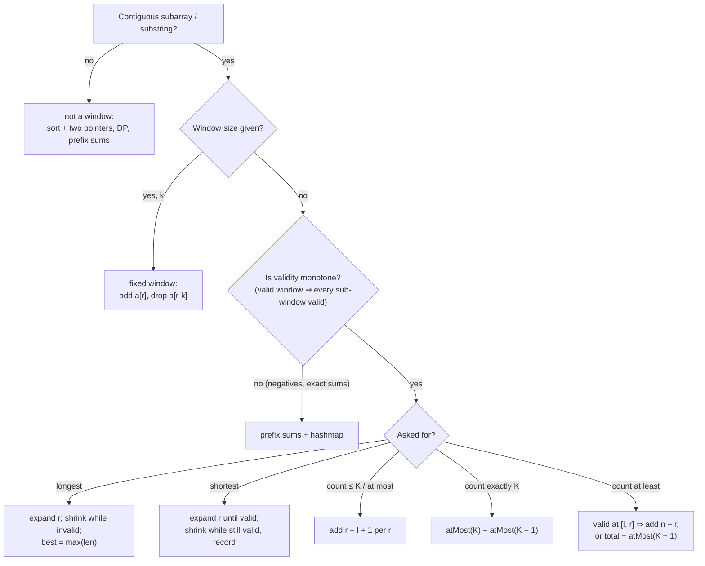

# Part 22: Sliding Window / 2 Pointer

← [Striver course map](../README.md)

> [!abstract] What this part covers
> **Goal:** Turn any contiguous subarray/substring question into a window with a clear validity rule, choose fixed vs variable vs non-shrinking form, and count exact-K windows with the atMost(K) − atMost(K − 1) subtraction.
> **Prereqs:** [Arrays](../14-arrays/README.md) · [Hashing](../15-hashing/README.md) · [Strings](../17-strings-basic-medium/README.md) **Time:** ~7 h.
> **Outcome:** Solve the standard window set (cards, unique substring, max ones, fruits, K distinct, character replacement, min window substring/subsequence, all-three substrings, binary sum, nice subarrays, K different integers) in O(n), and explain why each pointer moves only forward.

---

## Theory

| # | Lesson | What you get | Source |
|---|---|---|---|
| 1 | [Sliding Window & Two Pointers: Patterns and Templates](01-sliding-window-theory.md) | Fixed vs variable windows, the monotone-validity condition, shrink-while vs non-shrinking windows, counting by right end, atMost(K) − atMost(K − 1), two pointers vs window, amortised O(n) proof | [link](https://takeuforward.org/learning/dsa/theory?category=pattern-and-template&source=strivers-a2z-dsa-sheet) |

Read these first; the problems below apply them.

---

## Problems

| # | Problem | Difficulty | Key insight | Optimal | Source |
|---|---|---|---|---|---|
| | **Constant window** | | | | |
| 2 | [Maximum Points You Can Obtain from Cards](02-maximum-points-you-can-obtain-from-cards.md) | Medium | Whatever you take, the cards you leave form one contiguous block of length `n − k`. So try every split of `i` cards from the left and `k − i` from the right with a fixed-size window that slides around the ends. The equivalent view: minimise the sum of a middle window of size `n − k`. | O(k) | [link](https://takeuforward.org/learning/dsa/maximum-points-you-can-obtain-from-cards-?category=constant-window&source=strivers-a2z-dsa-sheet) |
| | **Longest and smallest window** | | | | |
| 3 | [Longest Substring Without Repeating Characters](03-longest-substring-without-repeating-characters.md) | Medium | Keep a window `[l, r]` with no repeats. When `s[r]` was last seen at index `j ≥ l`, jump `l` to `j + 1`. Storing the last index (instead of a set) lets `l` jump in one step rather than shrinking character by character. | O(n) | [link](https://takeuforward.org/learning/dsa/longest-substring-without-repeating-characters?category=longest-and-smallest-window-problems&source=strivers-a2z-dsa-sheet) |
| 4 | [Max Consecutive Ones III](04-max-consecutive-ones-iii.md) | Medium | Rephrase: longest window containing at most `k` zeros. Expand right, count zeros, shrink left while zeros exceed `k`. The no-shrink variant moves `l` by at most one per step, so the window size never decreases and its final size is the answer. | O(n) | [link](https://takeuforward.org/learning/dsa/max-consecutive-ones-iii?category=longest-and-smallest-window-problems&source=strivers-a2z-dsa-sheet) |
| 5 | [Fruit Into Baskets](05-fruit-into-baskets.md) | Medium | This is "longest subarray with at most K distinct values" with K = 2. Keep a count map for the window and shrink from the left whenever it holds more than two keys. | O(n) | [link](https://takeuforward.org/learning/dsa/fruit-into-baskets?category=longest-and-smallest-window-problems&source=strivers-a2z-dsa-sheet) |
| 6 | [Longest Substring With At Most K Distinct Characters](06-longest-substring-with-at-most-k-distinct-characters.md) | Medium | Same template as Fruit Into Baskets with a general `k`: expand, count, and shrink while the map holds more than `k` keys. With a fixed 26-letter alphabet, an array plus a running `distinct` counter avoids map overhead. | O(n) | [link](https://takeuforward.org/learning/dsa/longest-substring-with-at-most-k-distinct-characters?category=longest-and-smallest-window-problems&source=strivers-a2z-dsa-sheet) |
| 7 | [Longest Repeating Character Replacement](07-longest-repeating-character-replacement.md) | Medium | A window is fixable iff `len − maxFreq ≤ k`: keep the most common letter, change the rest. `maxFreq` never needs to decrease: the answer only grows when a window with a larger `maxFreq` appears, so a stale (too high) value only stops the window from shrinking when it shouldn't grow anyway. | O(n) | [link](https://takeuforward.org/learning/dsa/longest-repeating-character-replacement?category=longest-and-smallest-window-problems&source=strivers-a2z-dsa-sheet) |
| 8 | [Minimum Window Substring](08-minimum-window-substring.md) | Hard | Expand right until the window covers `t`, then shrink left as long as it still covers, recording each covering window. Track coverage with one integer, `need` = characters of `t` still missing, so the cover test is O(1). | O(|s| + |t|) | [link](https://takeuforward.org/learning/dsa/minimum-window-substring-?category=longest-and-smallest-window-problems&source=strivers-a2z-dsa-sheet) |
| 9 | [Minimum Window Subsequence](09-minimum-window-subsequence.md) | Hard | Scan forward matching `s2` in order; when the last character matches at `r`, scan **backwards** from `r` matching `s2` in reverse to find the latest start `l`. That gives the shortest window ending at `r`. Restart the forward scan at `l + 1`. | O(n·m) | [link](https://takeuforward.org/learning/dsa/minimum-window-subsequence?category=longest-and-smallest-window-problems&source=strivers-a2z-dsa-sheet) |
| | **Counting subarrays / substrings** | | | | |
| 10 | [Number of Substrings Containing All Three Characters](10-number-of-substrings-containing-all-three-characters.md) | Medium | For each right end `r`, the substring `s[l..r]` contains all three letters iff `l ≤ min(last[a], last[b], last[c])`. So the number of valid substrings ending at `r` is `1 + min(last)` (0 if a letter hasn't appeared). | O(n) | [link](https://takeuforward.org/learning/dsa/number-of-substrings-containing-all-three-characters?category=counting-subarrays-and-substrings-problems&source=strivers-a2z-dsa-sheet) |
| 11 | [Binary Subarrays With Sum](11-binary-subarrays-with-sum.md) | Medium | "Exactly goal" isn't monotone for a window, but "at most goal" is. So answer = atMost(goal) − atMost(goal − 1), where atMost counts windows by adding `r − l + 1` per right end. The prefix-sum + hashmap method also works and handles negatives. | O(n) | [link](https://takeuforward.org/learning/dsa/binary-subarrays-with-sum?category=counting-subarrays-and-substrings-problems&source=strivers-a2z-dsa-sheet) |
| 12 | [Count Number of Nice Subarrays](12-count-number-of-nice-subarrays.md) | Medium | Map each number to `x % 2` and it's Binary Subarrays With Sum with `goal = k`. Use atMost(k) − atMost(k − 1) on the odd count. | O(n) | [link](https://takeuforward.org/learning/dsa/count-number-of-nice-subarrays?category=counting-subarrays-and-substrings-problems&source=strivers-a2z-dsa-sheet) |
| 13 | [Subarrays with K Different Integers](13-subarrays-with-k-different-integers.md) | Hard | Exactly-k distinct isn't monotone, but at-most-k is: if `[l, r]` has ≤ k distinct, so does every `[l', r]` with `l' ≥ l`. So answer = atMost(k) − atMost(k − 1), each an O(n) window with a count map. | O(n) | [link](https://takeuforward.org/learning/dsa/subarrays-with-k-different-integers?category=counting-subarrays-and-substrings-problems&source=strivers-a2z-dsa-sheet) |

---

## Which window?

---

## Part 22 cheat sheet

| Question shape | Validity / state | Template | Answer update |
|---|---|---|---|
| Fixed size k (sum, avg, max points) | running sum | add `a[r]`, drop `a[r−k]` | at each full window |
| Longest with no repeats | last-seen index | `l = max(l, last[c] + 1)` | `max(r − l + 1)` |
| Longest with ≤ k bad elements | count of bad | shrink while `bad > k` | `max(r − l + 1)` |
| Longest with ≤ K distinct | count map + distinct | shrink while `distinct > K` | `max(r − l + 1)` |
| Longest fixable by k edits | `len − maxFreq ≤ k` | stale `maxFreq` is fine | `max(r − l + 1)` |
| Shortest covering t | deficit counter `need` | shrink while `need == 0` | `min` before removing `s[l]` |
| Shortest containing subsequence | order matters | forward match, backward shrink | `min`, leftmost on ties |
| Count ≤ K | as above | shrink while invalid | `+= r − l + 1` |
| Count exactly K | — | `atMost(K) − atMost(K − 1)` | subtraction |
| Count at least (all of a set) | last-seen positions | `+= 1 + min(last)` | per right end |

**Window works only when validity is monotone** in the left pointer: if `[l, r]` is valid then `[l+1, r]` is valid (for "≤" constraints). Negative numbers break sums; use prefix sums + hashmap. **Non-shrinking trick:** replace `while` with `if` for "longest" problems; return the final window size.

---

## Mastery checklist

- [ ] Write the fixed-size and variable-size window templates from memory
- [ ] State the monotone-validity condition and give a case where it fails (negatives)
- [ ] Explain the amortised O(n) bound: each pointer moves at most n times
- [ ] Use the non-shrinking window and justify why the final size is the answer
- [ ] Solve Longest Substring Without Repeating with a last-seen index (and the 'abba' trap)
- [ ] Solve Minimum Window Substring with a single `need` counter
- [ ] Count exact-K windows with atMost(K) − atMost(K − 1)
- [ ] Count 'at least' windows by adding n − r or 1 + min(last)

**Interview track →** [Sliding-window deep-dive](../../02-algorithms/04-sliding-window.md) · [Two-pointers deep-dive](../../02-algorithms/03-two-pointers.md) · [Sliding-window walkthroughs](../../04-practice/algorithms/04-sliding-window.md)

Next part → [Stack / Queues](../23-stack-and-queues/README.md)
