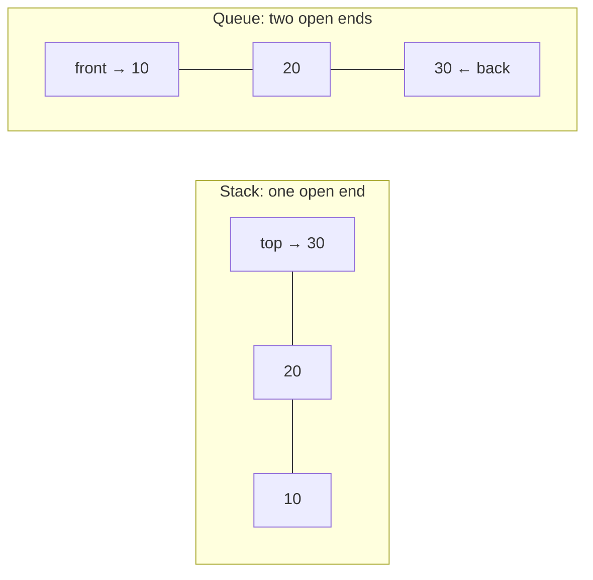
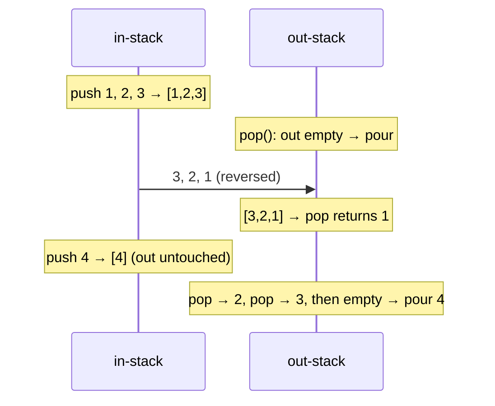
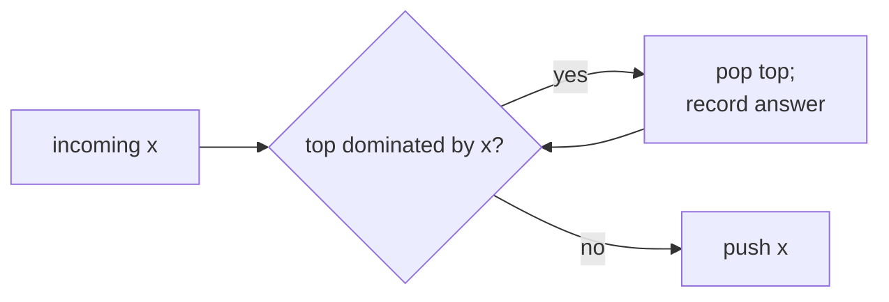
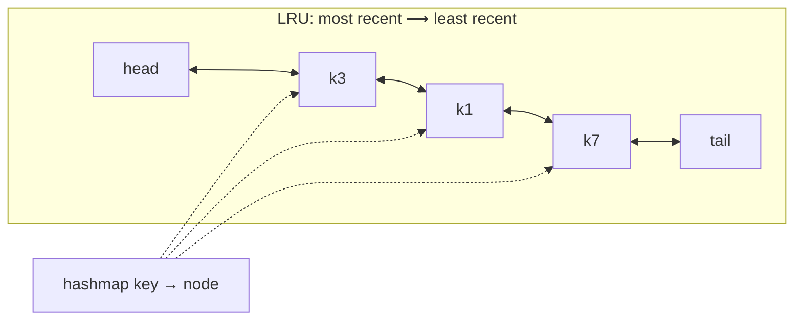

# 1. Stacks & Queues: Implementations, Monotonic Stacks and Design

← [Part 23 index](README.md) · Next → [Implement Stack using Arrays](02-implement-stack-using-arrays.md)

> [!abstract] What this covers
> **Core idea:** A stack (LIFO) and a queue (FIFO) are *contracts*: a fixed set of O(1) operations. Any substrate that meets the contract works: an array, a circular buffer, a linked list, or even the other structure. On top of the contracts, two algorithmic ideas carry the whole part. A **plain stack** handles nesting: brackets, expressions, undo, collisions. A **monotonic stack or deque** answers "nearest bigger/smaller" and "window max" questions in amortised O(n).
> **You'll be able to:** implement both structures three ways; simulate one with the other and state the amortised cost; convert and evaluate infix/prefix/postfix; pick the right monotonic order and pop condition for any NGE/NSE/PGE/PSE variant; use the contribution technique with correct tie-breaking; build O(1) caches (min stack, LRU, LFU).
> **Source:** [Striver: Stack / Queue, Implementation using different DS](https://takeuforward.org/learning/dsa/implementation-using-different-ds?category=implementation&source=strivers-a2z-dsa-sheet) · **Time:** 60 min

**Sections:** [1. The contracts](#1-the-contracts) · [2. Array implementations](#2-array-implementations) · [3. Linked-list implementations](#3-linked-list-implementations) · [4. Simulating one with the other](#4-simulating-one-with-the-other) · [5. Deque and language built-ins](#5-deque-and-language-built-ins) · [6. Expression notation](#6-expression-notation) · [7. The monotonic stack](#7-the-monotonic-stack) · [8. The contribution technique](#8-the-contribution-technique) · [9. The monotonic deque](#9-the-monotonic-deque) · [10. Design-problem recipes](#10-design-problem-recipes) · [Common mistakes](#common-mistakes) · [Practice](#practice) · [Key terms](#key-terms) · [Flashcards](#flashcards)

---

## 1. The contracts

| | Stack (LIFO) | Queue (FIFO) |
|---|---|---|
| Insert | `push(x)`: on top | `push/enqueue(x)`: at the back |
| Remove | `pop()`: from the top | `pop/dequeue()`: from the front |
| Peek | `top()` | `front()` |
| Also | `size()`, `empty()` | `size()`, `empty()` |
| Mental model | stack of plates; call stack | checkout line; BFS frontier |
| Typical uses | nesting, undo, DFS, backtracking, monotonic tricks | BFS, scheduling, buffering, sliding windows |

All operations are **O(1)**: worst case for linked lists and fixed buffers, amortised for growable arrays. Calling `pop`/`top` on an empty structure is an error. Decide early whether to throw, return a sentinel (−1), or assume it never happens, and say so in an interview.



---

## 2. Array implementations

**Stack:** a single index `top` (−1 when empty). Push writes at `++top`; pop reads at `top--`. With a growable array (`vector`, `ArrayList`, Python `list`) this is just push/pop at the end.

**Queue: the circular buffer.** A naive array queue that pops by shifting is O(n) per pop. One that only advances `front` leaks the space at the front. The fix is to **wrap indices modulo capacity** and keep a `size` counter, so full vs empty is never ambiguous:

| Operation | Code |
|---|---|
| push | `if size == cap: full`; `a[(front + size) % cap] = x`; `size++` |
| pop | `if size == 0: empty`; `x = a[front]`; `front = (front + 1) % cap`; `size--` |
| front | `a[front]` |

```python
class CircularQueue:
    def __init__(self, cap):
        self.a, self.cap, self.front, self.size = [0] * cap, cap, 0, 0
    def push(self, x):
        if self.size == self.cap:
            raise OverflowError("full")
        self.a[(self.front + self.size) % self.cap] = x
        self.size += 1
    def pop(self):
        if self.size == 0:
            raise IndexError("empty")
        x = self.a[self.front]
        self.front = (self.front + 1) % self.cap
        self.size -= 1
        return x
```

```cpp
struct CircularQueue {
    vector<int> a; int front = 0, sz = 0;
    CircularQueue(int cap) : a(cap) {}
    bool push(int x) { if (sz == (int)a.size()) return false; a[(front + sz) % a.size()] = x; sz++; return true; }
    int pop() { if (sz == 0) return -1; int x = a[front]; front = (front + 1) % a.size(); sz--; return x; }
};
```

```java
static class CircularQueue {
    int[] a; int front = 0, sz = 0;
    CircularQueue(int cap) { a = new int[cap]; }
    boolean push(int x) { if (sz == a.length) return false; a[(front + sz) % a.length] = x; sz++; return true; }
    int pop() { if (sz == 0) return -1; int x = a[front]; front = (front + 1) % a.length; sz--; return x; }
}
```

> [!tip] Two-pointer variant
> The textbook version keeps `front` and `rear` with no `size`. Then `front == rear` means *both* full and empty, unless you waste one slot (full ⇔ `(rear + 1) % cap == front`). A `size` counter is simpler and is what LC 622 expects.

**Growth:** doubling the array when full gives amortised O(1) push. Each element is copied O(1) times on average, because the copy costs form the geometric series `1 + 2 + 4 + … < 2n`. To grow a circular buffer, copy it **in logical order** starting at `front`, then reset `front = 0`.

---

## 3. Linked-list implementations

| Structure | Where to operate | Why |
|---|---|---|
| Stack | push and pop at the **head** | both O(1) on a singly linked list |
| Queue | push at the **tail**, pop at the **head** | keep a `tail` pointer; removing from a singly-linked tail would be O(n) |

Edge cases on the queue: when the last node is popped, set `tail = null` too. When pushing into an empty queue, set `head = tail = node`.

| | Array / circular buffer | Linked list |
|---|---|---|
| Worst-case op | O(n) on resize (amortised O(1)) | O(1) |
| Memory | contiguous, cache-friendly | one pointer per node + allocator overhead |
| Capacity | fixed or doubling | unbounded |
| Interview default | ✅ usually | when "no resizing" or "true O(1) worst case" is asked |

---

## 4. Simulating one with the other

| Goal | Approach | Cost |
|---|---|---|
| Stack using **one** queue | after pushing `x`, rotate the older `size − 1` elements behind it | push O(n), pop O(1) |
| Stack using two queues | push into `q2`, move all of `q1` behind it, swap | push O(n), pop O(1) |
| Queue using two stacks, **eager** | to push: move `in → out`, push, move back | push O(n), pop O(1) |
| Queue using two stacks, **lazy** ✅ | push to `in`; on pop/peek, if `out` is empty, pour all of `in` into `out` | **amortised O(1)** for both |

**Why the lazy queue is amortised O(1):** follow one element. It is pushed onto `in` once, moved to `out` once, and popped from `out` once: three O(1) moves over its whole life. n operations therefore cost O(n) in total, even though a single pop can cost O(n).



---

## 5. Deque and language built-ins

A **deque** (double-ended queue) supports push/pop at both ends in O(1). It generalises both structures and is the backbone of the monotonic deque (§9).

| Need | Python | C++ | Java |
|---|---|---|---|
| Stack | `list`: `append`, `pop`, `[-1]` | `stack<int>` / `vector` | `ArrayDeque`: `push`, `pop`, `peek` |
| Queue | `collections.deque`: `append`, `popleft` | `queue<int>`: `push`, `pop`, `front` | `ArrayDeque`: `offer`, `poll`, `peek` |
| Deque | `deque`: `appendleft`, `pop`… | `deque<int>` | `ArrayDeque`: `offerFirst/Last`, `pollFirst/Last` |
| Priority queue | `heapq` (min) | `priority_queue` (max) | `PriorityQueue` (min) |

> [!warning] Language traps
> - Python `list.pop(0)` is **O(n)**; use `deque.popleft()`.
> - Java's legacy `Stack` class is synchronized and extends `Vector`; prefer `ArrayDeque`. `ArrayDeque` rejects `null`.
> - C++ `stack::pop()` returns `void`: read `top()` first.
> - Java `ArrayDeque.push` adds at the **front**, so iteration order is top-first.

---

## 6. Expression notation

| Notation | Example of `(a + b) * c` | Needs parentheses? | Evaluated by |
|---|---|---|---|
| Infix | `(a + b) * c` | yes | humans; shunting-yard → postfix |
| Postfix (RPN) | `a b + c *` | no | stack, scanning left → right |
| Prefix (Polish) | `* + a b c` | no | stack, scanning right → left |

**Infix → postfix (shunting-yard):**
- **Operand:** append it to the output.
- **`(`:** push it.
- **`)`:** pop to the output until `(`, then discard the `(`.
- **Operator `o`:** first pop to the output while the top is an operator with higher precedence, or **equal precedence and `o` is left-associative**. Then push `o`. `^` is right-associative, so equal precedence does **not** pop for it.
- **End of input:** pop everything.

**Infix → prefix:** reverse the string and swap `(`↔`)`. Run shunting-yard, but now equal precedence pops only for right-associative operators (the associativity flips in the mirror). Reverse the result.

**Conversions between prefix/postfix/infix** use an **operand stack of strings**:

| From | Scan | On an operator, pop `top1` then `top2` and push |
|---|---|---|
| Postfix → infix | left → right | `"(" + top2 + op + top1 + ")"` |
| Postfix → prefix | left → right | `op + top2 + top1` |
| Prefix → infix | right → left | `"(" + top1 + op + top2 + ")"` |
| Prefix → postfix | right → left | `top1 + top2 + op` |

Memory aid: in a left → right scan the **second** pop is the left operand. In a right → left scan the **first** pop is the left operand.

---

## 7. The monotonic stack

**Question shape:** "for every `i`, find the nearest `j` to the right (or left) where `a[j]` is greater (or smaller)."

**Invariant:** the stack holds candidates in monotonic order. When `x` arrives, every candidate it dominates is popped, because `x` is both closer and better for every future query. **The popped element's answer is `x`** (or, for the previous-direction variants, the answer for `x` is whatever remains on top).

```python
def next_greater(a):
    n, ans, st = len(a), [-1] * len(a), []     # st: indices, values decreasing
    for i in range(n):
        while st and a[st[-1]] < a[i]:
            ans[st.pop()] = a[i]               # a[i] is the next greater of the popped index
        st.append(i)
    return ans
```

```cpp
vector<int> nextGreater(const vector<int>& a) {
    int n = a.size(); vector<int> ans(n, -1), st;
    for (int i = 0; i < n; i++) {
        while (!st.empty() && a[st.back()] < a[i]) { ans[st.back()] = a[i]; st.pop_back(); }
        st.push_back(i);
    }
    return ans;
}
```

```java
static int[] nextGreater(int[] a) {
    int n = a.length; int[] ans = new int[n]; Arrays.fill(ans, -1);
    Deque<Integer> st = new ArrayDeque<>();
    for (int i = 0; i < n; i++) {
        while (!st.isEmpty() && a[st.peek()] < a[i]) ans[st.pop()] = a[i];
        st.push(i);
    }
    return ans;
}
```

**The four variants:**

| Want | Stack order (bottom → top) | Pop while | Who gets the answer |
|---|---|---|---|
| Next greater | decreasing | `a[top] < x` | popped index ← `x` |
| Next smaller | increasing | `a[top] > x` | popped index ← `x` |
| Previous greater | decreasing | `a[top] ≤ x` | `x` ← top after popping |
| Previous smaller | increasing | `a[top] ≥ x` | `x` ← top after popping |

**Variations:**
- **Circular array:** iterate `i` over `0…2n−1` using `a[i % n]`, and push only while `i < n`.
- **Distances instead of values:** store indices; the answer is `j − i` (Daily Temperatures, Stock Span).
- **Right-to-left scan:** the same answers come from scanning backwards. After popping, the top is the answer for the current element. Striver's videos use this form, so know both.

**Amortised O(n):** each index is pushed exactly once and popped at most once, so the `while` loops perform at most n pops in total.



---

## 8. The contribution technique

**Question shape:** "sum (or count) of `f(subarray)` over all subarrays, where `f` is min or max."

Flip the sum: instead of looping over subarrays, ask **how many subarrays have `a[i]` as their minimum**. If the previous smaller element is at `p` and the next smaller is at `q`, the subarray can start anywhere in `(p, i]` and end anywhere in `[i, q)`:

$$\text{sum of mins} = \sum_i a[i] \cdot (i - p_i) \cdot (q_i - i)$$

**Tie-breaking:** with duplicate values, a subarray like `[2, 2]` would be counted for both 2s. Make one side strict and the other non-strict, for example a strictly smaller element on the left and a smaller-or-equal one on the right. Then each subarray's minimum is credited to exactly one index (its leftmost minimum).

| Problem | Formula |
|---|---|
| Sum of subarray minimums | `Σ a[i]·left·right` with PSE / NSE |
| Sum of subarray maximums | same with PGE / NGE |
| Sum of subarray ranges | `Σ max − Σ min` = contribution(max) − contribution(min) |
| Largest rectangle in histogram | `max h[i]·(NSE − PSE − 1)`: max instead of sum, so ties don't matter |

---

## 9. The monotonic deque

**Question shape:** "max (or min) of every window of size k" or "DP where `dp[i]` needs the best of the last k values."

The deque holds indices with **decreasing values** (for max), all inside the current window:
1. **Front:** pop it if it has expired (`front ≤ i − k`).
2. **Back:** pop while `a[back] ≤ a[i]`. Those elements are older and no bigger, so they can never be the max again.
3. Push `i`. The front is the window max.

| | Monotonic stack | Monotonic deque |
|---|---|---|
| Pops from | one end | both ends (dominance at the back, expiry at the front) |
| Answers | nearest greater/smaller | max/min over a moving range |
| Classic | NGE, histogram, stock span | sliding window max, LC 862, LC 1425 |

---

## 10. Design-problem recipes

| Design | State | Key trick |
|---|---|---|
| Min stack | pairs `(x, minSoFar)`, or one stack + `mn` | O(1) extra: push `2x − mn` when `x < mn`; a stored value `< mn` marks an encoded entry |
| Queue with O(1) max | two max-stacks, or a monotonic deque beside the queue | the same dominance rule as §9 |
| Stock spanner | stack of `(price, span)` | absorb popped spans |
| LRU cache | hashmap key → node + doubly linked list | sentinel head/tail; the node stores its key for eviction |
| LFU cache | key → (value, freq); freq → LRU list; `minFreq` | `minFreq++` when its bucket empties on touch; reset to 1 on insert |



**Interview pattern for design questions:**
- List the operations and their target complexity.
- Choose the structures: one for lookup, one for order.
- Write two or three private helpers (`unlink`, `pushFront`, `touch`).
- Build each public method from those helpers.
- Walk through the edge cases: an existing key, capacity 0 or 1, eviction order.

---

## Common mistakes

- **Circular queue:** full vs empty ambiguity. Keep `size` (or waste a slot).
- **Lazy two-stack queue:** pouring when `out` is *not* empty, which breaks the order.
- **Python:** using `list.pop(0)` as a queue (O(n)).
- **Monotonic stack:** storing values when you need distances or expiry. Store indices.
- **Pop condition:** wrong strictness. Equal elements should pop for "previous greater or equal / span", but not for strict "next greater".
- **Contribution technique:** strict on both sides undercounts and non-strict on both overcounts. Use one of each.
- **Histogram:** forgetting the sentinel bar 0, which leaves bars unprocessed.
- **Expression conversion:** reversing the operand order when building strings.
- **Shunting-yard:** popping equal precedence for right-associative `^`.
- **LRU:** not storing the key in the node, or evicting before checking whether the key exists.

---

## Practice

<details><summary>1. Why is a queue built from two stacks O(1) amortised, not O(1) worst case?</summary>

A single pop can pour n elements, which is O(n). Over any sequence of operations, though, each element is moved from `in` to `out` once, so the total work is O(number of operations).
</details>

<details><summary>2. Next greater element of [2, 7, 3, 5, 4, 6, 8]?</summary>

`[7, 8, 5, 6, 6, 8, -1]`.
</details>

<details><summary>3. Convert `a+b*(c^d-e)^(f+g*h)-i` to postfix.</summary>

`abcd^e-fgh*+^*+i-`
</details>

<details><summary>4. Evaluate postfix `2 3 1 * + 9 -`.</summary>

`2 + 3·1 − 9 = −4`.
</details>

<details><summary>5. Sum of subarray minimums of [3, 1, 2, 4]?</summary>

The contributions are 3·1·1 + 1·2·3 + 2·1·2 + 4·1·1 = 3 + 6 + 4 + 4 = **17**.
</details>

<details><summary>6. Which monotonic order solves "previous smaller element"?</summary>

An increasing stack. Pop while `top ≥ x`; the remaining top is the answer for `x`.
</details>

<details><summary>7. In an LFU cache, why can't minFreq jump by more than 1 during a get?</summary>

Only the touched key leaves bucket `f`, and it moves to `f + 1`, so bucket `f + 1` is non-empty right after.
</details>

---

## Key terms

| Term | Meaning |
|---|---|
| LIFO / FIFO | last-in-first-out (stack) / first-in-first-out (queue) |
| Circular buffer | fixed array with indices taken mod capacity |
| Amortised cost | average cost per operation over a worst-case sequence |
| Deque | double-ended queue, O(1) at both ends |
| RPN | reverse Polish (postfix) notation |
| Shunting-yard | Dijkstra's stack algorithm for infix → postfix |
| Monotonic stack | stack kept sorted by popping dominated elements |
| NGE / NSE / PGE / PSE | next greater / next smaller / previous greater / previous smaller element |
| Contribution technique | sum over elements of value × number of subarrays where it is the min/max |
| Sentinel | dummy element (bar of height 0, DLL head/tail) that removes edge cases |

---

## Flashcards

**How does a circular queue distinguish full from empty?** #flashcard
Keep a `size` counter, or leave one slot unused (full ⇔ `(rear + 1) % cap == front`).

**Queue using two stacks: when do you pour in → out?** #flashcard
Only when `out` is empty and a pop or peek is requested.

**Stack using one queue: how does push work?** #flashcard
Enqueue `x`, then dequeue and re-enqueue the other `size − 1` elements so `x` is at the front.

**Which end of a singly linked list does a queue push to and pop from?** #flashcard
Push at the tail (keep a tail pointer), pop at the head.

**Shunting-yard: when does an incoming operator pop an equal-precedence operator?** #flashcard
Only when the incoming operator is left-associative (not for `^`).

**Postfix → infix: which pop is the left operand?** #flashcard
The second pop: `(top2 op top1)`.

**Next greater element: stack order and pop condition?** #flashcard
Decreasing stack; pop while `top < x`, and `x` is the answer for each popped element.

**Why is the monotonic stack O(n)?** #flashcard
Every index is pushed once and popped at most once.

**Contribution of a[i] to the sum of subarray minimums?** #flashcard
`a[i] · (i − PSE[i]) · (NSE[i] − i)`, strict on one side and non-strict on the other.

**Sliding window max deque: what is popped from each end?** #flashcard
Front: expired indices (≤ i − k). Back: indices whose value is ≤ the incoming value.

**LRU vs LFU core structures?** #flashcard
LRU: hashmap + DLL. LFU: key → (value, freq), freq → LRU list, plus `minFreq`.

**Interview track →** [Stack deep-dive](../../01-data-structures/05-stack.md) · [Queue deep-dive](../../01-data-structures/06-queue.md)
