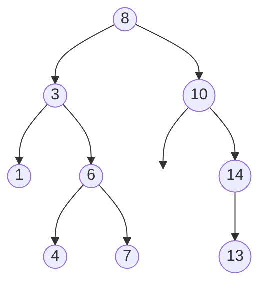
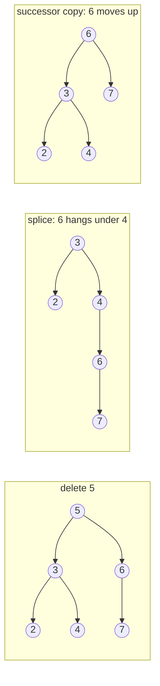

# 1. Binary Search Trees: Invariant, Walks, Insert/Delete and Inorder

← [Part 25 index](README.md) · Next → [Search in BST](02-search-in-bst.md)

> [!abstract] What this covers
> **Core idea:** A BST is a binary tree where, at every node, the **whole** left subtree is smaller and the **whole** right subtree is larger. That one rule gives two superpowers:
> 1. **Walks:** at each node, one comparison tells you which side the answer is on. Search, insert, floor/ceil, successor and LCA take O(h) and need no recursion.
> 2. **Sorted inorder:** an inorder traversal is a sorted array you never had to build. Kth element, validation, two-sum, recovery and the iterator are all "sorted-array tricks on a tree".
>
> **You'll be able to:** state the invariant precisely; explain why h is log n only when balanced; write the walk template with candidate tracking; insert and delete (all three cases); validate with bounds; implement the iterator; know what `std::map`/`TreeMap` give you for free.
> **Source:** [Striver: Introduction to BST](https://takeuforward.org/learning/dsa/introduction-to-bst?category=theory-and-basics&source=strivers-a2z-dsa-sheet) · **Time:** 45 min

**Sections:** [1. The invariant](#1-the-invariant) · [2. Height: O(h) is not O(log n)](#2-height-oh-is-not-olog-n) · [3. The walk template](#3-the-walk-template) · [4. Walk + candidate: floor, ceil, successor](#4-walk--candidate-floor-ceil-successor) · [5. Insert](#5-insert) · [6. Delete](#6-delete) · [7. Inorder is sorted](#7-inorder-is-sorted) · [8. Validation](#8-validation) · [9. The iterator](#9-the-iterator) · [10. Construction](#10-construction) · [11. Post-order summaries](#11-post-order-summaries) · [12. Balanced BSTs in practice](#12-balanced-bsts-in-practice) · [Common mistakes](#common-mistakes) · [Practice](#practice) · [Key terms](#key-terms) · [Flashcards](#flashcards)

---

## 1. The invariant



For **every** node `x`: all keys in `x.left` < `x.key` < all keys in `x.right`. Both subtrees are themselves BSTs.

| Statement | True? |
|---|---|
| "Each node is larger than its left child and smaller than its right child" | **Necessary, not sufficient.** `[5, 4, 6, null, null, 3, 7]` passes it but 3 sits in 5's right subtree. |
| "Every node lies inside an open interval set by its ancestors" | **Equivalent** to the invariant; this is how you validate. |
| "Inorder traversal is strictly increasing" | **Equivalent** to the invariant (for distinct keys). |

**Duplicates.** Striver and LeetCode mostly assume distinct keys. If duplicates are allowed, fix a convention (`≤` goes left, or store a `count` per node) and use it everywhere: search, insert, delete and validate.

Every node defines a window. In the tree above, node 6 must be in (3, 8), node 4 in (3, 6), and node 13 in (10, 14).

---

## 2. Height: O(h) is not O(log n)

All walk operations cost **O(h)**. What h is depends on the insertion order:

| Shape | How you get it | h | Search cost |
|---|---|---|---|
| Balanced | random insertion order (expected), or mid-first build from sorted data | ~log₂ n | O(log n) |
| Degenerate (linked list) | inserting sorted / reverse-sorted keys | n − 1 | O(n) |
| Self-balancing (AVL, red-black) | rotations after every insert/delete | ≤ 1.44 log₂ n (AVL), ≤ 2 log₂(n+1) (RB) | O(log n) guaranteed |

Always say "O(h), which is O(log n) **if balanced**". Interviewers listen for that qualifier.

Building a balanced BST from a sorted array: pick the middle as the root and recurse on both halves. O(n).

---

## 3. The walk template

Most BST operations descend a single root-to-leaf path:

```python
cur = root
while cur:
    if key == cur.val:   # found / stop condition
        ...
    elif key < cur.val:
        cur = cur.left
    else:
        cur = cur.right
```

| Operation | Stop / action | Notes |
|---|---|---|
| Search | return `cur` on equality | falling off the tree → absent |
| Min / max | follow only `.left` / only `.right` | the min may have a right child |
| Insert | the child on `key`'s side is null → attach | always a new **leaf** |
| LCA(p, q) | `p` and `q` not on the same side → `cur` | O(h), O(1) space |

The recursion is tail recursion, so always offer the loop: O(1) space instead of O(h).

---

## 4. Walk + candidate: floor, ceil, successor

These answers usually lie on the search path even when `key` is absent. Record a **candidate** on each turn in the right direction. Later candidates are always closer, so the last one recorded wins.

| Query | Record `cur` when… | then go | Equality |
|---|---|---|---|
| Floor (largest ≤ key) | `cur.val < key` | right | return key |
| Ceil (smallest ≥ key) | `cur.val > key` | left | return key |
| Predecessor (largest < key) | `cur.val < key` | right | go **left** |
| Successor (smallest > key) | `cur.val > key` | left | go **right** |

**Why it's correct (successor):** when you go left past `cur` (because `cur.val > key`), every node still to be visited is in `cur.left`, so all of them are smaller than `cur`. If any of them is > key it's a better candidate. If none is, `cur` was the answer. Going right discards only values ≤ key.

**Structural view of the successor** (the textbook version, for a node that is in the tree):
1. The node has a right child → the successor is the **leftmost node of the right subtree**.
2. Otherwise → it's the **nearest ancestor whose left subtree contains the node**: the last place you went left.

The candidate walk handles both cases in one loop.

---

## 5. Insert

The unsuccessful search for `key` ends at a null pointer, and that pointer is where `key` belongs. Insert never moves existing nodes.

```python
def insert(root, key):          # recursive idiom: return the subtree root
    if not root:
        return TreeNode(key)
    if key < root.val:
        root.left = insert(root.left, key)
    else:
        root.right = insert(root.right, key)
    return root
```

`root.left = f(root.left, …)` is the most reusable BST idiom: delete, trim (LC 669) and many construction problems use it.

| Insertion order | Resulting tree |
|---|---|
| 4 2 6 1 3 5 7 | perfect, h = 2 |
| 1 2 3 4 5 6 7 | right chain, h = 6 |
| any order of the same keys | always the same **inorder** |

---

## 6. Delete

Find the node, then split into three cases:

| Case | Action |
|---|---|
| Leaf | replace with null |
| One child | replace with that child |
| Two children | **(a) Successor copy:** copy the inorder successor's value (leftmost of the right subtree) into the node, then delete the successor from the right subtree. It has no left child, so this is case 1 or 2. **(b) Splice (Striver):** attach the right subtree as the right child of the **rightmost node of the left subtree**, and return the left subtree. |



Both keep the inorder sequence `2 3 4 6 7`. The successor copy doesn't increase the height; the splice can. Self-balancing trees use the successor version plus rotations.

---

## 7. Inorder is sorted

Inorder visits left subtree, node, right subtree. By the invariant that's "everything smaller, me, everything larger", applied recursively, so the output is sorted. This turns array techniques into tree techniques:

| Array technique | BST equivalent | Cost |
|---|---|---|
| `a[k−1]` | stop the inorder at the kth pop | O(h + k) |
| check sorted | inorder with `prev`, fail on `prev ≥ cur` | O(n) |
| find the two swapped elements | inorder descents: `first ← prev` once, `last ← cur` | O(n) |
| two pointers for two-sum | ascending + descending iterators | O(n) time, O(h) space |
| merge two sorted arrays | two iterators (merge two BSTs, LC 1305) | O(m + n) |
| reverse order | reverse inorder (right, node, left) | kth largest |

**Order-statistic augmentation:** store `size` (the subtree node count) in every node. Then kth smallest is an O(h) walk: if `k ≤ size(left)`, go left; if `k == size(left) + 1`, it's this node; otherwise subtract and go right. Rank (the count of keys < x) is the same walk run in reverse.

---

## 8. Validation

Pass the open window `(lo, hi)` down the tree:

```python
def ok(n, lo=float("-inf"), hi=float("inf")):
    if not n:
        return True
    if not (lo < n.val < hi):
        return False
    return ok(n.left, lo, n.val) and ok(n.right, n.val, hi)
```

- **Sentinel trap:** with `int` values in [−2³¹, 2³¹−1], `INT_MIN`/`INT_MAX` sentinels reject a legal tree like `[2147483647]`. Use `long`, nullable `Integer` bounds, or `±∞` in Python.
- **Alternative:** iterative inorder with `prev` (a node pointer, not an int sentinel).
- **Subtree-level variant:** "largest BST subtree" can't use top-down windows efficiently. Go bottom-up instead (§11).

---

## 9. The iterator

The iterative inorder can be paused between pops. Store the stack in an object:

| State | Invariant |
|---|---|
| Stack | the left spine of everything not yet visited; the top is the smallest unvisited |
| `next()` | pop `n`; push the left spine of `n.right`; return `n.val` |
| `hasNext()` | stack non-empty |

**Amortised O(1):** each node is pushed once and popped once over the full iteration, so n calls cost O(n) in total. A single call can cost O(h). Memory is O(h), not O(n).

Two iterators (one pushes left spines, the other right spines) give the two pointers of a sorted array. That's two-sum in a BST with O(h) space.

---

## 10. Construction

| Input | Method | Cost |
|---|---|---|
| Sorted array | middle as root, recurse on halves | O(n), balanced |
| Preorder | consume left to right with an **upper bound**: left child bound = node value, right child bound = parent's bound | O(n) |
| Postorder | consume right to left with a **lower bound**, build right before left | O(n) |
| Level order | insert one by one (each node arrives after its parent) | O(n·h) |
| Any order, unbalanced OK | n inserts | O(n²) worst |

For a general binary tree you need inorder plus one other traversal. For a BST, sorting the keys gives you the inorder, so preorder alone is enough. The bound trick avoids even the sort.

---

## 11. Post-order summaries

Bottom-up BST questions ("is this subtree a BST?", "largest/sum of a BST subtree") have each subtree return a summary:

| Field | Empty subtree | Valid BST at `n` | Invalid at `n` |
|---|---|---|---|
| min | +∞ | `min(l.min, n.val)` | −∞ (poison) |
| max | −∞ | `max(r.max, n.val)` | +∞ (poison) |
| size / sum | 0 | `l + r + 1` / `l + r + val` | best found below |

Validity test at `n`: `l.max < n.val < r.min`. The empty-tree sentinels always pass it, and the poisoned range always fails it, so invalidity propagates upward with no extra flag. One O(n) pass, compared with O(n²) for validating at every node.

---

## 12. Balanced BSTs in practice

You rarely implement balancing in an interview, but you should know what's built in:

| Language | Ordered set / map | Floor / ceil | Kth / rank |
|---|---|---|---|
| C++ | `std::set`, `std::map` (red-black) | `lower_bound` (≥), `upper_bound` (>), then `prev()` for floor | not built in (`__gnu_pbds` ordered set has `find_by_order`) |
| Java | `TreeSet`, `TreeMap` (red-black) | `floor`, `ceiling`, `lower` (<), `higher` (>) | not built in |
| Python | none built in | `bisect` on a sorted list (O(n) insert) or `sortedcontainers.SortedList` | `SortedList[k]`, `bisect_left` |

**Choose a BST over a hash map** when you need order: range queries, floor/ceil, min/max under updates, sorted iteration. **Choose a hash map** when you only need membership (O(1) average versus O(log n)).

**Heap vs BST:** a heap gives O(1) min and O(log n) push/pop, but no search or ordered iteration. A balanced BST gives everything in O(log n), at a higher constant factor.

---

## Common mistakes

- **Child-only invariant:** validating with `left.val < val < right.val`. Constraints come from all ancestors.
- **"O(log n)" without "balanced":** a sorted insertion order degrades every operation to O(n).
- **Searching both subtrees:** that's O(n) and ignores the ordering.
- **Floor/ceil turn direction:** a floor candidate is recorded on a right step, a ceil candidate on a left step.
- **Successor on equality:** you must go **right**; going left records smaller values.
- **Insert walking to null:** you lose the parent. Look ahead at the child or use the `root.left = insert(...)` idiom.
- **Delete root:** forgetting to return the new root when the root itself is deleted.
- **Two-child splice:** the right subtree goes under the left subtree's **rightmost** node, not its leftmost.
- **INT sentinels** in validation, or `prev = 0` in an inorder check.
- **Iterator "O(1)":** it's amortised, and its memory is O(h). Flattening to a list is O(n) memory.
- **Kth with a recursive counter passed by value** (C++/Java), so the caller never sees it decrement.

---

## Practice

<details><summary>1. Is <code>[10,5,15,null,null,6,20]</code> a BST?</summary>

No. 6 is the left child of 15 (locally fine) but it's in 10's right subtree, so it must be > 10.
</details>

<details><summary>2. Insert 1, 2, 3, 4, 5 into an empty BST. Height (edges)? Better order?</summary>

A right chain, h = 4. Inserting 3, 1, 4, 2, 5 (or any middle-first order such as 3 2 4 1 5) gives h = 2.
</details>

<details><summary>3. Floor and ceil of 5 in <code>[8,3,10,1,6,null,14,null,null,4,7,13]</code>?</summary>

Floor: 8 > 5 → left 3; 3 < 5 → fl 3, right 6; 6 > 5 → left 4; 4 < 5 → fl 4, right null. **Floor 4.** Ceil: 8 > 5 → ce 8, left 3; 3 < 5 → right 6; 6 > 5 → ce 6, left 4; 4 < 5 → right null. **Ceil 6.**
</details>

<details><summary>4. Inorder successor of 7 in the same tree?</summary>

7 has no right child. The last ancestor where the walk went left is 8. Walk: 8 > 7 → s 8, left 3 → right 6 → right 7 → equal, go right → null. **8.**
</details>

<details><summary>5. Delete 3 (two children) from that tree, using the successor copy. Result?</summary>

The successor is the leftmost node of 3's right subtree {6, 4, 7}, which is 4. Copy 4 into the node and delete 4 from the right subtree. The tree becomes 8 → (4, 10), 4 → (1, 6), 6 → (null, 7), 10 → (null, 14), 14 → (13, null).
</details>

<details><summary>6. Preorder <code>[10,5,1,7,40,50]</code>: draw the BST.</summary>

10 → (5, 40); 5 → (1, 7); 40 → (null, 50). The upper bounds: 5 is built with bound 10, 1 with bound 5, 7 with bound 10, 40 with bound ∞.
</details>

<details><summary>7. Inorder of a BST with two swapped nodes is <code>1 6 3 4 5 2 7</code>. Which nodes?</summary>

Descents: (6, 3) and (5, 2). `first` = 6 (prev at the first descent), `last` = 2 (cur at the last). Swap 6 ↔ 2 → `1 2 3 4 5 6 7`.
</details>

<details><summary>8. Why does the BST iterator use O(h) memory but make n calls in O(n) total?</summary>

The stack only ever holds one path (a left spine plus pending ancestors), so ≤ h + 1 nodes. Each node enters the stack once (when its parent's spine is pushed) and leaves once (on its `next()`), so the total work is 2n.
</details>

---

## Key terms

| Term | Meaning |
|---|---|
| BST invariant | all of left subtree < node < all of right subtree, at every node |
| Floor / ceil | largest ≤ key / smallest ≥ key |
| Predecessor / successor | largest < key / smallest > key (inorder neighbours) |
| Walk | a single root-to-leaf descent guided by comparisons, O(h) |
| Candidate tracking | recording `cur` on each turn in the right direction during a walk |
| Successor copy | two-child delete: copy the successor's value, delete the successor |
| Splice | two-child delete: right subtree under the left subtree's rightmost node |
| Window / bounds | the open interval `(lo, hi)` a node must lie in |
| Order-statistic tree | BST with subtree sizes → kth and rank in O(h) |
| Self-balancing BST | AVL / red-black: rotations keep h = O(log n) |
| Amortised O(1) | O(n) total over n operations, even if one costs more |

---

## Flashcards

**BST invariant: children or subtrees?** #flashcard
Subtrees: everything in the left subtree is smaller and everything in the right is larger, at every node.

**Cost of search/insert/delete in a BST?** #flashcard
O(h): O(log n) if balanced, O(n) if degenerate.

**What insertion order makes a BST degenerate?** #flashcard
Sorted or reverse-sorted.

**Inorder of a BST?** #flashcard
Strictly increasing (distinct keys).

**Floor walk: when is a candidate recorded?** #flashcard
When `cur.val < key`; then go right.

**Successor walk: what happens on equality?** #flashcard
Go right (the successor is strictly larger).

**Successor of a node with a right child?** #flashcard
The leftmost node of its right subtree.

**Successor of a node without a right child?** #flashcard
The nearest ancestor you went left from.

**Where is a new key inserted?** #flashcard
At the null slot where an unsuccessful search for it ends; always as a leaf.

**Delete: the two-child options?** #flashcard
Successor copy (doesn't increase the height), or splice the right subtree under the left subtree's rightmost node.

**Validate BST: window for the left child of node v with window (lo, hi)?** #flashcard
(lo, v).

**Why can INT_MIN/INT_MAX bounds fail validation?** #flashcard
Node values can equal them; use long, nullable bounds, or ±∞.

**Kth smallest in O(h)?** #flashcard
Augment each node with its subtree size and walk down.

**BST iterator: complexity?** #flashcard
Amortised O(1) per `next()`, O(h) memory.

**Why is preorder alone enough to rebuild a BST?** #flashcard
The sorted keys are the inorder; the upper-bound recursion does it in O(n) without sorting.

**Largest BST subtree: the empty subtree's (min, max)?** #flashcard
(+∞, −∞), so it always passes the parent's `l.max < v < r.min` check.

**Java floor/ceil on an ordered set?** #flashcard
`TreeSet.floor(x)` / `ceiling(x)`; strict: `lower(x)` / `higher(x)`.

**Interview track →** [Tree deep-dive](../../01-data-structures/08-tree.md)
