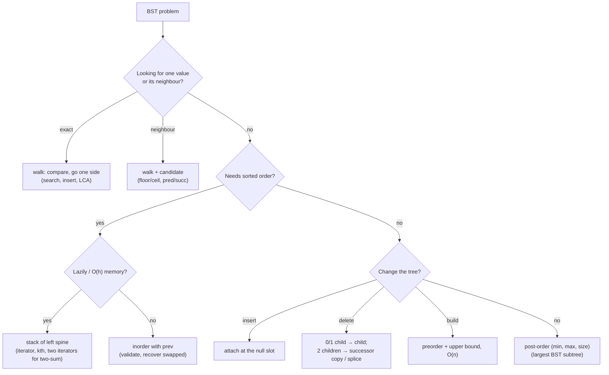

# Part 25: Binary Search Trees

← [Striver course map](../README.md)

> [!abstract] What this part covers
> **Goal:** Use the BST invariant to turn O(n) tree scans into O(h) walks. Cover search, floor/ceil, insert and delete, kth element, validation, LCA, construction from preorder, successor/predecessor and the iterator. Then combine the iterator with two pointers and post-order info passing for the harder FAQs.
> **Prereqs:** [Binary Trees](../24-binary-trees/README.md) **Time:** ~7 h.
> **Outcome:** Write every BST walk (search, floor/ceil, insert, successor) as a loop; delete with all three cases; validate with bounds (and survive INT_MIN/INT_MAX); build from preorder in O(n); implement the O(h)-memory iterator and use two of them for two-sum; recover a swapped BST and find the largest BST subtree in one pass.

---

## Theory

| # | Lesson | What you get | Source |
|---|---|---|---|
| 1 | [Binary Search Trees: Invariant, Walks, Insert/Delete and Inorder](01-bst-theory.md) | The BST invariant (whole subtrees, not just children), why inorder is sorted, O(h) vs O(log n), the walk template with candidate tracking (floor/ceil/successor), insert and the three delete cases, bounds-based validation, the iterator as paused inorder, balanced BSTs in standard libraries, and the post-order (min, max, size) pattern. | [link](https://takeuforward.org/learning/dsa/introduction-to-bst?category=theory-and-basics&source=strivers-a2z-dsa-sheet) |

Read these first; the problems below apply them.

---

## Problems

| # | Problem | Difficulty | Key insight | Optimal | Source |
|---|---|---|---|---|---|
| | **Theory and basics** | | | | |
| 2 | [Search in BST](02-search-in-bst.md) | Easy | The BST invariant tells you which side the target must be on, so you never explore both children. The search is a single root-to-leaf walk: O(h), not O(n). Because it's tail recursion, write it as a loop. | O(h) | [link](https://takeuforward.org/learning/dsa/search-in-bst?category=theory-and-basics&source=strivers-a2z-dsa-sheet) |
| 3 | [Floor and Ceil in a BST](03-floor-and-ceil-in-a-bst.md) | Medium | Walk as if searching for `key`. Each time you step **right**, the current node is ≤ key, so it's a floor candidate, and later candidates are only larger. Each time you step **left**, the node is ≥ key and becomes a ceil candidate. The last candidate recorded is the answer. | O(h) | [link](https://takeuforward.org/learning/dsa/floor-and-ceil-in-a-bst?category=theory-and-basics&source=strivers-a2z-dsa-sheet) |
| 4 | [Minimum and Maximum in BST](04-minimum-and-maximum-in-bst.md) | Easy | The minimum is the **leftmost** node and the maximum is the **rightmost** node. Follow one pointer until it's null. This is also the 'go far left/right' helper used in delete, successor and Morris. | O(h) | [link](https://takeuforward.org/learning/dsa/minimum-and-maximum-in-bst?category=theory-and-basics&source=strivers-a2z-dsa-sheet) |
| | **Medium** | | | | |
| 5 | [Insert a given node in BST](05-insert-into-bst.md) | Medium | Search for `val`. The null pointer where the search falls off the tree is exactly where it belongs. Attach a new leaf there. No existing node moves. | O(h) | [link](https://takeuforward.org/learning/dsa/insert-a-given-node-in-bst?category=medium&source=strivers-a2z-dsa-sheet) |
| 6 | [Delete a node in BST](06-delete-node-in-bst.md) | Medium | Leaves and one-child nodes are easy: replace the node with its only child (or null). For **two children**, either (a) copy the inorder successor's value up and delete the successor, or (b) splice: hang the right subtree off the rightmost node of the left subtree and return the left subtree. Both keep inorder order intact. | O(h) | [link](https://takeuforward.org/learning/dsa/delete-a-node-in-bst?category=medium&source=strivers-a2z-dsa-sheet) |
| 7 | [Kth Smallest and Largest element in BST](07-kth-smallest-largest-in-bst.md) | Medium | Inorder visits a BST in ascending order, so the kth node popped is the kth smallest. Reverse inorder (R → Root → L) is descending, so the kth popped is the kth largest. Stop early: O(h + k), not O(n). | O(h + k) | [link](https://takeuforward.org/learning/dsa/kth-smallest-and-largest-element-in-bst?category=medium&source=strivers-a2z-dsa-sheet) |
| 8 | [Check if a tree is a BST or not](08-validate-bst.md) | Medium | Comparing a node only with its children is the classic trap. Every node must lie inside an **(low, high) window** inherited from all its ancestors: go left and the high bound becomes this value, go right and the low bound does. Equivalently, the inorder sequence must be strictly increasing. | O(n) | [link](https://takeuforward.org/learning/dsa/check-if-a-tree-is-a-bst-or-not?category=medium&source=strivers-a2z-dsa-sheet) |
| 9 | [LCA in BST](09-lca-in-bst.md) | Medium | While both values are smaller than the current node, the LCA is to the left; while both are larger, it's to the right. The **first node where they split** (or where one equals the node) is the LCA. One walk, no recursion into both sides. | O(h) | [link](https://takeuforward.org/learning/dsa/lca-in-bst?category=medium&source=strivers-a2z-dsa-sheet) |
| 10 | [Construct a BST from a preorder traversal](10-bst-from-preorder.md) | Medium | For a BST, preorder alone is enough because the ordering is the missing inorder. Consume values left to right with a shared index. A subtree accepts the next value only if it's **below the upper bound** inherited from its ancestors. When a value exceeds the bound, that subtree is finished. O(n) total. | O(n) | [link](https://takeuforward.org/learning/dsa/construct-a-bst-from-a-preorder-traversal?category=medium&source=strivers-a2z-dsa-sheet) |
| 11 | [Inorder successor and predecessor in BST](11-inorder-successor-predecessor.md) | Medium | This is floor/ceil with **strict** inequalities. Walking down, every time you go left past a node, that node is a successor candidate (it's bigger and may be the closest). Every time you go right, the node is a predecessor candidate. It works even if `key` isn't in the tree. | O(h) | [link](https://takeuforward.org/learning/dsa/inorder-successor-and-predecessor-in-bst?category=medium&source=strivers-a2z-dsa-sheet) |
| | **FAQs** | | | | |
| 12 | [BST iterator](12-bst-iterator.md) | Medium | Turn iterative inorder into a resumable object. The stack holds the **left spine** still to be visited. `next()` pops the top (the smallest remaining), then pushes the left spine of its right child. Each node is pushed and popped once, so it's **amortised O(1)** per call with O(h) memory. | O(1) amortised | [link](https://takeuforward.org/learning/dsa/bst-iterator?category=faqs&source=strivers-a2z-dsa-sheet) |
| 13 | [Two sum in BST](13-two-sum-in-bst.md) | Medium | The inorder sequence is sorted, so this is two-sum on a sorted array: a left pointer moving up and a right pointer moving down. Run an ascending BST iterator and a descending one; that's two pointers in O(h) memory without materialising the array. | O(n) | [link](https://takeuforward.org/learning/dsa/two-sum-in-bst?category=faqs&source=strivers-a2z-dsa-sheet) |
| 14 | [Correct BST with two nodes swapped](14-recover-bst.md) | Hard | In the inorder sequence, a swap produces either **one** descent (adjacent elements swapped) or **two** descents (distant elements). Record `first` = the larger element of the first descent and `last` = the smaller element of the last descent, then swap their values. | O(n) | [link](https://takeuforward.org/learning/dsa/correct-bst-with-two-nodes-swapped?category=faqs&source=strivers-a2z-dsa-sheet) |
| 15 | [Largest BST in Binary Tree](15-largest-bst-subtree.md) | Hard | Post-order information passing. Each subtree reports `(min, max, size)`. A node forms a BST iff `left.max < val < right.min`, and then it reports `(min(left.min, val), max(right.max, val), l + r + 1)`. Otherwise it reports an **impossible range** `(−∞, +∞)` so that no ancestor can be a BST, along with the best size found below. Empty subtrees report `(+∞, −∞, 0)`, which always passes the check. | O(n) | [link](https://takeuforward.org/learning/dsa/largest-bst-in-binary-tree?category=faqs&source=strivers-a2z-dsa-sheet) |

---

## Which BST technique?

---

## Part 25 cheat sheet

| Problem | Template | Key rule | Complexity |
|---|---|---|---|
| Search / insert | walk | `val < cur ? left : right`; insert at the null slot | O(h) / O(1) |
| Min / max | spine walk | leftmost / rightmost | O(h) |
| Floor / ceil | walk + candidate | floor: record when `cur < key`, go right; ceil mirrors | O(h) |
| Pred / succ | walk + candidate | succ: record when `cur > key`, go left; equal goes right | O(h) |
| Delete | walk + case split | 2 children → successor copy, or splice right under left's rightmost | O(h) |
| Kth smallest / largest | iterative inorder (reverse for largest) | stop at the kth pop | O(h + k) |
| Validate | bounds `(lo, hi)` | left `(lo, v)`, right `(v, hi)`; use long / ±∞ | O(n) |
| LCA | walk | first node between p and q | O(h) |
| Build from preorder | recursion with upper bound | left bound = val, right bound = parent's | O(n) |
| Iterator | stack of left spine | `next`: pop, push left spine of right | O(1) amortised / O(h) |
| Two sum | two iterators | move the side that fixes the sum; stop when they meet | O(n) / O(h) |
| Recover swapped | inorder with prev | descent: `first ← prev` once, `last ← cur` | O(n) |
| Largest BST subtree | post-order | `(min, max, size)`; invalid → `(−∞, +∞, best)` | O(n) |

**h is log n only if balanced.** Sorted inserts produce a linked list. In production, use `std::map`/`std::set` or `TreeMap`/`TreeSet`; Python has no built-in balanced BST, so use `bisect` on a list or `sortedcontainers`.

---

## Mastery checklist

- [ ] State the BST invariant in terms of whole subtrees
- [ ] Write search, insert, floor, ceil, predecessor and successor as loops
- [ ] Delete a node: name the three cases and code either the successor-copy or the splice version
- [ ] Find the kth smallest and largest with an early-exit inorder
- [ ] Validate a BST with bounds; explain the INT_MIN/INT_MAX trap
- [ ] Find the LCA in a BST in O(h) and O(1) space
- [ ] Build a BST from preorder in O(n) using an upper bound
- [ ] Implement the BST iterator and justify amortised O(1)
- [ ] Solve two-sum in a BST in O(h) space with two iterators
- [ ] Recover a BST with two swapped nodes (one vs two descents)
- [ ] Find the largest BST subtree with post-order (min, max, size)

**Interview track →** [Tree deep-dive](../../01-data-structures/08-tree.md)

Next part → [Heaps](../26-heaps/README.md)
