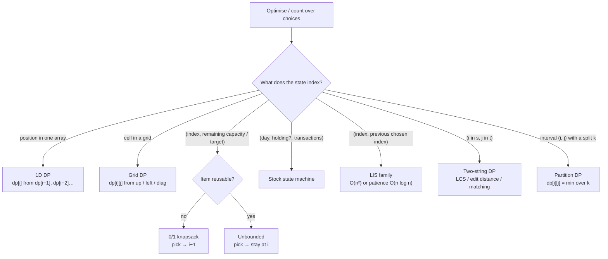

# Part 28: Dynamic Programming

← [Striver course map](../README.md)

> [!abstract] What this part covers
> **Goal:** Turn any "count / min / max / is-possible over choices" problem into a recurrence, then memoize, tabulate and space-optimise it. Cover the Striver DP families: 1D, 2D, grids, subsequences and knapsack, stocks, LIS, strings, and partition (MCM) DP.
> **Prereqs:** [Recursion](../18-recursion/README.md), [Hashing](../15-hashing/README.md) **Time:** ~20 h.
> **Outcome:** Define a state and a recurrence from "what is the last choice?"; convert memoization to tabulation by reversing the loop direction; drop a dimension when only the previous row is read; recognise pick/not-pick, take-again (unbounded), buy/sell state machines, LIS (O(n²) and O(n log n)), two-string tables (LCS/edit distance) and interval partition DP on sight.

---

## Theory

| # | Lesson | What you get | Source |
|---|---|---|---|
| 1 | [Dynamic Programming: From Recursion to Tabulation](01-dp-theory.md) | Overlapping subproblems and optimal substructure, the 4-stage pipeline (recurrence → memo → tabulation → space optimisation), how to choose a state, base cases and sentinels, loop order in tabulation, the DP families (1D, grid, subsequence/knapsack, stock state machine, LIS, two-string, partition/MCM) with their recurrences, reconstructing answers, and complexity accounting. | [link](https://takeuforward.org/learning/dsa/introduction-to-dp?category=introduction&source=strivers-a2z-dsa-sheet) |

Read these first; the problems below apply them.

---

## Problems

| # | Problem | Difficulty | Key insight | Optimal | Source |
|---|---|---|---|---|---|
| | **1D DP** | | | | |
| 2 | [Climbing stairs](02-climbing-stairs.md) | Easy | The last move was either a 1-step from `n−1` or a 2-step from `n−2`, so `ways(n) = ways(n−1) + ways(n−2)`, which is Fibonacci. Only the previous two values are ever read, so two variables replace the table. | O(n) | [link](https://takeuforward.org/learning/dsa/climbing-stairs?category=1d-dp&source=strivers-a2z-dsa-sheet) |
| 3 | [Frog Jump](03-frog-jump.md) | Easy | Stone `i` is reached from `i−1` or `i−2`, so `dp[i] = min(dp[i−1] + |h[i]−h[i−1]|, dp[i−2] + |h[i]−h[i−2]|)`. Greedy (always take the cheaper next jump) fails, because a cheap jump now can force an expensive one later. | O(n) | [link](https://takeuforward.org/learning/dsa/frog-jump?category=1d-dp&source=strivers-a2z-dsa-sheet) |
| 4 | [Frog jump with K distances](04-frog-jump-with-k-distances.md) | Medium | Generalise the last-move recurrence: `dp[i] = min_{j=1..k, i−j≥0} dp[i−j] + |h[i] − h[i−j]|`. Now `k` predecessors are read, so the rolling-variable trick no longer gives O(1). Keep the full array (or a window of size `k`). | O(n·k) | [link](https://takeuforward.org/learning/dsa/frog-jump-with-k-distances?category=1d-dp&source=strivers-a2z-dsa-sheet) |
| 5 | [Maximum sum of non adjacent elements](05-maximum-sum-of-non-adjacent-elements.md) | Medium | At index `i` you either **pick** it (then `i−1` is forbidden, so add `dp[i−2]`) or **skip** it (keep `dp[i−1]`): `dp[i] = max(a[i] + dp[i−2], dp[i−1])`. This pick/not-pick split is the core move of all subsequence DP. | O(n) | [link](https://takeuforward.org/learning/dsa/maximum-sum-of-non-adjacent-elements?category=1d-dp&source=strivers-a2z-dsa-sheet) |
| 6 | [House robber](06-house-robber.md) | Medium | The circle only adds one constraint: the first and last house are adjacent. So at most one of them is used, and the answer is `max(linear(a[0..n−2]), linear(a[1..n−1]))`, reusing the non-adjacent-sum DP. | O(n) | [link](https://takeuforward.org/learning/dsa/house-robber?category=1d-dp&source=strivers-a2z-dsa-sheet) |
| | **2D DP** | | | | |
| 7 | [Ninja's training](07-ninjas-training.md) | Medium | Today's choice depends on yesterday's, so the state needs that too: `dp[day][last]` = best points for days `0..day` when activity `last` is forbidden on `day`. Equivalently, `dp[d][t]` = best total ending with activity `t` on day `d`, and `dp[d][t] = p[d][t] + max_{t'≠t} dp[d−1][t']`. | O(n·9) | [link](https://takeuforward.org/learning/dsa/ninja's-training?category=2d-dp&source=strivers-a2z-dsa-sheet) |
| | **DP on grids** | | | | |
| 8 | [Grid unique paths](08-grid-unique-paths.md) | Medium | A cell is entered from above or from the left: `dp[i][j] = dp[i−1][j] + dp[i][j−1]`, with the first row and column all 1. Combinatorially it is `C(m+n−2, m−1)`: choose which of the `m+n−2` moves go down. | O(m·n) | [link](https://takeuforward.org/learning/dsa/grid-unique-paths?category=dp-on-grids&source=strivers-a2z-dsa-sheet) |
| 9 | [Unique paths II](09-unique-paths-ii.md) | Medium | Same recurrence as Unique Paths, but an obstacle cell has 0 paths. That single override also handles blocked starts, blocked ends and blocked first rows or columns, which the all-ones shortcut gets wrong. | O(m·n) | [link](https://takeuforward.org/learning/dsa/unique-paths-ii?category=dp-on-grids&source=strivers-a2z-dsa-sheet) |
| 10 | [Minimum Falling Path Sum](10-minimum-falling-path-sum.md) | Medium | This is a grid DP with a **variable start and end**: `dp[i][j] = a[i][j] + min(dp[i−1][j−1], dp[i−1][j], dp[i−1][j+1])`. Initialise row 0 with itself and take the min of the last row. One previous row is enough. | O(n²) | [link](https://takeuforward.org/learning/dsa/minimum-falling-path-sum?category=dp-on-grids&source=strivers-a2z-dsa-sheet) |
| 11 | [Triangle](11-triangle.md) | Medium | Going **bottom-up** removes the variable-end problem: start with the last row as `dp`, then `dp[j] = t[i][j] + min(dp[j], dp[j+1])` moving upward. `dp[0]` is the answer, with no final min, no ∞ checks and O(n) extra space. | O(n²) | [link](https://takeuforward.org/learning/dsa/triangle?category=dp-on-grids&source=strivers-a2z-dsa-sheet) |
| 12 | [Cherry pickup II](12-cherry-pickup-ii.md) | Hard | Both robots are always on the **same row**, so the state is `(row, c1, c2)`, which is 3D rather than 4D. Each step tries 3×3 = 9 move pairs. Add `g[r][c1] + g[r][c2]`, counting once if `c1 == c2`. | O(R·C²·9) | [link](https://takeuforward.org/learning/dsa/cherry-pickup-ii?category=dp-on-grids&source=strivers-a2z-dsa-sheet) |
| 13 | [Count Square Submatrices with All Ones](13-count-square-submatrices-with-all-ones.md) | Medium | Let `dp[i][j]` = side of the largest all-ones square with **bottom-right corner** `(i, j)`. Then `dp[i][j] = 1 + min(top, left, top-left)` when the cell is 1. A square of side `s` ending at `(i, j)` contains squares of sides `1..s` ending there, so the answer is `Σ dp`. | O(m·n) | [link](https://takeuforward.org/learning/dsa/count-square-submatrices-with-all-one?category=dp-on-grids&source=strivers-a2z-dsa-sheet) |
| | **DP on stocks** | | | | |
| 14 | [Best time to buy and sell stock](14-best-time-to-buy-and-sell-stock.md) | Easy | If you sell on day `i`, the best buy is the minimum price before `i`. One pass tracking `minSoFar` gives `max(prices[i] − minSoFar)`. It is the simplest DP: the state is just "cheapest so far". | O(n) | [link](https://takeuforward.org/learning/dsa/best-time-to-buy-and-sell-stock?category=dp-on-stocks&source=strivers-a2z-dsa-sheet) |
| 15 | [Best time to buy and sell stock II](15-best-time-to-buy-and-sell-stock-ii.md) | Medium | State `(i, holding)`. Not holding: skip or buy (`−p[i] + f(i+1, hold)`). Holding: skip or sell (`+p[i] + f(i+1, free)`). This **buy/sell state machine** is the template for all the stock problems, which only change the state. Here it collapses to summing every positive daily difference. | O(n) | [link](https://takeuforward.org/learning/dsa/best-time-to-buy-and-sell-stock-ii?category=dp-on-stocks&source=strivers-a2z-dsa-sheet) |
| 16 | [Best time to buy and sell stock III](16-best-time-to-buy-and-sell-stock-iii.md) | Hard | Add a transaction counter to the state: `(i, canBuy, capLeft)`. A transaction is consumed on **sell**, and `cap = 0` returns 0. Equivalently, four rolling variables (`buy1, sell1, buy2, sell2`) run forward in one pass. | O(n) | [link](https://takeuforward.org/learning/dsa/best-time-to-buy-and-sell-stock-iii?category=dp-on-stocks&source=strivers-a2z-dsa-sheet) |
| 17 | [Best time to buy and sell stock IV](17-best-time-to-buy-and-sell-stock-iv.md) | Hard | Generalise Stock III: `buy[j] = max(buy[j], sell[j−1] − p)`, `sell[j] = max(sell[j], buy[j] + p)` for `j = 1..k`. Equivalently, number the actions: `(i, t)` with `t ∈ [0, 2k)`, where even `t` means buy and odd `t` means sell. If `k ≥ n/2` the cap never binds, so fall back to Stock II. | O(n·k) | [link](https://takeuforward.org/learning/dsa/best-time-to-buy-and-sell-stock-iv?category=dp-on-stocks&source=strivers-a2z-dsa-sheet) |
| 18 | [Best time to buy and sell stock with transaction fees](18-best-time-to-buy-and-sell-stock-with-transaction-fee.md) | Medium | This is the Stock II state machine with `−fee` on the sell transition (or on buy, not both). Fees break the "sum of rises" greedy, because many small trades now cost more than one long hold. | O(n) | [link](https://takeuforward.org/learning/dsa/best-time-to-buy-and-sell-stock-with-cooldown-and-transaction-fees?category=dp-on-stocks&source=strivers-a2z-dsa-sheet) |
| 19 | [Best time to buy and sell stock with cooldown](19-best-time-to-buy-and-sell-stock-with-cooldown.md) | Medium | In the backward state machine, selling on day `i` jumps to `f(i + 2, canBuy)` instead of `f(i + 1, …)`. In the tabulated version you therefore need `ahead` **and** `ahead2` rows, i.e. one more rolling variable. | O(n) | [link](https://takeuforward.org/learning/dsa/best-time-to-buy-and-sell-stock-with-cooldown?category=dp-on-stocks&source=strivers-a2z-dsa-sheet) |
| | **DP on subsequences** | | | | |
| 20 | [Subset sum equals to target](20-subset-sum-equals-to-target.md) | Medium | `f(i, t)` = can `a[0..i]` make `t`? Either skip `a[i]` (`f(i−1, t)`) or take it if `a[i] ≤ t` (`f(i−1, t − a[i])`). Base cases: `t == 0` → true, and `i == 0` → `a[0] == t`. The table is `n × (k+1)` booleans, and a single row is enough if you iterate `t` **downward**. | O(n·k) | [link](https://takeuforward.org/learning/dsa/subset-sum-equals-to-target?category=dp-on-subsequences&source=strivers-a2z-dsa-sheet) |
| 21 | [Partition equal subset sum](21-partition-equal-subset-sum.md) | Medium | Equal halves means each sums to `total/2`. So: if `total` is odd, the answer is false; otherwise it is **subset sum to total/2**. Nothing new, which is exactly why it's here: recognise the reduction. | O(n·S) | [link](https://takeuforward.org/learning/dsa/partition-equal-subset-sum?category=dp-on-subsequences&source=strivers-a2z-dsa-sheet) |
| 22 | [Partition a set into two subsets with minimum absolute sum difference](22-partition-min-absolute-sum-difference.md) | Hard | If one group sums to `s1`, the other is `S − s1`, and the difference is `|S − 2·s1|`. Build the subset-sum reachability row for all `t ∈ [0, S]` and pick the reachable `s1 ≤ S/2` closest to `S/2`. **The last row of the subset-sum table answers every target at once.** | O(n·S) | [link](https://takeuforward.org/learning/dsa/partition-a-set-into-two-subsets-with-minimum-absolute-sum-difference?category=dp-on-subsequences&source=strivers-a2z-dsa-sheet) |
| 23 | [Count subsets with sum K](23-count-subsets-with-sum-k.md) | Medium | Turn the boolean OR into a sum: `dp[i][t] = dp[i−1][t] + dp[i−1][t − a[i]]`. **Zeros** are the trap: a 0 can be taken or skipped, doubling the count. So the base case must not stop early at `t == 0`. Start from `dp[0] = 1` (the empty set) and process every element, including zeros. | O(n·k) | [link](https://takeuforward.org/learning/dsa/count-subsets-with-sum-k?category=dp-on-subsequences&source=strivers-a2z-dsa-sheet) |
| 24 | [Count partitions with given difference](24-count-partitions-with-given-difference.md) | Medium | `s1 − s2 = d` and `s1 + s2 = S` give `s1 = (S + d) / 2`. So the answer is **count subsets with sum (S + d)/2**, or 0 if `S + d` is odd or `d > S`. | O(n·S) | [link](https://takeuforward.org/learning/dsa/count-partitions-with-given-difference?category=dp-on-subsequences&source=strivers-a2z-dsa-sheet) |
| 25 | [0 and 1 Knapsack](25-0-1-knapsack.md) | Medium | `dp[i][w] = max(dp[i−1][w], val[i] + dp[i−1][w − wt[i]])`. It is subset sum with values: the boolean OR becomes a max. One row suffices with `w` **descending**. Greedy by value/weight ratio is wrong for 0/1 items (it is right only for the fractional version). | O(n·W) | [link](https://takeuforward.org/learning/dsa/0-and-1-knapsack?category=dp-on-subsequences&source=strivers-a2z-dsa-sheet) |
| 26 | [Minimum coins](26-minimum-coins.md) | Medium | Unbounded choice: when you **take** coin `i` you stay at `i`. 1D form: `dp[t] = min over coins c ≤ t of 1 + dp[t − c]`, filled with `t` **ascending**. Use ∞ (e.g. `amount + 1`) for unreachable. Greedy-by-largest fails for coins like `[1, 3, 4]`, amount 6. | O(n·amount) | [link](https://takeuforward.org/learning/dsa/minimum-coins?category=dp-on-subsequences&source=strivers-a2z-dsa-sheet) |
| 27 | [Target sum](27-target-sum.md) | Medium | Let `P` be the `+` set and `N` the `−` set. Then `P − N = target` and `P + N = S`, so `P = (S + target)/2`. That is count partitions with a given difference: count subsets with sum `(S + target)/2`, with zeros doubling the count. | O(n·S) | [link](https://takeuforward.org/learning/dsa/target-sum?category=dp-on-subsequences&source=strivers-a2z-dsa-sheet) |
| 28 | [Coin change II](28-coin-change-ii.md) | Medium | Loop **coins outside, amount inside (ascending)**: `dp[t] += dp[t − c]`. Fixing the coin order means each multiset is counted once. Swapping the loops counts ordered sequences (permutations), which is Combination Sum IV (LC 377). | O(n·amount) | [link](https://takeuforward.org/learning/dsa/coin-change-ii?category=dp-on-subsequences&source=strivers-a2z-dsa-sheet) |
| 29 | [Unbounded knapsack](29-unbounded-knapsack.md) | Medium | Identical to 0/1 knapsack except taking stays at `i`: `dp[i][w] = max(dp[i−1][w], v_i + dp[i][w − wt_i])`. In 1D, the only change is that the capacity loop runs **ascending**. Loop direction is the entire difference between 0/1 and unbounded. | O(n·W) | [link](https://takeuforward.org/learning/dsa/unbounded-knapsack?category=dp-on-subsequences&source=strivers-a2z-dsa-sheet) |
| 30 | [Rod cutting problem](30-rod-cutting-problem.md) | Medium | Every piece length `1..n` is an item with weight `L` and value `price[L−1]`, usable any number of times, with capacity `n`. **Rod cutting is unbounded knapsack.** Equivalently, `dp[L] = max over first cut c of price[c−1] + dp[L − c]`. | O(n²) | [link](https://takeuforward.org/learning/dsa/rod-cutting-problem?category=dp-on-subsequences&source=strivers-a2z-dsa-sheet) |
| | **Longest increasing subsequence** | | | | |
| 31 | [Longest increasing subsequence](31-longest-increasing-subsequence.md) | Medium | O(n²): `dp[i]` = LIS ending at `i` = `1 + max dp[j]` over `j < i, a[j] < a[i]`. O(n log n): keep `tails[k]` = the smallest possible tail of an increasing subsequence of length `k+1`. For each `x`, `lower_bound(tails, x)` and overwrite (or append). `tails` is not an actual LIS, but its length is the answer. | O(n log n) | [link](https://takeuforward.org/learning/dsa/longest-increasing-subsequence?category=lis-dp&source=strivers-a2z-dsa-sheet) |
| 32 | [Print longest increasing subsequence](32-print-longest-increasing-subsequence.md) | Medium | Run the O(n²) `dp[i]` = LIS ending at `i` and also record `parent[i]`, the `j` that gave the best extension. Start at `argmax dp` and follow parents back, then reverse. This is the standard DP reconstruction: **store the choice, walk it backward**. | O(n²) | [link](https://takeuforward.org/learning/dsa/print-longest-increasing-subsequence?category=lis-dp&source=strivers-a2z-dsa-sheet) |
| 33 | [Largest divisible subset](33-largest-divisible-subset.md) | Medium | Sort ascending. Then a valid subset is a chain `x₁ | x₂ | … | x_k`, and divisibility is transitive, so checking only adjacent elements suffices. This is **LIS with `a[i] % a[j] == 0` instead of `a[j] < a[i]`**, plus parent reconstruction. | O(n²) | [link](https://takeuforward.org/learning/dsa/largest-divisible-subset?category=lis-dp&source=strivers-a2z-dsa-sheet) |
| 34 | [Longest string chain](34-longest-string-chain.md) | Medium | Sort by length, then LIS where "`a` can precede `b`" means `len(b) = len(a) + 1` and `a` is `b` with one character removed (a two-pointer check). The faster hash version: `dp[w] = 1 + max dp[w minus char i]` over all deletion positions. | O(n·L²) | [link](https://takeuforward.org/learning/dsa/longest-string-chain?category=lis-dp&source=strivers-a2z-dsa-sheet) |
| 35 | [Longest bitonic subsequence](35-longest-bitonic-subsequence.md) | Medium | `front[i]` = LIS ending at `i` (left to right) and `back[i]` = LIS **starting** at `i` going down (right to left). A bitonic sequence peaking at `i` has length `front[i] + back[i] − 1` (the peak is counted twice). | O(n²) | [link](https://takeuforward.org/learning/dsa/longest-bitonic-subsequence?category=lis-dp&source=strivers-a2z-dsa-sheet) |
| 36 | [Number of longest increasing subsequences](36-number-of-longest-increasing-subsequences.md) | Medium | Alongside `dp[i]` (LIS length ending at `i`), keep `cnt[i]` (how many such LIS end at `i`). For `a[j] < a[i]`: if `dp[j] + 1 > dp[i]`, **reset** `cnt[i] = cnt[j]`; if equal, **add** `cnt[i] += cnt[j]`. The answer sums `cnt[i]` over all `i` with `dp[i] == max`. | O(n²) | [link](https://takeuforward.org/learning/dsa/number-of-longest-increasing-subsequences?category=lis-dp&source=strivers-a2z-dsa-sheet) |
| | **DP on strings** | | | | |
| 37 | [Longest common subsequence](37-longest-common-subsequence.md) | Medium | `dp[i][j]` = LCS of prefixes `a[0..i)` and `b[0..j)`. Characters match → `1 + dp[i−1][j−1]`; else `max(dp[i−1][j], dp[i][j−1])`. Shifting indices by one (row/column 0 = empty prefix) removes the negative-index base cases. **Most of the string DPs below are LCS in disguise.** | O(n·m) | [link](https://takeuforward.org/learning/dsa/longest-common-subsequence?category=dp-on-strings&source=strivers-a2z-dsa-sheet) |
| 38 | [Longest common substring](38-longest-common-substring.md) | Medium | Contiguity changes the recurrence: `dp[i][j]` = length of the common substring **ending exactly** at `a[i−1]` and `b[j−1]`. Match → `1 + dp[i−1][j−1]`; mismatch → **0** (the run breaks). The answer is the max over all cells, not `dp[n][m]`. | O(n·m) | [link](https://takeuforward.org/learning/dsa/longest-common-substring?category=dp-on-strings&source=strivers-a2z-dsa-sheet) |
| 39 | [Longest palindromic subsequence](39-longest-palindromic-subsequence.md) | Medium | **LPS(s) = LCS(s, reverse(s))**. A palindromic subsequence reads the same both ways, so it is common to `s` and its reverse. The direct interval form: `dp[i][j] = 2 + dp[i+1][j−1]` if `s[i] == s[j]`, else `max(dp[i+1][j], dp[i][j−1])`. | O(n²) | [link](https://takeuforward.org/learning/dsa/longest-palindromic-subsequence?category=dp-on-strings&source=strivers-a2z-dsa-sheet) |
| 40 | [Minimum insertions to make string palindrome](40-minimum-insertions-to-make-string-palindrome.md) | Hard | Keep the longest palindromic subsequence untouched. Each of the other `n − LPS` characters needs a mirror inserted, and none of them can be saved. **Answer = n − LPS(s) = n − LCS(s, rev(s)).** | O(n²) | [link](https://takeuforward.org/learning/dsa/minimum-insertions-to-make-string-palindrome?category=dp-on-strings&source=strivers-a2z-dsa-sheet) |
| 41 | [Minimum insertions or deletions to convert string A to B](41-min-insertions-deletions-a-to-b.md) | Medium | Keep their LCS untouched: delete the other `|a| − LCS` characters of `a`, insert the other `|b| − LCS` characters of `b`. **Answer = |a| + |b| − 2·LCS.** The cost can't be lower because whatever survives from `a` must be a common subsequence. | O(n·m) | [link](https://takeuforward.org/learning/dsa/minimum-insertions-or-deletions-to-convert-string-a-to-b?category=dp-on-strings&source=strivers-a2z-dsa-sheet) |
| 42 | [Shortest common supersequence](42-shortest-common-supersequence.md) | Hard | Its length is `|a| + |b| − LCS` (shared characters are written once). To **build** it, walk the LCS table back from `(n, m)`: on a match emit the character once and go diagonal; otherwise emit the character of the side you move away from (toward the larger neighbour). Then flush the leftovers and reverse. | O(n·m) | [link](https://takeuforward.org/learning/dsa/shortest-common-supersequence?category=dp-on-strings&source=strivers-a2z-dsa-sheet) |
| 43 | [Distinct subsequences](43-distinct-subsequences.md) | Hard | `dp[i][j]` = ways to form `t[0..j)` from `s[0..i)`. If `s[i−1] == t[j−1]`: use it (`dp[i−1][j−1]`) + skip it (`dp[i−1][j]`). Else skip only. Base: `dp[·][0] = 1` (the empty `t` is formed once). In 1D, iterate `j` **descending**, like 0/1 knapsack. | O(n·m) | [link](https://takeuforward.org/learning/dsa/distinct-subsequences?category=dp-on-strings&source=strivers-a2z-dsa-sheet) |
| 44 | [Edit distance](44-edit-distance.md) | Hard | `dp[i][j]` for prefixes. Match → `dp[i−1][j−1]` (free). Else `1 + min(dp[i−1][j]` (delete `a[i−1]`), `dp[i][j−1]` (insert `b[j−1]`), `dp[i−1][j−1]` (replace)`)`. Bases: `dp[i][0] = i`, `dp[0][j] = j`. | O(n·m) | [link](https://takeuforward.org/learning/dsa/edit-distance?category=dp-on-strings&source=strivers-a2z-dsa-sheet) |
| 45 | [Wildcard matching](45-wildcard-matching.md) | Hard | `dp[i][j]` = does `p[0..i)` match `s[0..j)`? A letter or `?` → `dp[i−1][j−1]` if compatible. `*` → `dp[i−1][j]` (match empty) **or** `dp[i][j−1]` (absorb one more char of `s`). Base: `dp[0][0] = true`; `dp[i][0]` is true only while `p[0..i)` is all `*`. | O(n·m) | [link](https://takeuforward.org/learning/dsa/wildcard-matching?category=dp-on-strings&source=strivers-a2z-dsa-sheet) |
| 46 | [Word break](46-word-break.md) | Medium | `dp[i]` = can the prefix `s[0..i)` be segmented? `dp[i] = OR over j < i of dp[j] ∧ s[j..i) ∈ dict`. Bound `i − j` by the maximum word length to cut the inner loop. This is unbounded-knapsack-shaped: positions are capacities and words are items. | O(n·L²) | [link](https://takeuforward.org/learning/dsa/word-break?category=dp-on-strings&source=strivers-a2z-dsa-sheet) |
| 47 | [Count palindromic subsequences](47-count-palindromic-subsequences.md) | Hard | Interval DP with inclusion–exclusion: `dp[i][j] = dp[i+1][j] + dp[i][j−1] − dp[i+1][j−1]` counts subsequences avoiding at least one end. If `s[i] == s[j]`, add `dp[i+1][j−1] + 1` (wrap any inner palindrome, or the empty one, with the matching ends). Combined: equal ends → `dp[i+1][j] + dp[i][j−1] + 1`. | O(n²) | [link](https://takeuforward.org/learning/dsa/count-palindromic-subsequences?category=dp-on-strings&source=strivers-a2z-dsa-sheet) |
| | **Partition DP (MCM)** | | | | |
| 48 | [Matrix chain multiplication](48-matrix-chain-multiplication.md) | Hard | Matrix `i` is `arr[i−1] × arr[i]`. `f(i, j)` = cheapest way to multiply matrices `i..j`. The **last** multiplication splits the chain at some `k`: `(i..k)(k+1..j)` costs `arr[i−1]·arr[k]·arr[j]` plus both halves. Try every `k`. This is the template for every partition DP: **interval state, loop over the split point**. | O(n³) | [link](https://takeuforward.org/learning/dsa/matrix-chain-multiplication?category=mcm-dp&source=strivers-a2z-dsa-sheet) |
| 49 | [Minimum cost to cut the stick](49-minimum-cost-to-cut-the-stick.md) | Hard | Sort the cuts and add the endpoints `0` and `n`. Then `f(i, j)` = min cost to make all cuts strictly between `c[i]` and `c[j]`. The **first** cut `k` in that piece costs `c[j] − c[i]` and splits it into two independent pieces: `f(i, j) = (c[j] − c[i]) + min_k f(i, k) + f(k, j)`. | O(m³) | [link](https://takeuforward.org/learning/dsa/minimum-cost-to-cut-the-stick?category=mcm-dp&source=strivers-a2z-dsa-sheet) |
| 50 | [Burst balloons](50-burst-balloons.md) | Hard | Choosing the **first** balloon to burst breaks independence, because neighbours change. Choose the **last** balloon `k` to burst in `(i, j)` instead. When it pops, its neighbours are the fixed boundaries `a[i−1]` and `a[j+1]`, and the two sides were cleared independently: `f(i, j) = max_k a[i−1]·a[k]·a[j+1] + f(i, k−1) + f(k+1, j)`. | O(n³) | [link](https://takeuforward.org/learning/dsa/burst-balloons?category=mcm-dp&source=strivers-a2z-dsa-sheet) |
| 51 | [Evaluate boolean expression to true](51-evaluate-boolean-expression-to-true.md) | Hard | Track **both** counts per interval: `T(i, j)` and `F(i, j)`. Splitting at operator `k` combines `(lT, lF) × (rT, rF)` by the truth table: `&` is true only on `lT·rT`; `|` is false only on `lF·rF`; `^` is true on `lT·rF + lF·rT`. True-only DP fails because `^` and `|` need the false counts. | O(n³) | [link](https://takeuforward.org/learning/dsa/different-ways-to-evaluate-a-boolean-expression?category=mcm-dp&source=strivers-a2z-dsa-sheet) |
| 52 | [Palindrome partitioning II](52-palindrome-partitioning-ii.md) | Hard | This is **front partitioning**, not interval DP. `f(i)` = minimum pieces for the suffix `s[i..]` = `1 + min f(j+1)` over `j ≥ i` where `s[i..j]` is a palindrome. Cuts = pieces − 1. Precompute `isPal[i][j]` in O(n²) so each check is O(1), giving O(n²) overall. | O(n²) | [link](https://takeuforward.org/learning/dsa/palindrome-partitioning-ii-?category=mcm-dp&source=strivers-a2z-dsa-sheet) |
| 53 | [Partition array for maximum sum](53-partition-array-for-maximum-sum.md) | Medium | Front partition: `dp[i]` = best for the suffix `arr[i..]`. Try the first block `arr[i..j]` for `j < i + k`, keeping a running max: `dp[i] = max over j of maxSoFar·(j − i + 1) + dp[j+1]`. It is O(n·k), and the running max avoids rescanning each block. | O(n·k) | [link](https://takeuforward.org/learning/dsa/partition-array-for-maximum-sum?category=mcm-dp&source=strivers-a2z-dsa-sheet) |
| | **Extra (A2Z sheet)** | | | | |
| 54 | [Minimum path sum in a grid](54-minimum-path-sum-in-a-grid.md) | Medium | `dp[i][j] = grid[i][j] + min(dp[i-1][j], dp[i][j-1])`, with the first row and first column filled as prefix sums. This is unique-paths with `min` in place of `+` and a cost per cell. Space drops to one row because row `i` only reads row `i − 1` and the cell to its left. | O(mn) | [link](https://takeuforward.org/learning/dsa/minimum-path-sum-in-a-grid?category=2d-3d-dp&source=strivers-a2z-dsa-sheet) |

---

## Which DP family?

---

## Part 28 cheat sheet

| Family | State | Transition | Answer | Time / space |
|---|---|---|---|---|
| Fibonacci-like | `dp[i]` | `dp[i−1] + dp[i−2]` | `dp[n]` | O(n) / O(1) |
| Pick / not pick | `dp[i]` | `max(a[i] + dp[i−2], dp[i−1])` | `dp[n−1]` | O(n) / O(1) |
| Circular array | two linear runs | drop first or last | max of both | O(n) |
| Previous choice matters | `dp[i][last]` | over choices ≠ last | max of last row | O(n·k²) |
| Grid paths | `dp[i][j]` | up + left (min / sum) | `dp[m−1][n−1]` | O(mn) / O(n) |
| Variable start / end | whole first row init | three predecessors | best of last row | O(n²) |
| Two agents in lockstep | `(row, c1, c2)` | 9 moves | `dp[0][0][C−1]` | O(R·C²) |
| Subset sum / partition | `dp[i][t]` bool | `dp[i−1][t] or dp[i−1][t−a_i]` | `dp[n−1][T]` | O(nT) / O(T) |
| Count subsets | `dp[i][t]` count | `skip + take`; zeros need care | `dp[n−1][T]` | O(nT) |
| 0/1 knapsack | `dp[i][w]` | `max(skip, v_i + dp[i−1][w−w_i])` | `dp[n−1][W]` | O(nW) / O(W) |
| Unbounded (coins, rod) | `dp[i][w]` | take stays at `i` | `dp[n−1][W]` | O(nW) / O(W) |
| Stocks | `(i, buy?, cap)` | buy / sell / skip | `f(0, 1, k)` | O(n·k) / O(k) |
| LIS | `dp[i]` = LIS ending at i | `1 + max dp[j]`, `a[j] < a[i]` | `max dp` | O(n²); tails O(n log n) |
| LCS / two strings | `dp[i][j]` | match → diag + 1, else max(up, left) | `dp[n][m]` | O(nm) / O(m) |
| Edit distance | `dp[i][j]` | match → diag; else 1 + min(ins, del, rep) | `dp[n][m]` | O(nm) |
| Partition (MCM) | `dp[i][j]` | min over split k of `dp[i][k] + dp[k+1][j] + cost` | `dp[1][n−1]` | O(n³) / O(n²) |

---

## Mastery checklist

- [ ] Write the 4 stages (recursion, memo, tabulation, O(1) space) for climbing stairs and frog jump
- [ ] Solve non-adjacent sum and circular house robber
- [ ] Add the previous choice to the state (ninja's training)
- [ ] Solve grid paths with and without obstacles, triangle and falling path sum
- [ ] Model two agents with a 3D state (cherry pickup II)
- [ ] Count square submatrices of ones
- [ ] Solve subset sum, equal partition, min-difference partition and count subsets with sum k
- [ ] Handle zeros in count-subset problems
- [ ] Solve 0/1 knapsack and its 1D space-optimised version
- [ ] Solve min coins, coin change II, unbounded knapsack and rod cutting
- [ ] Map target sum onto count partitions with a given difference
- [ ] Write the stock state machine for I, II, III, IV, cooldown and fees
- [ ] Solve LIS in O(n²), print it, and in O(n log n) with tails + binary search
- [ ] Solve largest divisible subset, string chain, bitonic subsequence and number of LIS
- [ ] Fill and backtrack the LCS table (print LCS, shortest common supersequence)
- [ ] Derive palindromic subsequence and insertion/deletion counts from LCS
- [ ] Solve distinct subsequences, edit distance and wildcard matching
- [ ] Solve word break and count palindromic subsequences
- [ ] Write partition DP for MCM, cutting sticks, burst balloons and boolean evaluation
- [ ] Solve palindrome partitioning II and partition array for maximum sum by front partitioning

**Interview track →** [DP deep-dive](../../02-algorithms/15-dynamic-programming.md) · [Recursion → DP](../../02-algorithms/10-recursion-to-dp.md) · [Recursion & DP masterclass](../../03-patterns/RECURSION_AND_DP_MASTERCLASS.md) · [DP walkthroughs](../../04-practice/algorithms/15-dynamic-programming.md)

Next part → [Tries](../29-tries/README.md)
