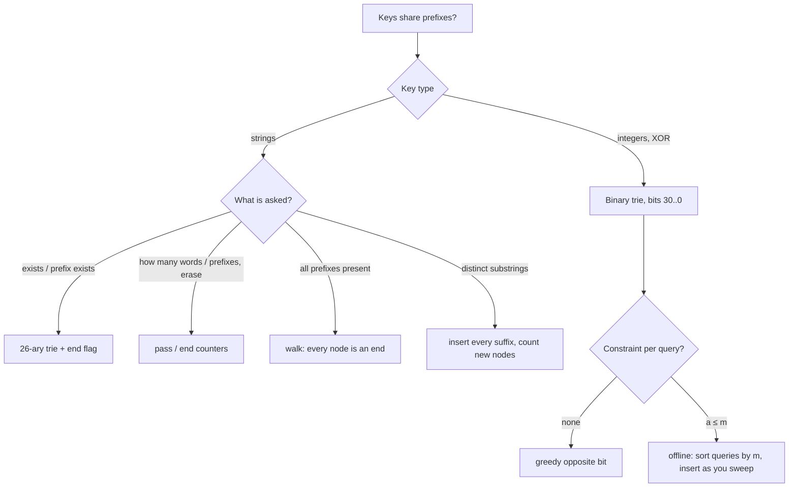

# Part 29: Tries

← [Striver course map](../README.md)

> [!abstract] What this part covers
> **Goal:** Build a trie from scratch (flag and counter variants), use it for whole-prefix checks and substring counting, and switch to a binary trie for max-XOR queries, both online and offline.
> **Prereqs:** [Strings](../17-strings-basic-medium/README.md), [Bit manipulation](../20-bit-manipulation/README.md) **Time:** ~4 h.
> **Outcome:** Write a 26-ary trie with insert/search/startsWith in 3 minutes; add pass/end counters for counting and erase; recognise "every prefix present", "count distinct substrings" and "max XOR" as trie problems; answer constrained XOR queries offline by sorting.

---

## Theory

| # | Lesson | What you get | Source |
|---|---|---|---|
| 1 | [Tries and Binary Tries](01-trie-theory.md) | Trie node design (array vs map children, end flag, pass/end counters), insert / search / startsWith / erase, complexity and memory, bit prerequisites (testing, setting and clearing bit i, XOR identities), the MSB-first binary trie, the greedy max-XOR argument, and offline query sorting. | [link](https://takeuforward.org/learning/dsa/bit-prerequisites-for-trie-problems?category=triessubc&source=strivers-a2z-dsa-sheet) |

Read these first; the problems below apply them.

---

## Problems

| # | Problem | Difficulty | Key insight | Optimal | Source |
|---|---|---|---|---|---|
| | **Theory & implementation** | | | | |
| 2 | [Implement Trie (prefix tree)](02-implement-trie-prefix-tree.md) | Medium | Each node holds up to 26 child pointers and an `end` flag. A word is a **path** from the root. `search` walks the path and checks `end`; `startsWith` only needs the path to exist. Shared prefixes share nodes, so a lookup costs O(L) however many words are stored. | O(L) per op | [link](https://takeuforward.org/learning/dsa/trie-implementation-and-operations?category=triessubc&source=strivers-a2z-dsa-sheet) |
| 3 | [Implement Trie II (count and erase)](03-implement-trie-ii-count-and-erase.md) | Medium | Replace the `end` flag with two counters per node: `pass` = how many inserted words go **through** this node, `end` = how many **finish** here. Then `countWordsStartingWith(p)` is `pass` at the end of `p`, `countWordsEqualTo(w)` is `end` at the end of `w`, and `erase` decrements both along the path. | O(L) per op | [link](https://takeuforward.org/learning/dsa/trie-implementation-and-advanced-operations?category=triessubc&source=strivers-a2z-dsa-sheet) |
| | **Problems** | | | | |
| 4 | [Longest word with all prefixes (complete string)](04-longest-word-with-all-prefixes-complete-string.md) | Medium | Insert every word into a trie. A word is **complete** when every node along its path has `end = true`. Check each word in O(L) by walking it and stopping at the first node that is not a word end. LC 720 is the same problem. | O(Σ L) | [link](https://takeuforward.org/learning/dsa/longest-word-with-all-prefixes?category=problems&source=strivers-a2z-dsa-sheet) |
| 5 | [Number of distinct substrings in a string](05-number-of-distinct-substrings-in-a-string.md) | Hard | Every substring is a prefix of some suffix. Insert all suffixes into a trie: each **new node** created is a distinct substring that was not seen before. So the answer is the number of trie nodes, plus 1 for the empty string (Striver's convention). | O(n²) | [link](https://takeuforward.org/learning/dsa/number-of-distinct-substrings-in-a-string?category=problems&source=strivers-a2z-dsa-sheet) |
| 6 | [Maximum XOR of two numbers in an array](06-maximum-xor-of-two-numbers-in-an-array.md) | Medium | XOR is maximised greedily from the **most significant bit**: a 1 at bit 30 beats anything in the lower bits. Insert every number's 31 bits into a binary trie (MSB first). For each `x`, walk down preferring the child with the **opposite** bit. Taking it sets that bit of the result. | O(31·n) | [link](https://takeuforward.org/learning/dsa/maximum-xor-of-two-numbers-in-an-array?category=problems&source=strivers-a2z-dsa-sheet) |
| 7 | [Maximum XOR with an element from the array](07-maximum-xor-with-an-element-from-the-array.md) | Hard | The `a ≤ m` filter changes per query, so answer the queries **offline**. Sort `nums` ascending and the queries by `m`. Sweep: before each query, insert every `nums` value `≤ m` into the binary trie. The trie then holds exactly the allowed set, and a normal max-XOR query answers it. | O((n + q) log + 31(n + q)) | [link](https://takeuforward.org/learning/dsa/maximum-xor-with-an-element-from-an-array?category=problems&source=strivers-a2z-dsa-sheet) |

---

## Which trie?

---

## Part 29 cheat sheet

| Problem | Trie | Key move | Time |
|---|---|---|---|
| Insert / search / startsWith | 26-ary + `end` | shared `walk()` helper | O(L) |
| Count equal / prefix, erase | `pass`, `end` counters | ++ on insert, −− on erase | O(L) |
| Complete string | 26-ary + `end` | every node on path has `end` | O(Σ L) |
| Distinct substrings | suffix trie | count nodes created (+1 empty) | O(n²) |
| Max XOR pair | binary, 31 levels | take opposite bit if present | O(31 n) |
| Max XOR with `a ≤ m` | binary + offline | sort queries by `m`, sweep inserts | O((n+q) log + 31(n+q)) |

---

## Mastery checklist

- [ ] Write a trie with insert, search and startsWith from memory
- [ ] Add pass/end counters and implement countWordsEqualTo, countWordsStartingWith and erase
- [ ] Solve complete string (longest word with all prefixes) with a trie, and with sort + set
- [ ] Count distinct substrings by inserting every suffix
- [ ] Recite the bit tricks: test, set, clear and toggle bit i
- [ ] Explain why max XOR is greedy from the MSB
- [ ] Solve max XOR of two numbers with a binary trie
- [ ] Solve max XOR with an element ≤ m by sorting the queries offline

**Interview track →** [Trie deep-dive](../../01-data-structures/09-trie.md) · [Bit manipulation](../../02-algorithms/17-bit-manipulation.md) · [Trie walkthroughs](../../04-practice/data-structures/09-trie.md)

Next part → [Strings (Advanced)](../30-strings-advanced/README.md)
