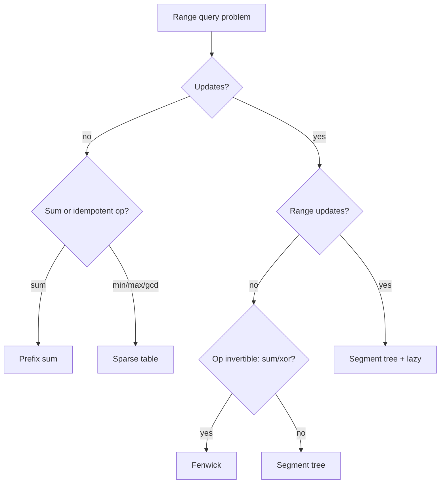

# 1. Range Queries

← [Part 32 index](README.md) · Next → [Advanced DP](02-advanced-dp-theory.md)

> [!abstract] What this covers
> **Core idea:** Pick the cheapest structure that supports your mix of **query** and **update**. Prefix sums handle static sums. A sparse table handles static min/max. A Fenwick tree handles point updates with sums. A segment tree handles anything associative, including range updates (lazy).
> **You'll be able to:** choose between the five structures in 10 seconds; write a Fenwick tree and an iterative/recursive segment tree from memory; add lazy propagation for range-add/range-sum; and count inversions with a BIT.
> **Source:** not in the A2Z sheet. It extends [Part 14 prefix sums](../14-arrays/00-array-techniques-theory.md). These come up in hard Google rounds and in "design a data structure" follow-ups. · **Time:** 60 min

**Sections:** [1. Chooser](#1-chooser) · [2. Prefix and difference](#2-prefix-and-difference) · [3. Sparse table](#3-sparse-table) · [4. Fenwick tree](#4-fenwick-tree) · [5. Segment tree](#5-segment-tree) · [6. Lazy propagation](#6-lazy-propagation) · [7. Offline tricks](#7-offline-tricks)

---

## 1. Chooser

| Updates | Query | Structure | Build | Query | Update |
|---|---|---|---|---|---|
| none | sum | prefix sum | O(n) | O(1) | — |
| none | min/max/gcd (idempotent) | sparse table | O(n log n) | O(1) | — |
| batch range-add, then read | values | difference array | O(n) | O(n) once | O(1) |
| point | sum / xor | Fenwick (BIT) | O(n) | O(log n) | O(log n) |
| range-add | point value | BIT on the difference | O(n) | O(log n) | O(log n) |
| point | any associative op (min, max, gcd, custom merge) | segment tree | O(n) | O(log n) | O(log n) |
| range | range | segment tree + lazy | O(n) | O(log n) | O(log n) |
| none, sliding window | min/max | monotonic deque (Part 23) | — | O(1) amortised | — |



---

## 2. Prefix and difference

- **1D:** `P[i+1] = P[i] + a[i]`, so `sum(l..r) = P[r+1] − P[l]`.
- **2D:** `P[i+1][j+1] = a[i][j] + P[i][j+1] + P[i+1][j] − P[i][j]`. The rectangle `(r1, c1)–(r2, c2)` is `P[r2+1][c2+1] − P[r1][c2+1] − P[r2+1][c1] + P[r1][c1]`.
- **Difference:** for each "add v to [l, r]", do `D[l] += v` and `D[r+1] −= v`. A prefix sum of D gives the final array. The 2D version adds and subtracts at the 4 corners.
- **Applications:**
  - Car pooling, corporate flight bookings and meeting-room counts use the difference array.
  - Matrix block sums use the 2D prefix.
  - Subarray sum equals k uses a prefix sum with a hashmap (Part 14).

---

## 3. Sparse table

`st[k][i]` is the min of `a[i .. i + 2ᵏ − 1]`. Build it with `st[k][i] = min(st[k−1][i], st[k−1][i + 2^(k−1)])`.

The query `[l, r]` uses `k = floor(log2(r − l + 1))` and returns `min(st[k][l], st[k][r − 2ᵏ + 1])`. The two blocks overlap, which is harmless **only for idempotent ops** (min, max, gcd, and/or). For sums, combine O(log n) disjoint blocks instead.

It is also used for O(1) LCA via the Euler tour + RMQ (lesson 3).

---

## 4. Fenwick tree

The tree is 1-indexed. `i & −i` is the lowest set bit, which is the length of the range that node i covers.

```cpp
struct BIT {
    int n; vector<long long> t;
    BIT(int n) : n(n), t(n + 1, 0) {}
    void add(int i, long long v) { for (; i <= n; i += i & -i) t[i] += v; }
    long long sum(int i) { long long s = 0; for (; i > 0; i -= i & -i) s += t[i]; return s; }
    long long sum(int l, int r) { return sum(r) - sum(l - 1); }
};
```

| Use | How |
|---|---|
| Count inversions | Scan right to left; `ans += sum(a[i] − 1)`, then `add(a[i], 1)`. Coordinate-compress first. An alternative to merge sort (Part 14) |
| Count smaller numbers after self | Same idea, storing per-index answers |
| Range add + point query | BIT over the difference: `add(l, v)`, `add(r+1, −v)`, point = `sum(i)` |
| Range add + range sum | Two BITs (B1, B2): `sum(i) = B1(i)·i − B2(i)` |
| k-th smallest in a multiset | Binary lifting over the BIT, O(log n) |
| 2D BIT | Nested loops, O(log² n) |

---

## 5. Segment tree

Each node stores the merge of its range. The tree has size 4n (recursive version) or 2n (iterative version).

```cpp
// recursive: build(1, 0, n-1)
void build(int node, int l, int r) {
    if (l == r) { tr[node] = a[l]; return; }
    int m = (l + r) / 2;
    build(2*node, l, m); build(2*node+1, m+1, r);
    tr[node] = tr[2*node] + tr[2*node+1];          // merge
}
long long query(int node, int l, int r, int ql, int qr) {
    if (qr < l || r < ql) return 0;                  // identity
    if (ql <= l && r <= qr) return tr[node];
    int m = (l + r) / 2;
    return query(2*node, l, m, ql, qr) + query(2*node+1, m+1, r, ql, qr);
}
void update(int node, int l, int r, int idx, long long v) {
    if (l == r) { tr[node] = v; return; }
    int m = (l + r) / 2;
    if (idx <= m) update(2*node, l, m, idx, v); else update(2*node+1, m+1, r, idx, v);
    tr[node] = tr[2*node] + tr[2*node+1];
}
```

To use a different operation, swap **merge** and **identity**. For example, use `min` with `+∞`, or `gcd` with `0`.

A **custom node struct** is needed for the following:
- Max subarray sum in a range: store (sum, best prefix, best suffix, best).
- Count of maximums.
- Longest run of 1s.

---

## 6. Lazy propagation

To support "add v to [l, r]" with range-sum queries, each node keeps `lazy[node]`, a pending add for its whole subtree.

```cpp
void push(int node, int l, int r) {
    if (lazy[node]) {
        int m = (l + r) / 2;
        apply(2*node, l, m, lazy[node]); apply(2*node+1, m+1, r, lazy[node]);
        lazy[node] = 0;
    }
}
void apply(int node, int l, int r, long long v) { tr[node] += v * (r - l + 1); lazy[node] += v; }
// in update/query: fully covered → apply & return; else push, recurse, pull
```

- **Assignment + add together:** you need to compose the lazy tags. The tag is an affine map `x → a·x + b`.
- **Rule:** `push` before descending, and `pull` after returning.

---

## 7. Offline tricks

| Trick | Idea | Example |
|---|---|---|
| Coordinate compression | Sort the unique values and map each to its rank | BIT over values up to 10⁹ |
| Sort queries by endpoint | Sweep r, update the BIT, answer the queries ending at r | Distinct elements in a range |
| Mo's algorithm | Sort queries by (block of l, r) and move the pointers | O((n + q)√n) for non-mergeable queries |
| Reverse time | Turn deletions into insertions, then use DSU | Offline connectivity |
| Sqrt decomposition | Blocks of size √n with per-block aggregates | Simpler than a segment tree, O(√n) per query |

---

## Common mistakes

| Mistake | Fix |
|---|---|
| 0-indexed BIT | Shift to 1-indexed (`i + 1`) |
| Segment tree array of size 2n with the recursive build | Use 4n |
| Sparse table for range sum with overlap | Overlap double-counts; use prefix sums |
| Forgetting `push` in a query | Stale children give wrong answers |
| BIT over raw values up to 10⁹ | Coordinate-compress |
| Wrong identity (0 used for min) | The identity must not change the result |

---

## Practice

<details><summary>1. Range sum queries with 10⁵ point updates: which structure?</summary>

A Fenwick tree: O(log n) for each operation, and the shortest code.
</details>

<details><summary>2. Static range-min queries, 10⁶ of them?</summary>

A sparse table: O(n log n) build, then O(1) per query.
</details>

<details><summary>3. Count inversions of [3, 1, 2] with a BIT.</summary>

Scan right to left. At 2, sum(1) = 0, then add 2. At 1, sum(0) = 0, then add 1. At 3, sum(2) = 2. The total is 2.
</details>

<details><summary>4. 10⁵ "add v to [l, r]" updates, then read the final array once?</summary>

A difference array: O(1) per update, then O(n) at the end.
</details>

<details><summary>5. Range max with range assignment?</summary>

A segment tree with an "assign" lazy tag, where the tag overwrites the children's pending tags.
</details>

---

## Key terms

| Term | Meaning |
|---|---|
| Idempotent op | `f(x, x) = x` (min, max, gcd), so overlap is safe |
| Lowbit | `i & −i`, the range length of a BIT node |
| Lazy tag | Pending update for a subtree, pushed down when needed |
| Offline | All queries are known up front, so they can be reordered |

---

## Flashcards

**Fenwick update / query loops?** #flashcard
Update: `i += i & -i`. Query: `i -= i & -i`. Both are 1-indexed.

**Why does the sparse table's O(1) query need idempotence?** #flashcard
The two 2ᵏ blocks overlap, so the overlap is counted twice.

**Segment tree size?** #flashcard
4n for the recursive version, 2n for the iterative bottom-up version.

**Range add + range sum with BITs?** #flashcard
Two BITs: prefix(i) = B1(i)·i − B2(i).

**2D prefix rectangle sum?** #flashcard
P[r2+1][c2+1] − P[r1][c2+1] − P[r2+1][c1] + P[r1][c1].

---

**Interview track →** [Array deep-dive](../../01-data-structures/01-array.md) · [Senior follow-ups](../../03-patterns/SENIOR_FOLLOWUPS.md)
